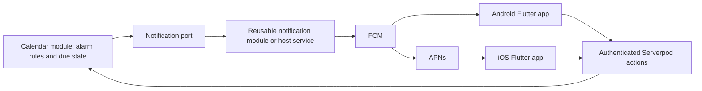

# ADR 0009: Alarms, notification delivery and Flutter boundaries

Status: **Proposed**. Date: 2026-10-19. The maintainer requires first-release alarm functionality and a Flutter push path through Serverpod to iOS/Android, and asks for a module-boundary recommendation. Alarm execution is no longer deferred. Package layout, channels and detailed constraints remain recommendations for review. The RFC tables confirm the personal UID/acknowledgement/snooze/DISPLAY and imported-alarm activation baselines; the RFC tables govern current feature scope.

## Recommended ownership

| Owner | Responsibility | Reason |
| --- | --- | --- |
| Calendar core | Alarm trigger semantics for events/tasks, occurrence identity, relative/absolute time calculation and supported VALARM validation | Calendar semantics stay reusable and testable |
| Calendar Serverpod module | Authorized personal alarm CRUD, recipient references, pending occurrences, acknowledgement/snooze, rescheduling/invalidation and durable reminder outbox | Calendar edits and alarm intent must stay consistent |
| Reusable notification server module or host service | Device registration, user/device/app routing, channel preferences, provider adapters, generic delivery queue, retries, invalid-token cleanup and delivery attempts | Push is useful to chat, bookings and other features, not just calendars |
| Small calendar-to-notification adapter | Map a due calendar intent to a generic notification request; pass lifecycle/deduplication context | Calendar module depends on a port, not FCM/APNs packages |
| Flutter notification integration | Request OS permission, register/refresh device tokens, handle foreground/background presentation, tap/deep-link and actions | Requires host app/platform capabilities |
| Flutter calendar GUI | Edit reminders, show status, invoke authenticated acknowledge/snooze and refresh calendar/task state | GUI consumes generated APIs; never trusts push as write authority |
| Host application | External identities/membership, verified recipients, app credentials/entitlements, localization/privacy policy and composition of adapters | No calendar-owned identity/device directory or provider secrets |

These are dependency boundaries, not a requirement to create seven repositories or deploy separate services. A notification package can initially live in the same workspace/process. Reuse a suitable host notification service instead of duplicating it. The release must still include a functioning reference integration for both iOS and Android; an abstract port alone is insufficient.

## Selected alarm scope and proposed implementation details

- Personal time-based reminders on events and tasks; multiple reminders per item/recipient. Store opaque host recipient references, not user profiles or device tokens. Calendar access is not automatic consent to alerts for every group member.
- Relative triggers before/after a supported start/end/due anchor and absolute UTC triggers. Validate each event/VTODO anchor under the selected RFC profile. Undated tasks can have an absolute reminder; relative reminders require a valid anchor.
- Stable alarm IDs and occurrence keys. Event recurrence, exclusions, moved/cancelled instances and named zones determine due times. Task recurrence is included under ADR 0017; task occurrence/completion and alarm interactions still need detailed design.
- Proposed recipient-level acknowledgement, dismissal and snooze shared across that recipient's devices, independent of other recipients. Store native delivery/user-action state separately from shared event data. Implement the selected RFC 9074 UID/ACKNOWLEDGED/RELATED-TO/SNOOZE baseline in the RFC tables, defining exact private projection constraints without claiming every extension.
- Trigger recalculation on edits, deletion/cancellation, task completion, recipient/access changes, snooze and relevant zone-data changes. Check authorization/current generation immediately before dispatch. Task completion/cancellation suppresses the affected reminders according to the task lifecycle; per-occurrence completion must not implicitly cancel an entire recurring series; changing an already accepted provider message cannot reliably recall it.
- Define date-only anchor zone/time, relative-duration/DST behavior, horizon, overdue/expiry policy and allowed snooze values before implementation. Never use the server machine's implicit local zone. Materialize a bounded horizon and refill it; do not schedule an infinite recurring series.
- Native visible reminder intent maps to a proposed ACTION:DISPLAY interchange baseline. Push is a delivery channel, not a new VALARM ACTION. Exact transport payload/presentation rules are separate from RFC alarm syntax.

The RFC tables select the scoped personal alarm/trigger baseline from the original recommendation. Detailed multi-reminder, dismissal and delivery policies remain implementation design rather than additional confirmed quotations. Geofencing/proximity, arbitrary scripts/audio downloads, critical/full-screen alerts, escalating chains and automatic EMAIL alarms remain deferred unless explicitly selected. iMIP scheduling mail remains required and is distinct from email reminder delivery.

The subsequent RFC 5545 review confirmed capped automatic REPEAT alarms with configurable count/interval limits and paired alarm DURATION. Include these in first-release alarm planning/dispatch; detailed acknowledgement/snooze/expiry interactions still need approval. See [ADR 0010](0010-rfc5545-property-decisions.md). The SNOOZE feature was subsequently selected in the RFC tables; exact wire/lifecycle constraints remain pending. Advanced alarm actions remain deferred.

## Durable scheduling and dispatch

Persist item/alarm mutations and invalidation/outbound intent atomically. A scheduled Serverpod job is a wake-up mechanism, not the only record of due work. Maintain due occurrence rows/generations and a recovery scan. Use transactional claiming/leases and idempotency keys such as alarm + original occurrence + generation + recipient + channel; record cancellations, expiry and superseded work explicitly.

A worker checks current item, recipient/access, alarm generation and due/expiry bounds before submitting to the notification port. The notification subsystem owns device/provider fan-out and retries, reusing a stable request ID across calendar submission retries. It must reject cancelled/superseded intent when possible and report accepted, suppressed, failed or expired outcomes. Define the revalidation/cancellation callback contract across the port so a generic retry cannot revive a stale alarm. Provider dispatch racing a cancellation has a documented boundary; do not promise recall after acceptance.

Calendar tracks reminder lifecycle and generic notification request ID; notification service tracks device/provider attempts. Neither provider acceptance nor a completed future call proves display or human acknowledgement. Use explicit application actions for acknowledge/snooze, authorized against the current recipient/occurrence with idempotent revision checks. A feed URL or push token is never enough to mutate calendar state.

## Competing instances and automated evidence

Under [ADR 0018](0018-automated-example-and-multiple-instances.md), multiple Serverpod processes may plan/claim/dispatch work concurrently. Work identity, outbox state and lease/ownership generations are shared and durable; enforce uniqueness and reject stale claims after takeover. Revalidate current generation/access/expiry across calendar and notification retries. Select the pinned scheduler/coordination contract during scaffolding rather than assuming a callback runs exactly once.

Automate worker races, duplicate wake-ups, process death after claim/commit/submission, lease recovery, task occurrence completion and cancellation/access-loss races using the real example hosts and recording notification adapter. Verify one logical intent/idempotent handoff and documented recovery. External-provider acceptance/crash ambiguity can still cause redelivery; no end-to-end exactly-once or recall guarantee is introduced. Automated Flutter app journeys exercise authenticated actions; doubles do not replace required live iOS/Android integration evidence.

## Push and client behavior

Recommended reference path: Serverpod due worker -> notification port -> host notification service -> FCM -> Android, with FCM/APNs integration for iOS. Direct APNs or another provider remains swappable. Provider configuration and device registries are outside calendar persistence. Serverpod live streams are an optional connected-app refresh path, not a replacement for native mobile push when an app is backgrounded/terminated.

Use a minimal payload with opaque reminder/occurrence/request identifiers, a safe generic preview and an authorized route hint. Flutter fetches current content through authenticated APIs. Any richer lock-screen preview is an explicit host privacy choice. Handle token refresh, logout/revocation, multiple devices, denied permissions and invalid tokens in the notification integration. Recheck recipient identity when processing actions; do not trust a client-supplied user ID or stale payload.

Proposed initial channel policy is server-scheduled push plus an in-app reminder/status view. A local scheduled notification adapter is a useful optional next integration for offline/time-sensitive display, but it needs an explicit delivery-owner/deduplication strategy with push, bounded scheduling, resync and cancellation handling. Do not enable both paths independently and produce duplicate alerts. Platform permissions, battery/background restrictions and provider/network conditions mean push timing/display is best effort, not a guaranteed alarm clock.

## Import/export and privacy

Promote the scoped VALARM/time-based profile into first-release work. RFC 9074's personal state and snooze features need an explicit private native/interchange mapping; PROXIMITY remains deferred. Unsupported properties still fail explicitly under the profile. Importing an untrusted ICS/iTIP payload must not arm notifications, select recipients or send mail automatically: require an authorized activation step/policy. Until its alarm handling is specified, reject an alarm-bearing input atomically rather than silently stripping it.

Private reminders/acknowledgements and delivery/device state are not included in public/secret subscription feeds by default. General interchange may include only the alarm information approved for that operation/recipient. Native full capability stays independent of feed-client VALARM behavior. Group alarm recipient expansion must use an explicit host policy, never every linked manager/member by assumption.

## First-release evidence and open decisions

Approve the proposed baseline, notification port/lifecycle contract, date-only and missed-alarm policy, channel/quiet-hours handling and selected provider integration. Document task completion and access-removal cancellation. Test process restart, duplicate workers, crash/retry, stale generation, recurrence/DST, moved/cancelled events, task completion, authorization removal, snooze/ack from several devices and untrusted imports.

The reference Flutter app must demonstrate an authorized event/task reminder on supported iOS and Android configurations, foreground/background handling, denied permission, token refresh/logout, taps/actions and recorded provider failures. Record provider/app/OS versions, acceptance/display/action outcomes and known restrictions separately; do not infer display from server logs.

Evidence sources reviewed 2026-10-19: [Serverpod 4 future calls](https://docs.serverpod.dev/concepts/scheduling/future-calls), [FCM Flutter setup](https://firebase.google.com/docs/cloud-messaging/flutter/get-started), [FCM receive/permission behavior](https://firebase.google.com/docs/cloud-messaging/flutter/receive-messages), [Apple local notification scheduling](https://developer.apple.com/documentation/usernotifications/scheduling-a-notification-locally-from-your-app), [Android notification permissions](https://developer.android.com/develop/ui/compose/notifications/notification-permission), [RFC 9074](https://www.rfc-editor.org/rfc/rfc9074.html). APIs must be verified again against the SDKs pinned during scaffolding. See FR-28–FR-31, NFR-12/NFR-13 and roadmap alarm/push work.
