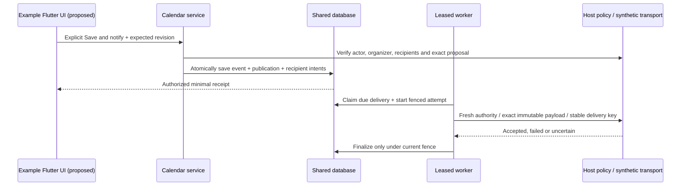

# ADR 0122: Explicit native organizer publication

Status: **Accepted by explicit maintainer approval on 2026-10-26: bounded non-recurring REQUEST workflow, four server-only tables, event origin, private publication retention and worker defaults. Scoped implementation and validation are documented in [the implementation guide](../native-organizer-scheduling.md).**

## Confirmed choices

Sending invitations/updates is an explicit action that saves the meeting and queues outbound intent in one transaction. Ordinary edits remain local until explicitly published. The first organizer workflow covers native-created events whose organizer address the host verifies. Imported meetings require a separate future adoption flow. The maintainer subsequently approved the physical models and bounded workflow below. This does not complete RFC 5546/6047 support.

## Accepted first batch

Implement transport-independent REQUEST invitations and updates for one existing, non-recurring native event, preserving DATE/UTC/named-zone timing under the current whole-second horizon. The first publication establishes one host-verified organizer and 1–64 approved recipient addresses; subsequent publications keep those addresses fixed. Native creation and publication remain separate commands. No network call occurs in the save transaction.

Recurring publication, recipient additions/removals, organizer replacement, cancellation messages, inbound replies, delegation/SENT-BY actions, counters, other methods and imported-meeting adoption follow in separate required batches. Reject those actions explicitly in this increment. This does not remove any selected first-release method. Native local cancellation sends no mail and blocks pending REQUEST dispatch; the later explicit cancellation workflow must notify previously invited recipients. While an organizer binding exists, reject event deletion, conversion to recurrence and source replacement/adoption rather than silently discarding scheduling state. This is an intentionally incomplete lifecycle increment, not a release-ready scheduling UI.

Follow the [RFC 5546 REQUEST constraints](https://www.rfc-editor.org/rfc/rfc5546.html#section-3.2.2) through the existing pure adapter. Use the native event's stable protocol UID, never its feed publication UID, publication-row UUID or transport Message-ID. Preserve event end/duration meaning. Emit empty SUMMARY for a native omitted/empty summary, never the example's display placeholder. Native protocol versions already advance on actual changes; a changed publication must have SEQUENCE greater than the last publication, with overflow rejecting atomically. Use nondecreasing whole-second database-clock component timestamps. Transport attempts never increment the component version.

Approved organizer/attendee values become canonical event protocol metadata, protected by source disclosure permissions and preserved by ordinary edits. The initial profile emits supported basic participant values only, with NEEDS-ACTION/RSVP requested and no inferred acceptance, assignment, access or resource reservation. Organizer/recipient changes outside the fixed-address profile reject; source metadata is not an identity directory. Do not silently discard richer data or alarms to fit REQUEST: unsupported existing component data rejects before saving or queueing.

## Command and authorization

An illustrative `saveAndNotify` request contains actual event UUID, expected event revision, proposed ordinary event content, untrusted recipient proposals for the first publication, and a caller-generated UUID command key. The host resolves organizer identity/address and approved transport routes from trusted actor/scope context. Clients cannot supply a trusted sender, authority reference, processing status or permission decision. Host-resolved calendar addresses and routes are separate values; address equality alone is not authorization. Reject recipient aliases resolving to duplicate routes in this bounded profile; route changes cannot silently redirect a queued delivery to a different calendar address.

Acquire the existing scope transaction lock, load the actual calendar/event/origin and current binding, validate the complete final state, and check independent publish-scheduling, ordinary edit, full ordinary-detail and source-disclosure permissions, plus dedicated host organizer/recipient approval. The policy sees actual parent/event, current state, validated proposal, exact outgoing snapshot, method, recipients and existing publication/version. An event-edit allow cannot authorize mail. The host must approve disclosure of the exact payload, including the shared attendee roster, to every recipient; this first profile does not silently redact or send a partial recipient set. Unavailable identity/policy/route resolution fails closed. Apply existing coordinated or declared external-fresh-check guarantees without silently downgrading; document the external after-check revocation race.

Commit canonical event changes, revision/scope generation, organizer binding, immutable publication and all recipient delivery intents atomically. Any failure rolls everything back. Return a minimal publication/event-revision receipt after final authorization, never raw routing references or message bytes. An identical normalized current state and last-published projection is a true no-op, including protocol version/revision and delivery intents; retrying failed delivery is a separate action, not an implicit resend on Save and notify.

Bind the command key to trusted actor/scope, actual event, original expected revision and normalized request digest. A retained exact retry rechecks current authority and returns its recorded receipt without another mutation or delivery. Reusing a retained key with different input fails generically. Do not authorize retries using knowledge of a command key. After receipt retention expires, an old request's expected revision must fail; no indefinite deduplication promise is made. Concurrent commands cannot both publish from the same expected revision.

## Approved schema

Four new server-only tables belong to the calendar Serverpod module. Pure temporal/iCalendar code and optional feeds remain independent. IDs are server-generated UUIDs without a required version. The generated model sources implement these record boundaries.

| Record | Fields and constraints |
| --- | --- |
| Organizer meeting | UUID, trusted scope, actual calendar/event references, unique event binding, fixed organizer calendar address, opaque host execution-authority reference, positive revision/publication generation, latest publication reference, database audit times. It owns no user/role/provider credential. Validate actual containment under the scope lock. |
| Scheduling publication | UUID, trusted scope, meeting reference, generation, method REQUEST, source UID/SEQUENCE/DTSTAMP, immutable normalized component snapshot and final ICS bytes/digest, bounded approved participant snapshot, command UUID, actor/request digest and original expected/resulting event revisions, queue/expiry times, completion time and aggregate outcome. Unique `(meeting, generation)` and `(scope, command key)`. Snapshot/bytes are private calendar content, not diagnostics. |
| Recipient delivery | UUID, publication reference, exact approved recipient calendar address plus opaque host route reference, stable delivery/idempotency UUID, pending/claimed/accepted/failed/expired/superseded/blocked state, attempt count, next-attempt time, lease owner/token, fencing generation, lease expiry, terminal time and bounded safe result code. Unique `(publication, recipient address)` and delivery UUID. Provider acceptance is not receipt or display. |
| Delivery attempt | UUID, delivery reference, monotonically increasing attempt number and unique `(delivery, attempt)`, claim/fence token, start/finish times, accepted/failed/uncertain outcome, bounded opaque adapter receipt and allowlisted failure code. No body, exception dump, credentials or transport headers. An unfinished abandoned attempt becomes uncertain. |

Add a server-controlled origin enum to active event data: `native`, `imported`, `unknown`. Native create and create-only import set it explicitly; source replacements preserve origin. Existing rows default to unknown unless provenance is independently established. Neither a null import baseline nor a UUID-shaped UID proves native origin. Unknown/imported rows cannot enter this first workflow; development data may be freshly created/reimported. Generate migrations normally; do not reset development storage automatically or invent historical provenance.

The publication is the durable outbox payload; recipient rows carry independent delivery/retry state. A separate outbox-body table or persisted MIME body is unnecessary in this increment. Canonical source metadata and the private last-published snapshot serve different purposes: local edits may diverge from the published state. A pending delivery always uses its immutable publication bytes, never freshly regenerated local edits. Authorize that exact snapshot against current host policy before every dispatch; denial blocks it. Never silently replace a queued body or its recipient.

## Approved bounds and retention

Defaults: 64 recipients, 512 KiB serialized ICS per publication, 16 nonterminal publications and 256 retained publication records per meeting, and 10,000 nonterminal recipient deliveries per scope. Configuration must enforce finite bounds. Check limits transactionally and reject the whole command at capacity; do not silently evict pending work or send a partial recipient set.

Retain completed superseded publication payloads, recipient records, attempts and command receipts for a configurable 30-day default, then remove them together. Keep the latest published snapshot/receipt while its organizer binding remains active so local/published comparison stays exact. Retention may therefore retain an older title/body after a local edit; ordinary event views, exports and feeds never disclose historical snapshots. Bound cleanup work and preserve referenced rows. The first batch has no organizer-binding deletion/restore API; later cancellation/deletion must specify scrubbing and minimal correlation-marker retention before enabling it. No indefinite stale-inbound protection is claimed by this outbound-only schema.

## Worker and host transport port

Use shared database-clock leases and fencing across independent processes: a 120-second lease, a bounded 30-second transport timeout, at most eight attempts, exponential retry delays starting at 30 seconds and capped at one hour, and seven-day intent expiry. Keep the delivery key stable across crash recovery and retain each attempt identity; a new attempt receives its own identity. Never mutate immutable payload/version. Check current publication generation, parent existence/status, organizer/recipient authority, route/address binding and expiry before each dispatch/retry. A newer publication supersedes older work not yet submitted. A claim holder may lose authority or generation after the final check; an already submitted message cannot be recalled. Record this boundary without promising exactly-once transport or race-free external revocation.

Claims and attempt-start records commit before network submission. Perform no network I/O under the scope lock. Finalize only with the current lease/fence; a stale worker cannot overwrite takeover results. Crash after transport acceptance but before recording success is uncertain and may deliver twice on retry. The host adapter receives the stable delivery key and should support idempotency, but the module cannot guarantee provider deduplication. A denied/unavailable current authority check sends nothing and records a safe blocked state; it is not a successful delivery. An invalidated native timing/status or unsupported state is visible as blocked/needs attention, not silently repaired.

The initial example uses a deterministic synthetic transport recording submissions in ignored test storage, never real email. The port accepts validated iTIP bytes, trusted execution/route context and stable delivery key, and returns acceptance/failure/uncertainty with bounded safe diagnostics. MIME generation and real inbound/outbound mail adapters remain a separate reviewed RFC 6047 batch. No SMTP provider SDK, credentials, FCM/APNs or device token belongs in these tables.

## Alternatives and acceptance

Automatic mail on every edit conflicts with the confirmed explicit-publication choice. Regenerating retry payloads from live events would leak unpublished changes and alter retry meaning. A single event-row queue cannot represent independent recipient outcomes or durable attempts. Inferring origin from imported metadata could authorize a forged organizer. These alternatives are rejected; the four-table design trades private snapshot retention for reproducible retries and explicit local/published state.

The maintainer approved this bounded workflow, four tables, event-origin field, private snapshot retention and defaults before model-source changes. Generate migrations with the pinned toolchain. Verify fresh/upgrade databases, including unknown legacy origin. Use focused service tests during development and full agreed batch checks before one check-in.

Acceptance must cover independent permissions, forged sender/route proposals, imported/unknown rejection, source disclosure, stale revisions, command reuse/retries, true no-ops, serialization failure/atomic recipient-cap rollback, canonical UID/participant/version preservation and unsent local edits. Exercise two independent hosts racing commands/claims, scope capacity, revocation before dispatch, generation supersession, crash before submission and after synthetic acceptance, actual claimant loss and stale fencing. Test bounded retention without losing the active publication checkpoint. Add generated-client and Flutter explicit-publish/local-dirty/status journeys. These tests do not establish inbound reconciliation, resource acceptance, full RFC conformance or real mail/client interoperability.
