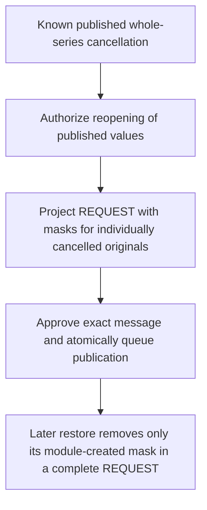

# ADR 0130: Reopening the published series while retaining individual cancellations

Status: **Accepted by explicit maintainer approval on 2026-10-27, including the complete API/projection/v6/authority batch. Scoped implementation is described in the runtime guide; actual validation remains separate from approval and client compatibility.**

## Confirmed policy and source evidence

Reopening the published whole series must not restore its individually cancelled originals. Do not remove the current guard until a concrete workflow preserves that state. This confirmation does not approve an encoding, transport ordering scheme or storage/API change.

[RFC 5546 REQUEST](https://www.rfc-editor.org/rfc/rfc5546.html#section-3.2.2) permits recurring updates with EXDATE and restricts REQUEST status to active states. [RFC 5545 EXDATE](https://www.rfc-editor.org/rfc/rfc5545.html#section-3.8.5.1) removes original starts from the recurrence set, taking precedence over rule/inclusion dates while retaining DTSTART identity. Primary references were checked on 2026-10-27. Using exclusions as an explicit scheduling-publication projection, preserving private cancellation identity and choosing a reopening API are application policies, not additional RFC requirements or interoperability evidence.

## Approved bounded published-value reopening

Add `reopenPublishedAndNotify` with immutable event/revision/command UUIDs and no client-proposed text/timing/organizer/roster. The first profile requires an already published whole-series CANCEL, a native-created recurring organizer binding, known individual cancellation state and an explicit retained active REQUEST basis under ADRs 0128/0129. Older/unknown history must not be guessed. Existing ordinary reopening without individual cancellations stays unchanged.

Reopen the last published series values, preserving newer native text, timing, patterns, ranges and occurrence flags. Change only the native master lifecycle status to the retained published active status (CONFIRMED or TENTATIVE), never an invented default. This is distinct from Save and notify, which publishes explicitly proposed current content. A mismatched current native timing profile remains a private draft; never retarget an original or create a native override to force agreement.

Emit one complete METHOD:REQUEST. In an ephemeral outgoing copy, add EXDATE for every currently published individually cancelled original and omit its occurrence component from that REQUEST. Merge with ordinary source exclusions without changing their meaning. Use the exact original DATE/UTC/named-zone identity, not moved start instants. Retain RRULE/RDATE/PERIOD meaning, source annotations and all supported non-cancelled components. An excluded DTSTART remains stored. Range anchors remain unavailable for individual cancellation. Reject unrepresentable or over-limit projections; never drop data to fit. No STATUS:CANCELLED component is placed in REQUEST.

These extra EXDATE values are publication-only cancellation masks, not native recurrence exclusions or a loss of canonical cancellation state. Ordinary import/export and feeds retain their existing contracts. An untrusted external EXDATE never establishes module-created cancellation history, permission or restoration authority. No URL, alarm or source participant activates anything.

The approved flow keeps the published projection separate from private native drafts:

## Approved restoration after projected reopening

A standalone instance REQUEST cannot remove a master EXDATE. Therefore, while this publication mode is active, `restoreOccurrenceAndNotify` must atomically queue one complete published-series REQUEST that removes only the target's module-created mask, retains every other cancellation mask and includes the restored target's faithful published active values with a newer independent version. It clears only a matching current native single flag under ADR 0129; all other native drafts remain intact. Ordinary source EXDATE values are never removed or reclassified as module masks.

The unprojected retained basis and last-active component data remain the source of restoration values. This first batch does not publish newer native content while individual cancellations remain. New native additions, profile changes or private exclusions are not silently copied into the published basis. Once every individual cancellation is restored, complete Save and notify can return to the existing path only after retained current membership/kind/profile validation; a private orphaning edit still rejects.

New explicit single cancellations can keep their minimal detached CANCEL profile. Preserve the last complete REQUEST's mask set separately from the latest cancellation state, since a later partial CANCEL need not have appeared as EXDATE yet. A subsequent complete restoration/reopening projects all remaining cancelled originals, so it cannot omit a later cancellation. Native flags and publication-only masks are never conflated.

## Approved authority, delivery and status

Require independent `reopenScheduling`, scheduling-read, full event/source and lifecycle authority even when the native status already matches. Ordinary text editing and REQUEST publication are not substitutes for published-value reopening; hosts may map permissions together explicitly. The action accepts no proposed content. Existing restore/cancel permissions continue to govern their respective actions.

Preliminary access precedes historical decoding/projection. Both final host phases and dispatch receive complete current/final native snapshots, the unprojected published basis, immutable generated mask identities, exact outgoing message/bytes/digest and the explicit action kind. Source addresses grant no authority. Keep current sender/route/origin/parent checks and declared coordinated/fresh guarantees.

Require prior binding deliveries to be terminal before a new projected reopen or restoration, retaining the existing serialized first profile and global generation fence. Exact retained retries and true no-ops reauthorize without queueing or replaying a newer native state. Whole-series Cancel remains an intentional complete-UID supersession action. A new reopen requires the published master to be cancelled; retained retries/no-ops may refer to the already reopened state. Reopening then creates one new publication and recipient delivery set atomically, not a master-plus-CANCEL chain. Provider acceptance is not receipt/display and no atomic remote-client visibility is promised.

Add explicit generated publication kinds for published-series reopen and occurrence restoration that also updates the master, plus authorized status indicating publication-only exclusion mode. The row sequence/stamp describe the actual master for these complete REQUESTs; existing partial rows continue to describe their target. The UI clearly distinguishes reopening published values from publishing current drafts and retains exact uncertain commands.

## Approved v6 private checkpoint and version rules

Reuse the existing four tables/columns and retention. No table, index, column, migration, dependency or development reset is proposed. A bounded v6 envelope keeps the unprojected active REQUEST basis, native publication-time checkpoint, cancellation/restoration and last-active component versions, the last complete REQUEST's module mask identities and its actual master/component versions, separately from the latest outgoing message. Never recursively embed v6 envelopes. Read legacy through v5 without inventing projection provenance; only reviewed known history can enter this mode.

Rebuild and validate the exact projected body, exclusion origins, omitted cancelled components, source membership, UID/parent/kind/profile, independent versions and digest before use. Preserve the original mask set on later partial CANCEL records, while separately retaining newly cancelled identities. A later complete message recomputes masks from actual durable cancellation state. Cleanup must leave the latest checkpoint self-contained. Snapshot/comparison/payload remain limited to 512 KiB each; all active/reset/cancelled/restored originals share 64 slots without eviction, and generated exclusions consume existing work/date budgets.

The reopening master advances above whole-series cancellation and relevant current/native floors; emitted occurrence components obey the existing reopening floor. Omitted cancelled components retain their last-active values and cancellation history, without inventing a new component version. A projected restoration advances the actual master because its exclusions change, and the restored target above its cancellation/active/master/native floors. Unrelated unchanged active components retain their own versions. New partial cancellations also consider the actual current published master version, not the older unprojected basis. Whole-series Cancel advances above all retained states. Use nondecreasing whole-second stamps; overflow rejects atomically.

Once masks and cancellations are empty, build a validated non-recursive bridge to the existing full REQUEST ledger for subsequent explicit native publication, retaining every restored original and independent version. Never use a private current native snapshot as evidence of what was published. Native/source presence differences and unsent local occurrence restores remain distinguishable in status.

## Alternatives and consequences

Restoring every original contradicts the confirmed policy. Reopening with an unqualified master REQUEST can lose cancellations. A master REQUEST followed by multiple CANCELs would require grouped generations, dependency-aware deliveries, aggregate admission/retention and a separate uncertainty contract; merely advancing today's latest-publication pointer is unsafe. The approved single-message exclusion projection keeps cancellations in the reopened recurrence set without that multi-message workflow, but requires explicit projection provenance and master-updating restoration. It does not claim ordinary canonical export equivalence or tested external-client behavior.

The bounded published-value API deliberately leaves native draft publication and broader overlapping workflows restricted. General full updates while cancellations remain, future cancellation, recipient changes, imported adoption, inbound reconciliation, MIME transport and binding cleanup remain separate required work. No real mail is authorized.

## Approved acceptance

Test confirmed/tentative published status, private native field/profile/pattern/flag preservation, DTSTART cancellation, exact named aliases/DST, RDATE/PERIOD and earlier-range identities, multiple masks, ordinary versus generated EXDATE and no cancelled REQUEST components. Cover independent authority/full-message context, stale/no-op/retry behavior, pending gates, lower-version messages, overflow/caps/work budgets, malformed provenance, v4/v5/v6 reads and pruning.

Exercise reopen, later minimal cancellation, master-updating restoration of one while others stay masked, last restoration and guarded normal complete publication. Verify generation/retention/delivery identity through competing workers, actual process loss before/after synthetic acceptance, cross-host races and Flutter journeys. Keep native/protocol/synthetic-consumer results separate from real scheduling-client and mail evidence. Use focused checks during development and the full batch checks at completion.
