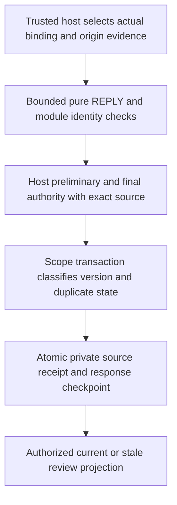

# ADR 0131: First authenticated attendee replies

Status: **The maintainer confirmed on 2026-10-27 that older-version replies are retained as stale for review and never automatically applied. The concrete first REPLY scope, trusted ingress, three tables, authority, version/retention and example mechanics below are proposed, not approved or implemented.**

## Context and confirmed policy

The next recommended area is organizer-side attendee responses to the existing durable native invitations. Start with one non-recurring native-created meeting and its fixed published roster. Recurring/instance replies, attendee-side invitations, other inbound methods, adoption, delegation and email transport remain separate required work. Ordinary file import and feeds never become scheduling ingress.

The maintainer selected retaining a supported, verified reply to an older published SEQUENCE as stale for review, without automatically changing the current response. No manual adoption/overwrite is implied by retaining it. Newer native drafts remain untouched.

[RFC 5546 sequencing](https://www.rfc-editor.org/rfc/rfc5546.html#section-2.1.5) identifies the invitation revision in REPLY SEQUENCE and uses DTSTAMP to order responses to that revision. [The REPLY method](https://www.rfc-editor.org/rfc/rfc5546.html#section-3.2.3) distinguishes attendee response data from changes that require COUNTER. The RFC allows an organizer to decide whether to accept an older response; this initial application policy never does so automatically. These primary references were checked on 2026-10-27. The [restricted mail/trust boundary](0015-restricted-imip-profile.md) remains separate; pure parser success or SMTP headers establish no authority.

## Proposed trusted ingress and source profile

Expose server-only receipt processing through a replaceable trusted host adapter, not a generated endpoint accepting a client-supplied verified-sender flag. The host selects the actual local event/binding in one trusted scope and supplies a namespaced opaque delivery key plus origin evidence. The module loads the actual parent and requires the source UID/ORGANIZER and replying ATTENDEE to match that binding's published identities and fixed roster. Never route by an untrusted body UID alone, guess address aliases/case, create an attendee, or infer trust from From, feed credentials, DNS, participant parameters or a session's display address. The host must explicitly verify that this origin may act for the exact stored attendee address.

The first profile accepts exactly one non-recurring VEVENT REPLY from the existing pure bounded decoder. No RECURRENCE-ID/RANGE or recurrence lists/rules. Keep source omissions and independent timestamps; omitted SEQUENCE compares as zero without inserting it into source. Preserve decoded source groups, annotations, comments and bounded result data. No fetching, contact/resource lookup, native assignment, alarm action, delegation or automatic reply follows. Reject unsupported delegated/SENT-BY flows until separately profiled.

The only applied value is the replying attendee's own participation state. Preserve optional source PARTSTAT separately; its [RFC 5545 NEEDS-ACTION default](https://www.rfc-editor.org/rfc/rfc5545.html#section-3.2.12) may be presented explicitly without manufacturing a source parameter or applying native event defaults. Support non-delegated NEEDS-ACTION/ACCEPTED/DECLINED/TENTATIVE. For application to the matching active version, any supplied ordinary event timing/text/metadata must match the corresponding published values in the selected exact DATE/UTC/named-zone/annotation profile; omission stays omission. COMMENT and REQUEST-STATUS describe this response, not event edits. Retaining stale/unmatched source does not invent validation against unavailable historical optional values; its association and bounded profile are verified, not a claim that its old timing was correct. Retain a supported verified current-version mismatch as a reviewable conflict; never silently treat it as a counterproposal or update event fields. Non-success REQUEST-STATUS data stays reviewable and does not establish participation, initiate retries or generate mail.

Malformed/over-budget input, an unknown/foreign UID, unknown attendee, unsupported method/profile or unverified origin is rejected without domain mutation or automatic response. The host owns any raw-mail archive/quarantine outside the module. Only bounded supported source associated with a verified actual binding is admitted to these private tables; no arbitrary foreign payload archive is introduced.

## Proposed version and atomicity rules

Compare against the last committed published REQUEST, not a newer unpublished native revision or the success of a provider delivery. Replies need not prove provider acceptance and never mark an outbound attempt accepted. A cancelled published meeting accepts no current participation update. Retain lower versions as stale, higher unmatched versions as reviewable unmatched source, and supported replies while cancelled as unapplied source. Never reopen a meeting or apply these records later automatically.

For the matching active published SEQUENCE and attendee, compare source DTSTAMP with that attendee's last applied response to the same version. A later stamp replaces the response; an earlier stamp is stale. Equal stamp plus the exact normalized message is a duplicate; equal stamp with differing source is a retained conflict with no overwrite. Receipt arrival time is independent database audit time and never wins this protocol tie. Source DTSTAMP is not identity, authority or proof of clock accuracy: a verified sender's future clock can prevent older replies from becoming current until a later separately designed review/correction action. Hosts may reject clock-policy violations through their explicit adapter; the module never silently normalizes clocks.

If a new invitation version commits first, an older reply is stale. If a reply commits first, a later invitation makes it a prior-version response, not acceptance of the new invitation. Query current versus prior response explicitly. A roster member with no admitted matching reply is unknown/not recorded; do not synthesize a response from the outgoing NEEDS-ACTION parameter or from historical absence. Preserve source versions/omissions and accepted response history without carrying participation automatically across a changed invitation.

Use the existing durable scope transaction/lock and database uniqueness across hosts. Preliminary access and sender approval precede private historical disclosure; final host and module checks see immutable actual parent/event, published version/roster, verified origin reference, complete source, digest and proposed classification/response. Support declared coordinated/fresh-check guarantees with no silent downgrade; fresh external checks retain their documented revocation race. Failure rolls back the receipt, source and response together. A transient failure is retried by the host with the same delivery key; this batch adds no asynchronous inbox worker or automatic outbox intent.

Response processing changes neither native event API/protocol revisions/content/baselines nor availability, feed validators, scope publication generation or outbound meeting generation/leases. It must not fence unrelated queued deliveries. No native participant address/role or organizer ownership changes.

## Proposed three-table model

All tables are server-only with server UUIDs and actual scope/binding references, using reviewed [Serverpod model sources](https://docs.serverpod.dev/concepts/data-and-the-database/models) and pinned 4.x generation/migrations only after approval:

1. **Reply source** stores a bounded deterministic normalized pure REPLY, digest, exact stored attendee address, nullable source SEQUENCE, source DTSTAMP, source participation/result data and database receipt/audit time. Unique binding/attendee/source-digest lookup also compares exact normalized bytes; a digest collision is not a duplicate. Source remains untrusted data even after authenticated association. It contains no SMTP headers, provider credentials, device data or copied native drafts.
2. **Ingress receipt** stores a digest of the trusted host namespace/delivery key within the actual binding, source UUID, outcome and database time. Unique scope/binding/key provides retained idempotency. Repeating the same key/source returns the recorded result after fresh authorization; reusing it with different source rejects without replacing anything. Identical normalized messages under different host keys share one source row, record their own duplicate receipt and do not advance response state. Normalization uses deterministic source serialization while preserving supported property/group order; it is not a claim of semantic equivalence across every reordered encoding.
3. **Attendee response** stores one current checkpoint per binding/exact attendee, response revision, applied source UUID, invitation SEQUENCE, source DTSTAMP and nullable source/effective participation distinction. The immutable source/receipt rows retain superseded and stale data for review; no invented transition history is created. Matching a later invitation version is computed explicitly, not by rewriting the old response as a new acceptance.

The last applied source remains while it matches the active published invitation version so ordering survives cleanup. Other stale/conflict/unmatched/superseded sources and terminal receipts default to host-configurable 30-day retention. An unapplied source starts retention at database receipt time; a formerly current source becomes eligible only after the module observes its published version becoming inactive, with a recorded database-time retention boundary. An obsolete response checkpoint may be removed with its expired source, since published-version comparison still rejects old replies. Unexpired transport receipts also retain their referenced source; cross-key duplicates can therefore extend source retention through their latest receipt expiry. Bounds still apply and cleanup removes expired receipt references before eligible obsolete sources/checkpoints. Pruning cannot remove an active-version source, weaken ordering or reapply an old reply. Retained duplicate guarantees are bounded by retention; do not promise permanent transport-key deduplication. Existing binding/parent deletion guards remain; eventual cleanup must scrub these private rows atomically and is not an implicit new deletion API.

Proposed configurable defaults: 512 KiB normalized source; 256 retained sources and 1,024 receipts per binding, 4,096 sources and 8,192 receipts per scope; the existing fixed roster remains at most 64. Reject capacity exhaustion atomically with a bounded result; never evict still-retained/current source to accept more data. Whole bounded metadata lists contain no raw source, totals or hidden foreign membership; explicit authorized source lookup returns at most one bounded message. No new cursor table or unbounded history query.

## Proposed authorization, example and review

Add separate response-read and reply-source-read operations alongside existing scheduling/full event/source access for this first complete-disclosure profile. Actual parent/object context remains mandatory. The public generated API can list the bounded current/prior response summaries and retained review descriptors and read an explicitly selected source only with its independent gate. It cannot accept sender proof or ingest arbitrary replies. Current response summaries expose no raw comments/body. Retained source-review descriptors require both response-read and source-read; the first bounded list is all-or-nothing if any admitted source is withheld. Transport receipts remain server-only. Restrict stale/conflict source and comments to the source-read operation; ordinary event views/exports/feeds expose none of these rows.

The example uses deterministic synthetic trusted ingress and a clearly labelled test simulation, not SMTP or an identity bypass in the reusable module. The host verifies the authenticated private demo scope and synthetic roster under its explicit test adapter. The simulation entry is disabled outside development/test mode. Simulations cannot escape that scope or emit mail. Flutter shows current versus earlier-version responses and reviewable stale/conflict source without changing the event. Production hosts must supply their own trusted ingress and authorization; no real mail is authorized by approving this batch.

## Alternatives and proposed acceptance

A two-table design could copy a whole source into every transport receipt. The proposed three tables keep delivery-key idempotency separate from source identity and avoid copying large bodies for duplicates, at the cost of extra relationships and migration surface; that physical choice requires review.

Discarding stale source contradicts the selected review policy. Applying the latest-arriving reply ignores protocol ordering. Updating event participants or sending automatic updates would conflate response data with independently authorized native publication. Routing by UID/sender text without a trusted actual binding risks cross-calendar copies and impersonation. Broader MIME/recurrence/delegation/adoption/manual conflict resolution stays separate.

Test verified versus spoofed/unknown origin, actual scope/parent/UID/roster, cancelled/pending publication and native-draft isolation, omitted zero SEQUENCE, lower/equal/higher versions, source-stamp ordering/ties and result data. Cover exact/cross-key duplicates, conflicting key reuse, atomic final denial, capacity/overflow, private raw-read gates, retained/pruned ordering and ordinary export/feed invisibility. Run two actual hosts racing publication/receipt and duplicate/conflicting replies, plus process-loss transaction/retry recovery and Flutter review journeys with synthetic ingress. Verify fresh/upgraded storage using the pinned generator, focused feature tests and complete batch checks. Do not claim mail or external-client interoperability from this increment.
