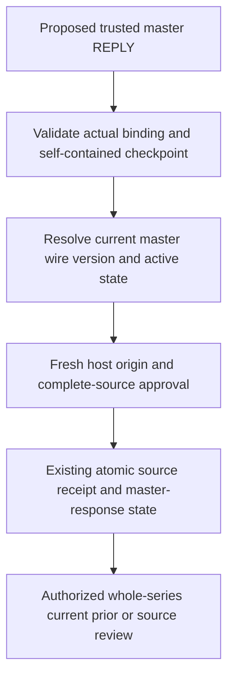

# ADR 0132: Recurring master attendee replies

Status: **Proposed. No implementation or new capability is approved by this document.**

## Context

Accepted [ADR 0131](0131-first-authenticated-attendee-replies.md) implements one non-recurring organizer-side REPLY with trusted host origin checks, separate participation/source storage and bounded retention. Outgoing scheduling already supports recurring masters, independently versioned exceptions, partial cancellation/restoration and publication-only exclusion masks. The latest publication row can therefore describe one occurrence rather than the current whole master.

The next recommended increment is whole-series master replies to these recurring native-created bindings. Instance and range replies remain required separate work; their version/identity and presentation contracts are not selected here. RFC 5546 [sequencing](https://www.rfc-editor.org/rfc/rfc5546.html#section-2.1.5) distinguishes UID/RECURRENCE-ID/SEQUENCE/DTSTAMP, and [REPLY](https://www.rfc-editor.org/rfc/rfc5546.html#section-3.2.3) permits optional original-request values without turning a response into a counterproposal. Those primary sections were checked on 2026-10-27.

## Proposed bounded scope

Accept one supported VEVENT REPLY with no RECURRENCE-ID or RANGE for either a non-recurring binding or the master of a recurring binding. Minimal replies can omit recurrence/timing; supplied values retain their source distinctions and must match the actual published master. Exact scope, event, UID, organizer and fixed roster association, explicit native provenance, nondelegated states and preliminary/final trusted origin approval remain mandatory. Source participants never grant authority. Imported organizer adoption, other inbound methods and mail remain separate.

Expose this as a **whole-series master response**. Preserve unknown/current/prior values without introducing inferred per-occurrence acceptance or a per-occurrence query. A response to one changed instance cannot be admitted as a master response. Instance replies reject explicitly until their own contract.

## Proposed current-master resolution

Introduce one private resolver over the validated self-contained scheduling checkpoint. It returns the actual current master wire message/component, its SEQUENCE and active/cancelled state, the carrier publication identity and the distinct canonical published snapshot. It must not use the latest row's scalar SEQUENCE/method as master evidence when that row is a detached occurrence message.

For ordinary complete REQUESTs, use their validated master. For detached occurrence cancellation/restoration, retain the known active master from the self-contained basis. For v6 reopening and masked restoration, use the actual last complete master REQUEST including its publication-only exclusions. A whole-series CANCEL is inactive and uses its cancellation version for classification; individual cancellation alone does not make the whole master cancelled. Missing, malformed or inconsistent checkpoint evidence fails unavailable instead of guessing from native drafts or pruned rows.

Current native edits remain private. Source validation and host approval distinguish the canonical published snapshot from the exact master wire projection and its exclusion masks. Never reconstruct accepted published values from a newer local recurrence pattern, or treat an ordinary source EXDATE as authority to manufacture a mask.

Validate the complete retained published message and select its master explicitly. Supply both that complete immutable message and the selected master component to host policy; preserve and validate its occurrence components rather than stripping them to manufacture an acceptable source. The incoming target still remains the master only.

## Proposed matching, ordering and retention

Reuse ADR 0131's stale/unmatched/result/conflict handling, optional-zero SEQUENCE, DTSTAMP ordering and source/key idempotency, now against the resolved master version. A later changed master makes an older response prior. A partial occurrence publication that leaves the master version unchanged preserves its currentness. A cancelled whole master accepts no current participation update. Nothing is automatically applied after reopening or pruning.

For matching current versions, compare supplied recurrence values using the bounded existing typed rule/set profile: canonical rule filters and inclusion/exclusion identities, exact DATE/UTC/named-zone meaning and faithful PERIOD end/duration forms. Preserve source groups/omissions in the stored normalized message. Matching optional values does not permit changing the master; unsupported pure-profile forms still reject without repair or loss. Publication-only exclusions form part of the actual wire master being answered. Stale/unmatched source does not claim to validate an unavailable historical pattern.

Every outgoing commit path that changes the actual master version/active state must record an inactivity boundary for old applied reply source inside the same scope transaction, including v6 reopening and complete masked restoration. Detached changes with an unchanged master do not expire it. Exact retries, same-version no-ops and unchanged master components keep their response/source state. This hook runs even on a publishing host without an inbound adapter. Cleanup continues to protect active master ordering and unexpired receipts, with the existing budgets/defaults. No process-local latest-master cache is introduced.

## Proposed storage, API and authority

Reuse the approved three private tables without new tables, columns, indexes or a migration. Stored publishedSequence/publishedCancelled describe the master target at admission, never an unrelated partial row. Existing source records remain readable without invented history; bound mode conversion remains blocked. Existing caps, atomicity and deletion guards remain.

Add a read-only recurring indicator to the response view so hosts can label whole-series responses. Its publicationId identifies the current checkpoint carrier; publishedSequence is explicitly the resolved master version. Extend the trusted reply context with the complete published master message and latest publication kind, alongside actual parent/current native/canonical published state. Both phases approve the exact proposed classification and source; retained retries still include the actual current response. Generated models/clients change through the pinned toolchain after agreement. This is an unpublished host-interface change requiring coordinated host upgrades.

Retain independent response/source-read rights plus full scheduling/event/source authority, all-or-nothing bounded review and no totals/new cursor. No new right is inferred from recurrence or an iCalendar address. The development/test-only example permits recurring bindings and labels the target as the whole master; source remains inert text and no email is sent.

## Alternatives and acceptance

Implementing instance replies in the same batch would also require reviewed component keys, membership/projection version rules, scope budgets and master/instance response presentation. That remains required follow-up work, not silently inferred by this master-only increment. Reading the latest publication scalar directly is rejected because a partial occurrence message may have a different independently managed version.

Test DATE/UTC/named-zone recurring masters, rule/date/PERIOD source matching and mismatch, omissions and source versions; partial REQUEST/instance CANCEL/restore with unchanged master versions; whole CANCEL/reopen, v6 masks and complete mask restoration; retained/pruned bases, malformed proof, source privacy and host-context/final-denial behavior. Exercise two actual hosts racing master publication and replies, stable retries and actual process loss, plus the labelled Flutter review journey. Use focused tests first, then the complete agreed batch checks before a single code commit. No real-client/MIME/mail interoperability follows from synthetic evidence.
