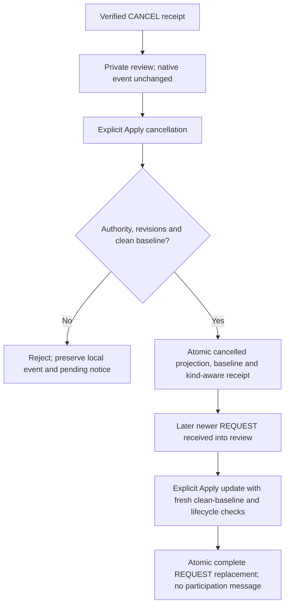

# ADR 0141: Explicit linked cancellation application and later REQUEST reopening

Status: **Accepted by explicit maintainer approval on 2026-10-29 for the complete application/projection/checkpoint/API/authority/reopening batch. Scoped implementation and complete local batch validation are recorded separately.**

## Context and confirmed policy

Accepted [ADR 0140](0140-trusted-cancellation-intake-and-review.md) receives known, verified whole-meeting cancellation notices into private review without changing native events. The maintainer confirmed that an explicit Apply cancellation must require a clean accepted-source baseline and reject local content changes. The approved batch completes the first non-recurring cancellation lifecycle, including a later explicit newer REQUEST through the existing update command. It sends no participation reply and grants no organizer authority.

The [existing linked-update guide](../linked-invitation-updates.md) describes the current REQUEST baseline/retry behavior. [RFC 5546 cancellation constraints](https://www.rfc-editor.org/rfc/rfc5546.html#section-3.2.5) and the [pure message profile](../itip-message-profile.md) describe source messages; the native projection, authority, storage and retry mechanics below are application policies.

## Approved action and projection

Add an independently authorized applyCancellation endpoint using the existing immutable CalendarInvitationApplyRequest IDs and expected invitation/event/calendar/application revisions. Cancellation digests use an explicit literal action prefix in the existing length-framed encoding, disjoint from the UUID-led REQUEST format. Keep existing REQUEST digests unchanged so retained latest REQUEST retries survive the additive upgrade without rewriting hashes or guessing history. Identical command fields cannot alias a different action. The actual destination comes from the stored link and trusted recipient. Require the exact pending current whole-meeting CANCEL, supported non-recurring profile and exact UID/organizer/correlation, with a strictly newer version and incremented SEQUENCE over the accepted REQUEST. Existing intake validation is rechecked against stored evidence; receiving a notice proves no authority to apply it.

Require current normalized native content/overrides/protocol state to equal the accepted private baseline. An identical native save may advance API revision but remains clean; the expected revision must match. Reject local edits, deleted/missing/corrupt evidence and stale selections atomically. No overwrite, merge, new event, relink or private-draft adoption is inferred.

The action retains current event UID, timing/end form, text, descriptive metadata, source participants/references/unarmed alarms and native imported origin. It changes lifecycle status to CANCELLED, marks STATUS present and installs the incoming cancellation's exact independently optional protocol version values. Missing source CREATED/LAST-MODIFIED remain absent rather than retaining older protocol values; database creation/audit timestamps remain separate. Optional non-lifecycle CANCEL properties remain inert source-review data; they do not overwrite retained event metadata. The view and command explicitly describe this status/version projection rather than a complete event replacement. Never run METHOD removal or invent a standalone event from a minimal cancellation.

Record a normalized baseline of that complete agreed native projection, not a claim that the source supplied a complete VEVENT. Preserve the separately protected normalized CANCEL body under existing queue retention. Calendar metadata time/revision stays unchanged; event/API revision, nondecreasing database audit time, scope generation and feed invalidation advance. Source protocol times remain exact. Personal definitions/actions survive; ordinary generation/revalidation suppresses cancelled reminders. No notification or scheduling message is queued.

## Approved workflow

## Approved acceptance checkpoint and models

Reuse the existing one-row-per-link CalendarInvitationApplicationRecord, adding kind using CalendarInvitationSourceKind. Existing rows default to request because previous accepted application commands handled REQUEST only. No new table/body snapshot or expanded retention is proposed. The row continues to hold current accepted source IDs/digest/version, baseline/creation digests, revisions/time and latest request/result. For cancellation acceptance, its kind and baseline must agree with explicit cancelled native projection; never infer accepted source kind from native STATUS alone.

Add acceptedKind and canApplyCancellation to CalendarInvitationApplicationView and kind to CalendarInvitationApplyReceipt. Current incoming kind/text and current native content remain separate. A host-only immutable current/proposed application state carries kind. A cancellation receipt uses the same revision/result structure, clearly identified by kind. Validate fresh/populated upgrades and upgrade all participating hosts before enabling the new actions; mixed implementations are unsupported.

The immutable original creation receipt stays unchanged. The single latest application result now spans both explicit REQUEST and cancellation actions. Exact latest retries reauthorize and return the same result without replay, revision/generation change, alarm action or dismissal of a newer source. After a different application commits, older REQUEST or cancellation commands are no longer retained retries and reject stale. No historical receipt ledger is invented.

## Approved authority, transaction and reopening

Require independent invitation applyCancellation plus summary/source/link/application-read rights; native import/replacement/update/full-detail/source-read rights; and lifecycle authority for every cancellation command, including an already-cancelled clean event receiving a newer cancellation version. Ordinary Apply update retains its own applicable change permissions. Hosts may map gates together. Preliminary authorization precedes private conflict classification; final complete current/proposed source/link/event/baseline/checkpoint/result authorization occurs inside the shared scope transaction after proposed writes, with final actor/recipient mapping and declared guarantee checks.

Event projection, accepted baseline/checkpoint/latest result and dismissal of exactly the selected source commit together. Denial, expiry/unavailable evidence, concurrent deletion/edit/intake/application, capacity or revision failure leaves no partial state. A verified transport recipient never becomes a fabricated native actor.

After explicit cancellation application, a later strictly newer current REQUEST may reopen through the existing explicit Apply update workflow. It must pass the same clean-baseline, revision, full-source and lifecycle checks; receipt alone still changes nothing. Reopening uses that complete REQUEST rather than resurrecting old values. Ordinary local reopen is a native edit and sends nothing; it also makes the accepted-source baseline dirty, blocking source replacement until a separately reviewed reconciliation flow.

## Example and validation

Add an explicit cancellation preview/action that shows retained content and the lifecycle-only change, protected complete incoming source and local-conflict rejection. Keep uncertain request/action stable for retry and reload stale selections explicitly. Label accepted REQUEST versus cancellation and distinguish a later pending REQUEST from automatic reopening.

Test source/kind/profile/version/identity checks, clean versus identical native saves, all independent gates/final rollback, exact latest retry and cross-action hash separation, superseded commands, source expiry, original creation identity, personal-state preservation, ordinary export/feed invalidation and explicit newer REQUEST reopening. Verify no outbound or automatic source alarm activation. Exercise generated populated upgrades, real two-host races/loss before/after commit, generated clients and Flutter actions. Run focused checks during development and broader batch checks before one code commit.

## Alternatives, consequences and accepted decision

Automatic application would violate review-first policy. Status-only edits without an accepted projection would falsely classify the system's own cancellation as a local conflict and leave later source versions ambiguous. Copying every optional cancellation field would silently turn a lifecycle command into content replacement. A separate receipt/history table expands retention beyond the agreed latest-result policy. The proposed one-row kind plus explicit projection keeps the first lifecycle bounded, at the cost of stale rejection for older commands.

The maintainer explicitly approved the complete action/projection/checkpoint/API/authority/reopening batch on 2026-10-29 before source changes. See [the scoped implementation](../linked-invitation-cancellation.md) and separate validation evidence. Reviewed overwrite/merge, recurring/instance/range cancellation, attendee removal, participant responses, organizer adoption, link purge/relink and RFC 6047 mail remain separate required work. No real mail is authorized.
