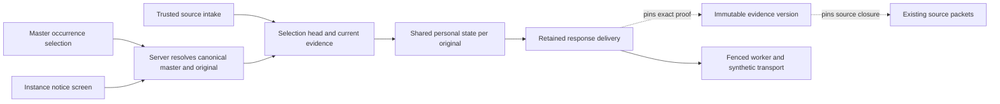

# ADR 0179: Durable shared occurrence responses for ordinary recurring invitations

Status: **Proposed, 2026-11-06.** The maintainer confirmed effective separately received notice/version selection, restore-only proof independently of calendar Apply, and one shared personal response state per original across master and instance entry paths. The grouped storage/API/history/authority mechanics below require explicit agreement before implementation.

## Context and evidence

[ADR 0178](0178-pure-recurring-response-source-selection.md) implements the bounded pure selector in [PR #188](https://github.com/jimmyspets/serverpod_calendar/pull/188), application **666e1ec0dd90471965c80265f81c67b2d7963d29**. Its 45 focused cases, complete pure suites and 124 affected SDK regressions passed. Full hosted [run 42181250708](https://github.com/jimmyspets/serverpod_calendar/actions/runs/42181250708) now has **inspect: success / runtime: success** at that exact head. Pure success establishes no complete retained history or permission to respond.

Current response state is keyed by scope/recipient/entry/target, and a retained delivery pins only its own source entry. That does not prove a combined master/notice/cancellation basis. Entry-based instance and root-based selection could also queue contradictory choices for one original. Inspected source/entry/receipt retention, response state/delivery/attempt tables and worker fences, known-series membership, occurrence/cancellation/restoration projections, command hashes and current SDK/Flutter paths. Open PRs contain the prerequisite and no overlapping durable implementation; open issues returned none at inspection.

[RFC 5546 sections 3.2.3 and 3.7.1](https://www.rfc-editor.org/rfc/rfc5546.html#section-3.2.3) provide instance REPLY identity/version context. Source-only proof retention, shared state and the conservative restore/freshness policies below are application rules, not a universal RFC storage algorithm.

## One complete implementation group

Group trusted source-history capture, protected selection/activity queries, explicit Accept/Tentative/Decline, durable synthetic delivery, generated clients, migrations, Flutter entry paths, two-host/process-loss and MIME reconciliation checks. No intermediate feature code commits. This increment targets ordinary recurring invitations; non-recurring and complete-bundle workflows keep their existing contracts. It sends one occurrence REPLY with RECURRENCE-ID and no RANGE, not a suffix response.

Add an explicit response-runtime option enabling this profile, initially false for existing hosts and enabled by the synthetic example. Enrollment begins only with a genuinely new ordinary recurring master correlation received while enabled, with no prior entry/link/response history for that correlation. Completeness concerns source history captured by this module, not undisclosed external messages. Existing or purged/unknown histories cannot be enrolled by guessing from current rows. Legacy behavior remains available outside enrollment; the new combined APIs fail unavailable there. Pre-beta development may use a fresh synthetic database, as already authorized. A future reviewed adoption/reset flow is separate. The option controls new enrollment/API admission, not whether an existing head can be maintained: every host receiving later notices for an enrolled correlation must capture proof or fail unavailable atomically. A missing runtime/adapter capability cannot silently skip capture. Workers also verify the actual current entry/source vector against retained proof rather than trusting the head pointer alone.

## Shared identity and entry paths

Resolve trusted scope/recipient, actual opened entry, correlation and actual master on the server. Use the stable master entry UUID plus the exact original and a new `recurring-occurrence-v1` target namespace in existing response state/delivery storage. Master, sibling originals and other recipients stay independent. Do not use moved DTSTART, client-claimed parentage, source UID alone or the current controlling notice entry as personal-state identity.

Opening through a master or a separately received instance returns the same state/revision/activity. When an instance entry is used, the requested original must exactly match its actual stored target. A range entry may open a selected validated original, but never implies a suffix response. Both routes resolve the same effective controller and proof. Changing the controller changes eligibility/source evidence, not the occurrence's personal identity or recorded choice.

For enrolled histories, old selected-instance response read paths resolve that shared state; their old scalar send shape cannot approve a multi-packet proof, so new sends must use the new command/API. Flutter routes both screens to that command. Retained old command retries keep their historical identity/receipt and reauthorize without reactivation. Do not rewrite or merge old commands, payloads, hashes or state rows. Enrollment excludes such legacy histories, so an upgrade invents no merged personal choice. Ordinary master replies and all non-enrolled/bundle paths preserve existing behavior.

## Source-only capture and restoration

Within the existing trusted ingress transaction and recipient/scope coordination, maintain a separate response-selection head and immutable evidence versions. This records received source facts and reply eligibility only: no native event, accepted calendar baseline, assignment, alarm or personal participation choice changes. Add/Apply/dismiss do not send, advance this source proof or determine restoration. Local drafts never supply source history.

Capture the current recurring membership REQUEST, actual current whole-master state, current single/range notice references and flat active/restored range-cancellation history. Revalidate exact correlation/recipient/profile/member identities and every packet under shared limits before deriving a complete basis. Keep the last membership REQUEST when a minimal whole CANCEL arrives; missing membership/history never becomes a fabricated basis. Whole CANCEL blocks all new occurrence replies, while a later current REQUEST does not discard separate active cutoffs or single cancellations.

A range CANCEL records its exact anchor/version plus references to the uncancelled source basis needed to reproduce its effective timing/content and strict version floors. It masks every original from that anchor, including later exceptions. Preserve frozen evidence through later master/notice receipts. A later same-anchor THISANDFUTURE REQUEST retires that mask only after exact restore-only timing/content comparison and the existing strict sequence floors, including cancellation/affected-component/prior-restoration evidence. Reproduce comparisons from retained source packets; never trust a copied digest alone. A different anchor or rescheduling/content-changing REQUEST cannot clear it. A valid source-only restoration needs no calendar addition or Apply and may coexist with a native event that remains cancelled or locally conflicted.

Distinct active cutoff anchors remain separate masks; restoring one leaves other covering masks active. At a repeated active anchor retain the original uncancelled basis, require the conservative newer version floor and retain transition evidence. Repeated restore/cancel cycles keep flat bounded history, not recursively nested snapshots. No incoming version or receipt time silently compacts or erases proof. Unsupported/ambiguous history yields unavailable eligibility, never fallback to the master or automatic restoration.

Raw trusted intake/review retains its existing semantics. A valid raw notice that cannot establish a supported complete selection records an explicit unavailable proof without dropping the notice or the last valid cancellation evidence. Capacity exhaustion instead rejects atomically before accepting an unretainable transition. A later packet can restore complete eligibility only from retained proof, not by deleting an inconvenient notice/history item. Historical ingress receipt retries run before new admission and never rebuild or advance current proof.

## Proposed schema and limits

The following diagram is a proposed data flow, not implemented runtime behavior:

Add three server-only tables and one nullable relation on the existing delivery table:

| Storage | Fields and purpose |
| --- | --- |
| `CalendarInvitationResponseSelectionHeadRecord` | Server UUID; trusted scope/recipient/correlation; actual master entry UUID; revision; nullable current evidence UUID; active/unavailable/purged state; audit/inactivity times. Unique scope/recipient/correlation. Mutable pointer and a minimal scrubbed marker, not a calendar identity or inbox item. |
| `CalendarInvitationResponseSelectionEvidenceRecord` | Server UUID; head UUID/revision; normalized version-1 evidence JSON; digest/UTF-8 byte count; created/retired times. Payload/digest are immutable; retirement is lifecycle metadata. JSON contains exact source/entry references, typed original/range identities, current vector and flat cancellation/restoration comparison/floor evidence. |
| `CalendarInvitationResponseSelectionSourcePinRecord` | Server UUID; evidence UUID relation; source UUID relation; unique evidence/source and indexed source reference. Derived from that immutable proof, with no copied text; scope/recipient/entry ownership is verified through actual parents. |
| Existing `CalendarInvitationResponseRecord.selectionEvidenceId` | Nullable evidence UUID relation. Null preserves every legacy delivery; a new combined command pins its immutable multi-packet basis. No response-state table change is required. |

Create a head with a null evidence pointer and populate it atomically; complete active heads require a valid current evidence row. Null is permitted for initialization/purged history, never as a guessed eligible basis.

Evidence refers to existing immutable normalized source bodies; it does not copy an email, native event or source body. Frozen comparisons are reproducible from referenced packets, with explicit source versions and canonical comparison digests. Validate reference scope/recipient/correlation/entry identity and full payloads; IDs/hashes alone grant no authority. Old evidence versions do not recursively reference other versions: each retained version has a bounded flat source closure.

Proposed new configurable maxima/defaults: **128 heads per recipient / 4,096 per scope**, **64 evidence versions per head**, **64 flat history/notice slots**, **16,384 source pins per recipient / 262,144 per scope**, **4 MiB evidence JSON per head / 16 MiB per recipient / 64 MiB per scope**. These are additional bounded proof-storage budgets, not a claim that total existing storage is unchanged. Within a version, at most **65 distinct source packets including the master**, **262,144 raw UTF-8 bytes across its complete deduplicated source closure**, and the ADR 0178 current-selector/component/zone/shared-work ceilings apply. Frozen/history replay shares the same work ceiling; no extra independent budget or partial eligibility. Callers may lower caps. Reused raw bodies still count in all existing source-entry/recipient/byte limits; response/state/pending/attempt quotas and the aggregate 32-responses-per-invitation limit remain unchanged. Full proof/history capacity rejects without automatic eviction.

Insert evidence and its complete deduplicated source-pin rows atomically, and verify pin/JSON-reference equality when validating a proof. Indexed pins and foreign keys protect source deletion without replaying every JSON proof during global cleanup; mismatch fails unavailable. Proof maintenance/pruning uses bounded candidate batches and removes pins only after proving their evidence unreferenced and retention-expired, before deleting the evidence or source. Quotas charge pins separately, and a full quota rejects the whole transition.

Retained current or response-pinned evidence protects every referenced source and its entry, including noncontrolling packets and frozen cutoff bases. Never delete proof first and reinterpret a command with today's source. Retired unreferenced versions use the existing configurable terminal retention (30-day default); active proof/history may remain longer while the enrolled series is active or referenced. Validate all pins even on hosts without an active worker. Cleanup must consider head/evidence ownership and external references together so self-pins cannot prevent eventual terminal cleanup.

After all notices are dismissed/inactive and no active calendar link or retained response requires the head, retire its payload under that retention rule. Scrub proof when eligible, retaining only head UUID/scope/recipient/correlation/master identity/revision/purge time while surviving entry references require an unknown-history marker. That marker blocks implicit re-enrollment. Remove it once external references are gone and the configured terminal marker period has passed. A head and its otherwise-prunable master entry may be deleted in the same transaction; their ownership/foreign-key references cannot require each other to disappear first. Personal state remains until its existing entry-pruning boundary; pruning never rearms a choice. Deletion/retention tests must prove both no premature source loss and eventual content scrubbing.

Generate module/example migrations with the pinned CLI. Fresh storage exercises enrollment. Populated upgrade must leave existing rows, hashes, receipts, leases and attempts unchanged, create empty head/evidence/pin tables and null delivery relations, and invent no source history, shared choice or send. No destructive development reset is part of an upgrade.

## Protected API and immutable command

Add immutable `CalendarInvitationRecurringOccurrenceResponseView` with the existing personal response view, actual opened and canonical master identity/revisions, exact original, selection head/evidence identity/revision/digest, complete/unavailable/blocked eligibility, and protected controlling entry/source/role/anchor/version. Current proof is separate from the version a previous choice answered. Never expose source counts, unrelated notice content or a complete history vector through ordinary response views.

Add immutable `CalendarInvitationRecurringOccurrenceResponseRequest`: nested existing command plus opened-entry UUID, exact original and expected head/evidence revision/digest. Snapshot nested DTOs before awaiting. The base command identifies the canonical master and membership source; retained proof separately identifies the controlling packet/version. Bind the entire wrapper to a new `recurring-occurrence-response-v1` criteria family. Same command UUID with another route/original/proof/input rejects; old hash families and exact historical receipts remain unchanged.

Dedicated `recurringOccurrenceResponse`, `recurringOccurrenceResponseActivity` and `sendRecurringOccurrenceResponse` endpoints accept the opened entry and explicit original, resolve canonical identity and return only the bounded authorized target. Authorize opened-entry read/raw-source access before type-specific rejection or correlation discovery, then check the actual root and required sources. No totals or implicit read-to-create state. The read supplies one transaction-consistent proof for a later explicit command. Re-resolve the expected proof at commit; no client-supplied vector or stale controller becomes authoritative.

The proof freshness vector binds source identities/digests, source kinds, modes and exact target identities; it does not bind review-only entry revisions or dismissal metadata. Foreground command revisions still protect the actual opened/master views, while worker freshness does not mistake a later dismissal revision for a source change.

New source receipts advance the head only for actual source/proof changes; duplicates and calendar/review-only actions do not. Per-original CAS, strictly later actual database-second stamps, supersession and leases remain on the shared state. A new response replaces only that original's pending intent, regardless of opened screen. A changed whole selection proof conservatively withdraws all unsent new-profile intents pinned to the older proof, including noncontrolling source changes; it never rewrites recorded choices or replays them when eligible again. Provider acceptance cannot be recalled.

## Host checks, dispatch and example

Require ordinary response read/send/dispatch plus dedicated `readRecurringOccurrence`, `sendRecurringOccurrence` and `dispatchRecurringOccurrence` operations. Add independently approved `maintainRecurringResponseEvidence` during new-profile trusted intake. Context contains actual opened/master/controlling objects and immutable current/proposed combined source proof, separately from the minimal outgoing REPLY. Require raw-source/recipient access for every required basis packet; denial/unavailable evidence must not select a weaker fallback. No native calendar adoption/read/edit permission is a prerequisite merely to respond. Apply declared coordinated/external checks with no downgrade; a fresh external check still has an after-check race.

Before submit/retry, workers validate the retained immutable evidence, exact current head, original, effective controller/version, current recipient/route/authority, state generation, expiry and fenced lease. There is no fabricated actor. Retry uses the same delivery UUID and exact payload/MIME bytes; terminal history pins its actual proof. Unknown proof is bounded retryable, denied/stale proof withdraws, and expired work remains expired. An exact retained command retry reauthorizes the historical proof and returns its receipt without new admission or reactivation.

Flutter opens the same target state from master selection and instance notice, labels the effective source/version and historical choice separately, and freezes uncertain command retries. Explicit Accept/Tentative/Decline remains separate from Add/Apply/dismiss. Synthetic MIME loopback verifies that the organizer receives one original/controlling-version REPLY. Real mail, provider authentication, RANGE participation, legacy history adoption and external-client compatibility remain separate work.

## Complete acceptance and alternatives

Test fresh and populated upgrades, new enrollment versus legacy/purged histories, DATE/UTC/exact zones/DST/PERIOD/exclusions, original identity under moves, master/single/range precedence and independent optional versions, every current/frozen packet's corruption/permission/budget checks, masks/restoration and repeated cycles without calendar adoption/Apply, whole cancellation/reopening and orphaning master patterns, source-only versus local draft independence, duplicate/historical receipts, shared-state cross-route races/command loss, per-target clocks and aggregate quotas, proof/source pins and eventual pruning. Include denial/final rollback and immutable nested callback snapshots.

Use real two-host intake/selection/send races, competing fenced workers, actual loss before/after commits and synthetic acceptance, stable UUID/payload/MIME retries, generated JWT clients, trusted organizer reconciliation and connected Flutter master/instance shared-state journeys. Focus tests during implementation, then complete agreed pure/SDK/migration/recovery/client/Flutter and full exact-head hosted checks before readiness and one code check-in. Preserve CI read-only permissions, disposable storage and every existing complete check group.

A controller-entry state changes identity when a different notice becomes effective and permits contradictory screen-local choices. A single source pin cannot replay combined authorization/restoration proof. Relying on calendar Apply violates the confirmed separation of participation and booking. Inferring history for legacy rows fabricates cancellation/restoration provenance. Keeping every payload forever or silently deleting proof violates bounded storage and retry identity. The explicit head/evidence split makes shared state, currentness and historical command proof independently reviewable.
