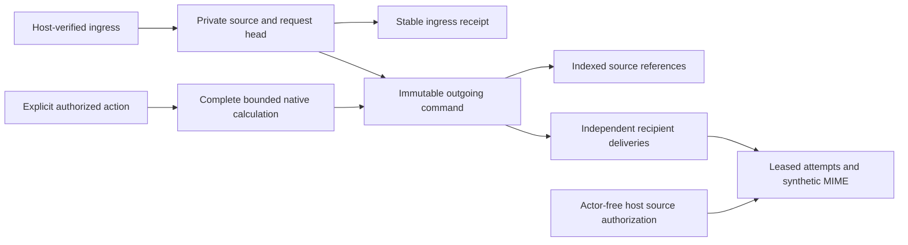

# ADR 0180: Authenticated bounded VFREEBUSY exchanges

Status: **Accepted by explicit maintainer agreement, 2026-11-06.** The maintainer approved the grouped contract, seven private tables, nullable cursor extension and withdrawal/scrubbing of queued and retained reports on source deletion. Implementation and actual validation are recorded separately; acceptance does not establish runtime success.

## Evidence and scope

The ADR 0179 implementation is application aaaf1f47d18a293f611ecb8b5fde27112081b4be in PR #190. Its local pure/SDK/upgrade/recovery/JWT/connected Flutter checks passed; exact-head hosted run 42248235619 subsequently passed inspect and runtime. That evidence applies to ADR 0179, not the later exchange implementation.

RFC 5546 section 3.3 defines PUBLISH, REQUEST and REPLY for VFREEBUSY. A reply preserves the request UID and identifies the requester as ORGANIZER and respondent as ATTENDEE; publication has no ATTENDEE. These roles do not authenticate a sender. RFC 6047 sections 2.1–2.3 distinguish the email binding and security requirements; the existing restricted synthetic MIME profile does not claim full iMIP authentication/conformance.

Sources: [RFC 5546 section 3.3](https://www.rfc-editor.org/rfc/rfc5546.html#section-3.3) and [RFC 6047 section 2.2](https://www.rfc-editor.org/rfc/rfc6047.html#section-2.2). Current local evidence: the pure three-method adapter, authenticated per-calendar export and native complete/unknown calculation. The latter uses a 31-day window, 256 raw events, 64 definitions/source openings, 5,000 booking/opening projections, 1,000 output intervals and shared 200,000 recurrence work. These are existing application limits, not RFC limits.

Group trusted intake/private review, explicit publication/request/share/refusal, immutable intent, fenced synthetic delivery, generated clients, migrations, Flutter and two-host/MIME/recovery checks in one feature-code batch. First native report scope is one actual calendar, one host scope and an explicit UTC window of at most 31 days. No partial calendar may be presented as a person's complete availability: the host must verify that the sender/target mailbox represents this exact calendar. Subject/common-free publication and cross-scope resolution remain separately required roadmap work.

Use the existing pure wire profile without flattening accepted source groups/omissions: up to 32 PUBLISH components, 64 REQUEST attendees and 1,000 periods, within 262,144 decoded bytes and existing component/value/work ceilings. Native calculation and REQUEST windows are bounded to 31 days. Incoming PUBLISH retains any supported increasing source window because it performs no native calculation; a multi-component publication remains one atomic source document. Native output has one component. All dates remain whole-second UTC in [1970,2100), with only explicit exclusive endpoints at 2100 midnight.

## Explicit behavior and trust

An incoming REQUEST is private review data. Receipt/dismissal performs no booking calculation, publication, native change or automatic reply. A host-resolved mailbox binding identifies the actual calendar/owner/scope before accepting the request; a client cannot claim that mapping. Distinct verified local recipients of a multi-attendee request are admitted independently under their envelope-bound route, without inferring recipients from arbitrary attendee claims.

Incoming PUBLISH and correlated REPLY remain informational source reports. Preserve groups, overlaps, source status codes, annotations and periods outside the advertised window; never promote them into native availability or infer free time/completeness from empty/successful source data. No source URL is fetched. A REPLY must match a retained outgoing REQUEST's UID, verified respondent route, local requester and exact requested window in this first profile; mismatched/unknown/expired correlations reject before admission. Exact window matching is a stricter application rule, not a claim about every legal RFC reply.

Expose explicit Publish busy snapshot, Request busy time, Share busy snapshot, Refuse request and Withdraw unsent command actions. Publication/request may select up to 64 independently host-approved routes. REQUEST contains the actual approved attendees and no busy data. Successful reports use the existing complete native calculation, not detail-list visibility. Unknown/denied/limit-exceeded calculation rejects before intent is written. Refusal is an explicit authorized REPLY with status 3.8 and no FREEBUSY, not an empty success; it needs mailbox/refusal authority, not access to booking data. There are no automatic failure messages or response loops.

Publish/request receive separate server-generated protocol UIDs, independent of calendar/API/feed identities. Replies preserve the selected request UID/window/roles. All outgoing stamps use actual whole-second database UTC. For another reply to the same incoming request, require a later actual database second, never a manufactured future timestamp. There is no SEQUENCE on VFREEBUSY.

The host verifies sender address, actual mailbox/calendar binding, recipients/routes and complete immutable message at preliminary/final queue writes and dispatch. For REPLY the transport sender is the responding ATTENDEE, not its ORGANIZER. Source/MIME addresses, status codes, DNS or possession of a UID confer no authority. Keep raw ingress server-only; the example admits synthetic verified-origin fixtures and records enough_mail MIME under ignored local storage, never real mail.

The accepted logical flow is implemented as follows; actual check outcomes are recorded separately:

## Incoming request identity

Use a private request head keyed by scope, owner, verified requester/local binding and exact UID hash. Its calendar binding and window are fixed. A same-UID request changing that window/binding rejects until a separate replacement profile is reviewed. Exact decoded retries reuse their source. Higher source DTSTAMP may select a new source for the same fixed identity; lower/equal-but-different versions remain private stale/conflict review data and cannot authorize a new reply. DTSTAMP ordering is source selection, not authentication or proof of real freshness. No silent current-source replacement on a conflict.

Head source revision and private reply revision are separate. New share/refusal commands require both expected revisions and exact selected source. Another source withdraws unsent replies pinned to the former source, not unrelated commands. Dismissal sends/withdraws nothing. Historical ingress/command retries run before new capacity admission, reauthorize their actual source/owner and return retained results without activation.

## Approved seven-table layout and private cursor extension

All seven records are server-only with server-generated UUIDs. Accepted table names are `serverpod_calendar_fb_request_head`, `_fb_source`, `_fb_ingress`, `_fb_command`, `_fb_source_ref`, `_fb_delivery` and `_fb_attempt` (the latter six share the `serverpod_calendar` prefix). No user/group/membership/provider/device tables are added.

| Record | Stored fields and invariants |
| --- | --- |
| `CalendarFreeBusyRequestHeadRecord` | Scope/owner, correlation hash, immutable verified mailbox/calendar binding and window, current-source UUID pointer, source revision, reply revision/last actual reply stamp/latest-command pointer, active/conflicted/purged state and lifecycle/audit fields. An equal-stamp/different-body conflict blocks new replies until a strictly later admissible source resolves it; a lower stale source does not replace the selected source. Nullable plain pointers permit atomic initialization/retirement without circular FK ownership. |
| `CalendarFreeBusySourceRecord` | Scope/owner, method, optional request-head or outgoing-request-command relation according to method, source digest/byte count, decoded calendar payload, bounded derived header capped at 32 KiB (method/windows/verified role references and local mailbox, no periods, protocol UID text or event counts), bounded verified-origin/binding references, received/expiry/dismissal fields. Header-only reads cannot grant raw-read or action authority: action/dispatch paths parse and verify the complete source against its recorded binding. Payload immutable while retained; no source claims become native data. |
| `CalendarFreeBusyIngressReceiptRecord` | Scope/owner/namespace/delivery key unique identity, input digest, source relation, immutable result and expiry. Lookup/recheck precedes new admission; duplicate delivery cannot reactivate a source. |
| `CalendarFreeBusyCommandRecord` | Scope/owner/client command UUID unique identity, request-criteria digest, method/action, optional selected incoming source relation, actual native calendar relation, database stamp, timezone/calculation profile and parent-settings digest, immutable payload/digest/bytes, generation, audit/expiry/correlation-retention fields and immutable receipt. Private payload/request data may be scrubbed into minimal nonreactivating markers only under the reviewed deletion/retention policy. |
| `CalendarFreeBusySourceReferenceRecord` | Command relation and exactly one actual event/availability identity relation, its revision and content fingerprint. Unique command/source, indexed reverse references. Up to 320 sources per native snapshot (256 events plus 64 availability definitions); rows reproduce the complete source basis without event text or saved access decisions. |
| `CalendarFreeBusyDeliveryRecord` | Command relation, trusted recipient/route references, generation, outcome/attempt count, next attempt, lease owner/until, expiry/terminal time and bounded provider receipt. Stable UUID is the transport retry key. Source scrubbing clears sensitive route/body-associated fields while preserving approved minimal audit fields. |
| `CalendarFreeBusyAttemptRecord` | Delivery relation, generation/attempt ordinal, lease owner, database times, bounded outcome/reason and payload/MIME digests. No copied calendar payload or credential. |

Add one nullable server-only nested `freeBusyExchangeState: CalendarFreeBusyExchangeCursorState?` field to the existing `CalendarCursorRecord`, not a new cursor table. Its typed versioned state binds family/owner/criteria/private metadata-vector digest and any activity parent. Bind the existing principal/scope/policy/native data revision/timezone identity as applicable; private source/command changes invalidate the additional vector digest without advancing domain generations. Inbox, outgoing and activity pages have no totals; candidates are charged before authorization and exhaustion is proved. Limit page size to 50, scan at most the configured owner ledger cap under one shared budget, and fail rather than return partial success on exhaustion. Store no access decisions or busy data in cursors. All legacy cursor handlers explicitly reject this new family before fallback. Reuse existing cursor token/expiry/quota rules and verify populated legacy cursor rows remain unchanged with a null new field.

Source relations have no implicit cascade that could invalidate an active command. Head latest pointers are not an ownership cycle. Incoming replies pin their outgoing request until their source/receipts expire; outgoing replies pin their incoming source. Releasing source/receipt/command/reference dependencies in order must permit eventual pruning; no indefinitely self-pinned row is accepted.

## Budgets and lifecycle

Accepted configurable ceilings/defaults: 128 heads and 512 source rows per owner, 4,096 heads/8,192 source rows per scope; 64 source versions per request head; 1,024 ingress receipts per owner/32,768 per scope; 128 retained commands per owner/4,096 per scope; 16,384 source-reference rows per owner/262,144 per scope; 256 pending deliveries per owner/10,000 per scope; 64 recipients per command. Incoming storage counts both decoded payload and bounded header; incoming and outgoing payload families each cap at 8 MiB per owner/64 MiB per scope, with 262,144 bytes per message. Existing pure/calculation ceilings still apply; callers may lower caps. Exhaustion rejects the complete transaction, never evicts current proof or returns partial publication.

Use 30-day source/ingress and terminal-reference retention by default. Accepted outgoing REQUESTs remain correlatable for 30 days after creation; a new late reply cannot extend new admission forever. References can retain a request/source longer until existing dependent records expire. Body-free terminal/head markers have a further 30-day bound once their references permit retirement. Ordinary lists omit retired markers; known exact retries never reconstruct them. Keep only IDs, scope/owner, digests, revisions/outcome/times in scrubbed markers, not intervals, query text, addresses or source content.

Busy snapshots expire for delivery after 15 minutes by default; data-free requests after 24 hours. Use at most eight attempts, a 120-second database lease, 15-second transport timeout, bounded exponential backoff starting at 30 seconds/capped at one hour, and batches of 32. Expiry/revocation withdraws or expires work; late recovery never reactivates it. Private withdrawal cancels unsent delivery, not a wire CANCEL and not already accepted mail.

## Actual source authorization without a fabricated actor

Factor only reusable data loading/calculation from the current per-calendar pipeline. Foreground calls retain readFreeBusy/exportFreeBusy and every actual event/rule projection check, plus independent exchange operations. Worker contexts have no actor. A dedicated host background source-projection port receives the same immutable actual parent/event/rule requests and verified recorded owner/mailbox/recipient context; it must authorize every required source before dispatch. Scope-only row loading may not synthesize CalendarHostContext or bypass source checks. Preserve all existing complete/unknown and shared-budget semantics.

Bind each successful snapshot to the actual calendar settings/timezone-data identity and the complete indexed source set/revisions/fingerprints. Recheck actual current sources and all host rights under the scope transaction before submit/retry. Any changed supported source basis withdraws that command instead of recomputing bytes under its old transport ID. An unsupported recorded timezone/calculation profile is unavailable, not evidence of a user edit; mixed timezone-data upgrades remain a separate operational gate. Other calendars' writes do not invalidate it through an unnecessarily global generation. Recheck complete immutable recipient/message disclosure for the actual delivery; independent routes remain independently fenced.

Retain coordinated versus external fresh-check guarantees with no downgrade. An external after-check revocation race and external provider acceptance cannot be eliminated by a database lease. Same command UUID/criteria returns the same authorized receipt, never a new body, route or message. Different criteria reject. Source/lease/generation checks precede every retry.

## Accepted source-deletion policy

Withdraw and scrub private reports during shared source deletion. Delete the calendar or contributing event/rule and, in the same scope transaction, fence affected pending commands, remove their indexed source references, and scrub their retained busy-interval payloads/source vectors (including terminal report bodies). Accepted delivery remains accepted with content-free audit, never recalled. Do not recompute a replacement report under an old command or transport ID. Unrelated commands remain independently fenced. Source-targeted request delivery becomes ineligible when its actual mailbox/calendar binding is deleted; incoming foreign reports are not native booking data and retain their own private inbox lifecycle.

After scrubbing, no body API may expose intervals/query text/addresses from the removed report. Minimal command/delivery receipts retain only opaque IDs, scope/owner, criteria/payload digests, revisions, outcomes and times. Exact historical command retries reauthorize a matching content-free marker and return only its stable result; they do not reconstruct a body, resend or reactivate source data. Raw-body retrieval fails unavailable. Keep ordinary marker discovery suppressed and prune markers once references/retention allow. Validate this boundary separately from receipt retries whose source body remains retained.

The maintainer explicitly approved this policy for queued and terminal report bodies and contributing-source deletion in the combined contract review. Already accepted external delivery cannot be recalled.

## Accepted API families

Expose `listFreeBusyInbox`, `getFreeBusyMessage`, `getFreeBusySource`, `dismissFreeBusyMessage`, `listFreeBusyOutgoing`, `freeBusyDeliveryActivity`, `publishFreeBusy`, `requestFreeBusy`, `replyFreeBusy`, `refuseFreeBusy` and `withdrawFreeBusyCommand`. Typed immutable request DTOs contain only actual object references, bounded query/recipient input, expected source/reply revisions and command UUIDs; never a claimed owner, grant, sender identity or source vector. Receipts contain opaque command/result identity, not source periods. Native calculation scope and wire recipient context remain explicit.

The replaceable host ports resolve the trusted current private owner, verify ingress-origin and each relevant source role, bind the actual local mailbox/calendar, approve the exact immutable message/routes, and independently authorize foreground/background source projections. Expose separate receivePublish/receiveRequest/receiveReply, header/raw read, share/publish/request/refuse/withdraw, outgoing/activity and dispatch operations. A successful report requires ordinary free/busy/export and all actual source projections as well as its mail-specific gates. Refusal authorizes only a data-free response. No operation grants another implicitly; background contexts have no fabricated actor. All complete-message/route checks are repeated for the actual delivery.

## API/example and complete validation group

Use immutable bounded source/command/receipt DTOs; no provider references, source-event IDs/counts or native lookup IDs appear in wire reports. Header/raw-source/outgoing/activity rights are independent. Inbox/outgoing/activity use authorized opaque pages without totals; no native detail-list filtering supplies availability. The example shows private incoming requests/reports, explicit publish/request/share/refuse/withdraw actions and delivered-versus-accepted distinctions. Nothing automatically reserves time or changes calendars, tasks, native protocol versions, alarms, invitations or received-report coverage.

Test source roles and exact UID/window correlation, one/many request targets and grouped publications, stale/conflict/no-reply behavior, empty success versus refusal/unknown, private-source denial, recurrence/DST/all-day/rule/fallback/tentative calculation, copied IDs/hidden counts exclusion, nested callback mutation, final rollback, independent commands, quota/source-reference mismatch, expiry/retention and eventual ordered pruning. Test the chosen deletion policy before implementation is complete.

Run real two-host ingress/queue/lease races, actual process loss around commit and synthetic acceptance, stable UUID/calendar/MIME bytes, host revocation/route changes, generated JWT clients and connected Flutter. Generate source migrations with 4.1.0 and prove fresh/populated upgrade behavior. Focus during development, broaden once the entire group is complete, commit feature code once, and require full exact-head hosted success before readiness. No real sender/provider authorization, deployment, package publication or blanket external interoperability follows.

## Implementation and evidence

The optional runtime, seven table sources, generated migrations/clients, protected endpoint families, example MIME/Flutter integration and recovery harness implement this accepted slice. See [the implementation guide](../authenticated-freebusy-exchanges.md) for operational boundaries and [validation](../scaffold-validation.md) for checks actually run. Implementation does not establish full roadmap completion or real email interoperability.
