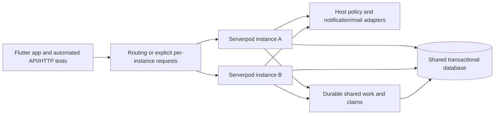
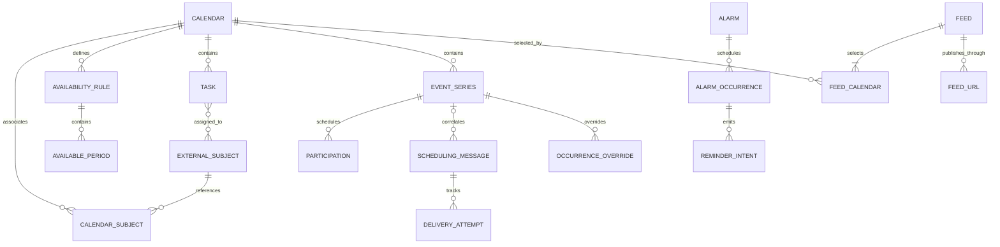

# Proposed architecture

Status: **proposed implementation of maintainer-stated scope**. No module or endpoint exists yet. Target Serverpod 4.x and later.

The primary interface is the Serverpod module and its generated Dart client for host Flutter GUIs. Calendar, task, scheduling and availability-search services exceed the external feed subset. A feed is an explicit publication projection; client display limitations must not narrow canonical storage or native API behavior. See [ADR 0008](adr/0008-module-clients-tasks-and-search.md).

## Module boundaries

| Module | Responsibility | Dependencies |
| --- | --- | --- |
| Calendar core | Alarm trigger/occurrence semantics, calendar/event/task types, temporal/availability rules, recurrence, exceptions, interval/free-busy calculations, domain errors | Pure Dart; evaluated time-zone/recurrence libraries |
| iCalendar adapter | Parse/validate/serialize the declared profile, including VEVENT/VTODO, VTIMEZONE, recurring series, VAVAILABILITY and supported scheduling/free-busy components | Core and evaluated parser |
| Serverpod module | Persistence, transactions, host authorization integration, feed/URL management, alarm lifecycle/due state/reminder outbox, task lifecycle/assignment, list-based availability searches, availability rules/queries and transactional scheduling inbox/outbox | Core and adapter |
| Scheduling core/service | iTIP role validation, message reconciliation and participant state | Core and iCalendar adapter; independent of mail provider |
| iMIP email adapters | MIME encoding/decoding, outbound host delivery and trusted inbound host ingress | Scheduling service, evaluated MIME library and host address policy |
| Notification port/adapter | Submit due reminder intents with cancellation/revalidation and idempotency | Calendar services depend on an abstract port |
| Host/shared notification service | Generic device routing, credentials/provider adapters and delivery retries | Separate reusable module/service; FCM/APNs reference integration |
| Flutter notification integration | Permissions, token lifecycle, presentation, taps and authenticated actions | Host app/platform plugins; no calendar core dependency |
| Feed HTTP adapter | HTTPS GET/HEAD, token validation, representation and conditional requests | Module services and iCalendar adapter |
| Generated client | Full authorized calendar/task/scheduling/search services for Flutter | Generated from module sources |
| Example host/app | Automated host/Flutter integration journeys, external identity/policy adapters, subset feeds and multiple-instance acceptance harness | Actual module/client/migrations; synthetic fixtures; deterministic delivery adapters in CI |

Physical layout follows the pinned Serverpod template selected during scaffolding. Verify the [official module guide](https://docs.serverpod.dev/concepts/server-fundamentals/modules) for that version. CalDAV and general upstream-provider synchronization remain separate adapters. iTIP and iMIP are first-release boundaries; see [standards](standards.md).

## Multiple active instances and automated acceptance

The example host/app is a maintained automated integration-test application as well as a demonstration. [ADR 0018](adr/0018-automated-example-and-multiple-instances.md) requires at least two simultaneously active Serverpod host processes sharing logical storage, with requests and workers able to run on either instance.

Proposed deployment:

Module state, revisions, inbound deduplication and background intent must be durable and shared. Proposed coordination uses transactions, constraints and reclaimable claims with stale-owner protection; select and verify the exact framework/database mechanism during scaffolding. Process-local locks, a singleton assumption and sticky routing cannot supply correctness. Host policy/cache invalidation must prevent successful post-revocation requests on any instance; unchanged feed bytes/configuration must have consistent ETags across nodes.

Automated acceptance uses the actual module, generated client, HTTP routes and migrations, plus Flutter integration journeys. Run competing writes, worker/ingress duplicates, warm-cache revocation, process interruption/restart and cross-instance reads. Deterministic CI mail/push adapters verify intent and retries; separately measured feed-client/mobile push evidence remains required. No multi-instance runtime behavior has been verified yet.

## Proposed relationships

`EXTERNAL_SUBJECT` is a conceptual host-owned identity, not a module table. Calendars and feeds may exist without an active URL; an active feed selects at least one calendar.

## Candidate entities and invariants

- Calendar: ID, name, description, optional color and RFC 7986 publication metadata, revision, timestamps; associations reference external subjects by namespace, kind (`user`/`group`/`room`/`venue`/`equipment`, with approved host extensions), and opaque ID. Multiple associations are allowed. No user/group profiles or memberships are copied into the module. Resource catalog ownership is also proposed at the host boundary. Explicit availability-contribution metadata distinguishes booked subjects from access/management associations; each calendar defines an availability zone for date-only events.
- Host policy adapter: authenticate management callers and decide read/write/manage/publish/free-busy permissions. Associations alone do not grant rights. Resolve current group membership and tenant context server-side; fail closed if resolution fails.
- Event/series: transparency, status/blocking classification, internal identity, source iCalendar UID, globally unique stable publication UID, typed times, recurrence set, revision and persistent export metadata. Distinguish source identity from publication identity so independently imported equal UIDs can coexist in aggregate feeds. Publication UIDs remain stable across URLs and feeds.
- Occurrence override: series reference, original recurrence identity, changed fields or cancellation. Master and overrides share publication UID, differentiated by RECURRENCE-ID. Reject conflicting duplicate components, not legitimate exceptions.
- Zoned times retain local civil time and a zone reference; recurrence is evaluated in that zone. Record time-zone data version. Keep date-only, UTC, and zoned values distinct; explicitly reject unsupported floating times.
- Feed: its own RFC 7986 name/description, stable publication identity and persistent update metadata, optional color, explicit calendar selection, revision and host authorization context. FeedCalendar is a unique join. One calendar can participate in several feeds.
- Feed URL: independent token digest, feed reference, label, creation/revocation metadata. Return the raw generated URL only at creation. Multiple URLs may publish the same feed. Revoking a URL does not delete its calendars or other URLs.
- Availability rules: VAVAILABILITY definitions and AVAILABLE periods, revisions, zone/range/priority/BUSYTYPE metadata; calculate opening/working-hour constraints under RFC 7953 alongside bookings.
- Scheduling state: organizer/attendee calendar addresses and participation, stable protocol UID/version/occurrence identity, inbound processing ledger and transactional outbound intent/delivery state. Free/busy scheduling messages need no event-series reference. These are event/transport metadata, not user/group profiles. Host policy verifies address authority; feed credentials never authorize scheduling writes.
- Task: calendar, UID, title/description, optional typed start/due, priority, lifecycle/completion state, external assignee references and revision. Recurring tasks are required under ADR 0017; define per-occurrence completion, series edits and VTODO constraints; an undated task is not an event. Task dates alone do not block availability; explicit linked-event reservations require a defined policy.
- Alarm/occurrence: event or task reference, recipient reference, trigger and private action state, occurrence/generation key, due/expiry and cancelled/superseded state. Persist reminder outbox intent transactionally; no device tokens, provider keys or user directory in calendar storage. Calendar timing/state and notification provider attempts have distinct owners under ADR 0009.
- Use namespaced tables, referential constraints and expected revisions. Keep application revisions distinct from iCalendar SEQUENCE. Import batches and feed selection changes are atomic.

## Request flows

Management: authenticate caller -> host policy for every target -> validate -> expected revision -> atomic commit. Recheck authorization when changing associations, selection or publication. Never trust client-supplied user/group membership.

Import: bound input -> parse full profile -> resolve known-zone/rule support and validate matching VTIMEZONE definitions (arbitrary custom zones deferred under ADR 0017) -> authorize target -> check series/component identity -> atomic insert. Existing-series imports conflict initially; no implicit upsert. Ordinary export preserves source UIDs; subscriptions use the stable publication identity mapping.

Publish: authenticate manager -> require publish permission for every selected calendar -> create feed/selection and independent secret URL. A combined feed returns one VCALENDAR using the declared subset of selected calendar data, with required zone/recurrence definitions for published events. Tasks, availability rules, workflow state and other non-feed fields remain stored and available through native APIs. It appears as one subscription calendar to the client.

Fetch: validate token and active feed -> revalidate publication authority with host -> read consistent committed snapshot -> deterministic serialization -> evaluate If-Match then If-None-Match with RFC precedence -> 412 on failed If-Match, otherwise 200 with content or bodyless 304. HEAD has equivalent status/headers without a body. A token authorizes only this read surface, never management or writes. Apply fixed ICS/ETag-only HTTP behavior and successful private revalidation versus no-store errors under ADR 0016.

Proposed fail-closed policy: if any selected calendar disappears or publication authority is withdrawn, deny the whole feed until an authorized manager repairs its selection. Do not silently publish an incomplete feed. Validate access before cache/validator handling; suppress shared-cache reuse and redact bearer URLs throughout the serving stack.

Queries expand recurring occurrences only inside explicit bounds and work budgets. Feeds publish masters/exceptions instead of expanding endless recurrence into individual events. Document feed size/history policies before release; do not silently truncate.

Availability: authenticate -> authorize target and complete busy projection -> resolve all availability-contributing calendars -> read snapshot -> RFC 7953 availability-rule composition plus bounded recurrence expansion and exception/status/transparency handling -> clip/merge constrained busy intervals -> derive free gaps with explicit coverage. A missing/denied/incomplete calendar cannot produce an apparently free result. Free/busy-only permission reveals no private event details. Evaluate each calendar independently using its rules, per-calendar no-rule fallback (default free) and bookings. Return separate calendar results under their permissions; an optional host-selected subject summary intersects complete free intervals across all contributors under ADR 0012. Common-free search then intersects subject summaries. Optional iCalendar response uses VFREEBUSY UTC periods; ordinary subscription feeds remain VEVENT output. A free/busy query does not reserve a slot; exclusive booking requires an atomic conflict-check-and-write policy. See [ADR 0006](adr/0006-resource-availability.md).

Scheduling: host-authorize organizer/attendee action or verify trusted inbound iMIP context -> validate MIME/METHOD and component roles -> correlate scheduling UID/occurrence/version -> reconcile state and deduplicate -> atomic event/inbox/outbox commit -> asynchronous host mail delivery with tracked retries. Free/busy requests use the same authorized availability calculation. Unknown/spoofed authority cannot mutate state or trigger automatic responses. Ordinary imports retain their conflict semantics. See [ADR 0007](adr/0007-scheduling-and-email.md).

RFC 7986 descriptive metadata is part of the initial calendar/feed output under [ADR 0014](adr/0014-rfc-extension-decisions.md). Metadata changes affect output and validators; aggregate feeds have their own presentation. Implement the selected RFC 9073 structured metadata, RFC 9074 personal alarm and RFC 9253 relationship profiles; finalize their detailed parser/schema constraints using the RFC tables and ADR 0014 and the RFC tables. These wire-format extensions do not replace external identity links, access policy or availability-contribution semantics. Time-based alarm execution is now explicitly required under ADR 0009; this does not enable proximity, arbitrary external actions or automatic URI fetching.

Availability search: accept subject list + bounded window + optional minimum duration + explicit per-target/common-free mode -> resolve and authorize complete calendars -> apply rules/bookings -> return each target's intervals/coverage or intersect common free intervals. Support selecting available rooms or meeting times for everyone; unknown targets never become free. Flutter renders results via generated client APIs. See [ADR 0008](adr/0008-module-clients-tasks-and-search.md).

Alarm: validate personal alarm -> commit item/alarm change and planning/invalidation intent -> bounded occurrence planner -> due worker with current-generation/access/expiry checks -> generic notification port -> shared provider delivery -> Flutter presentation/actions. Reconcile pending work after crashes; provider acceptance is not display or acknowledgement. See [ADR 0009](adr/0009-alarms-and-notification-boundaries.md) for the recommended module split and first-release push integration.

## Decisions still needed

Define detailed alarm action/expiry and notification-port/device contracts, validate RFC availability-rule precedence and the selected per-calendar fallback/intersection, specify method/property constraints for the selected event/free-busy scheduling methods and identity/trust profiles, inbound/outbound mail adapters, resource/availability association semantics, blocking/group/capacity policy, host authorization/publication lifecycle, deletion behavior, exact recurrence constraints and recurring-task lifecycle, known-zone/alias validation, gap/fold rules, feed limits and client versions. Select compatible SDKs, parser, recurrence engine, zone database, licenses and package layout. See [requirements](requirements.md), [compatibility](compatibility.md), and [ADRs](adr/README.md).
