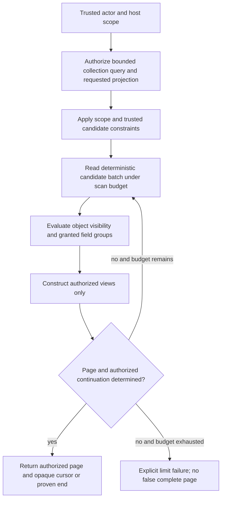

# Authorized queries, disclosure and pagination

Status: **maintainer-confirmed response boundaries; query/adapter algorithms and schemas proposed, not implemented**. See [ADR 0044](adr/0044-authorized-query-projections-and-pagination.md), the [authorization context guide](host-authorization.md) and [operation catalog](authorization-operations.md).

## Confirmed choices

On 2026-10-20 the maintainer selected:

1. Separate event/task detail lists from privacy-safe free/busy responses. No mixed list of detailed events and redacted busy placeholders in the initial API.
2. Initial paginated list APIs return an authorized page and opaque continuation cursor, **without total counts**. Exact authorized totals can be considered later with explicit cost/disclosure rules; raw or denied totals are never exposed through this choice.
3. Hosts control detail disclosure through **predefined field groups**, rather than arbitrary individual-field rules in the initial contract. Each object can receive different granted groups. Exact group names and generated model mappings remain proposed.

These selections do not implement query filtering, approve a cursor encoding/expiry, or guarantee cross-system authorization snapshot consistency.

## Separate result meanings

| Response | What the caller can learn | What it must not imply |
| --- | --- | --- |
| Calendar/event/task detail page | Authorized object identities and permitted field groups | No access to omitted objects, private fields, raw storage records or another recipient's personal state |
| Availability/free-busy response | Authorized target's calculated intervals/classification and complete/unknown coverage | No private event IDs, titles, attendees, source-event counts or unrestricted access to the source calendars/rules |

A detail page may legitimately be empty because no objects are visible. It is **not** evidence that a calendar/person is free. The availability service evaluates all required contributors through its separately authorized busy projection; it must not reuse a caller's filtered detail page as its source. Lack of detail access does not itself prevent an independently permitted complete busy projection. If that projection cannot cover a contributor, report unknown coverage or fail according to the availability contract, never omit the contributor and claim free time.

Availability intervals can be merged/segmented according to busy semantics. The observable number of calculated intervals is not an exported count or one-to-one listing of private source events. Native availability target identities are disclosed only as separately authorized; hidden contributor calendars need not be named. These native API choices do not redefine feed publication or supported iCalendar projections.

## Proposed field-group contract

The module defines a finite set of typed groups for each view. The host chooses permitted groups using trusted actor, operation, actual collection/object and requested projection context. The requested group set is only a request: the module returns its intersection with the policy grant and the view's supported groups. An unknown group fails validation, never defaults to full detail.

Candidate groups for review include:

| Candidate group | Example contents and boundary |
| --- | --- |
| Timing | Authorized event spans/occurrence timing or task start/due; DATE/UTC/zoned semantics remain explicit |
| Title | Native/imported summary, independently grantable from description or location |
| Description | Descriptive text/comments permitted by the view; no hidden preserved metadata escape hatch |
| Location | Location/geo/resource publication labels, without creating host identity or booking authority |
| Participants | Permitted organizer/attendee publication metadata; not host roles/membership |
| Attachments | Authorized attachment references/declared metadata; no content access grant or automatic fetching |
| Relationships | Permitted links/categories/structured references; targets remain independently authorized and private identifiers cannot leak |
| Recurrence | Authorized rule/original-identity/exception information needed by the view; no hidden override details |
| Task progress | Permitted completion/progress state for the requested task/occurrence |
| Task assignments | Permitted assignee references; no host directory/profile or membership disclosure |

These illustrative groups are not an accepted exhaustive field map. Status/classification, revisions, calendar settings and structured metadata still need explicit mapping before schema generation. Do not bundle title with sensitive location/participants merely for convenience. Private alarms, feed credentials, internal scheduling/worker state, trusted ingress metadata and host identity directories are never unlocked by a general event/task detail group.

Object identity itself requires disclosure permission. A readable object's minimal typed envelope can identify the authorized object and indicate which groups were disclosed; exact required fields remain a schema gate. If identity cannot be disclosed, omit/deny the object rather than return a discoverable placeholder. Groups omitted by policy must be distinguishable from groups that were disclosed and contain genuine null/empty values. A proposed explicit disclosed-group mask supplies that distinction; merely setting hidden values to null is insufficient.

Nested collections, linked targets, overrides and mutation receipts must honor their own authorization boundaries. Group grants do not automatically disclose children or referenced private identifiers. Requests must not recover hidden fields through alternate serializers, diagnostic errors, exports or nested response shapes. Mutation responses use the same authorized view construction; write permission does not imply full read access. Read group grants do not grant edit/progress/assignment permissions.

Caller-controlled search/filter/sort inputs can also reveal hidden fields. Initially, only support combinations whose disclosure is authorized; reject unsupported or unauthorized query criteria without revealing matching hidden data. Host-internal ACL constraints can use trusted policy information without exposing it. Sorting tie-breakers, filters and computed fields require explicit mapping and tests, rather than assuming a redacted output alone protects the source.

## Proposed query pipeline

This is a proposal. Trusted candidate constraints reduce database work but do not replace object-specific policy. Batch evaluation should avoid one remote call per field or item where the host can evaluate together. The module retains scope/containment checks even when a host supplies constraints. A host that cannot express its policy as database predicates must still have a bounded evaluation path; do not require hosts to duplicate ACL tables into calendar storage or accept arbitrary client SQL.

The final constraint representation and host batch-policy interface remain open. The initial implementation must support replacing the example policy with genuine object-level rules. A coarse calendar-ID allowlist alone does not satisfy that requirement.

Filtering occurs **before the visible page boundary**. The module may scan several candidate batches to collect an authorized page and, where needed, authorized lookahead. It must not fetch one ordinary database page, remove denied objects and then report the remainder as a complete page/result set. Bound scanned candidates, policy work, recurrence expansion, query window, payload and output independently; a host-defined callback does not remove resource limits.

Page size limits visible results. A proposed page either contains the requested maximum or is a shorter page whose authorized end is proven. If the work budget prevents determining a correct page/continuation, fail explicitly instead of returning an apparently exhausted success or a cursor that exposes only hidden candidate existence. Precise limit/error semantics need implementation review. Availability retains explicit coverage semantics rather than treating its calculated intervals as an ordinary detail page.

## Proposed continuation rules

- Use stable ordering with a unique authorized identity/occurrence tie-breaker. Do not use a client-writable offset as authority or silently skip concurrent changes.
- Bind continuation to the trusted principal/execution context, host scope, operation, requested collections/filters/projection, ordering and relevant data/policy snapshot/version. A cursor is not a permission grant.
- Reauthorize each page and object against current policy. A cursor issued before revocation must not preserve withdrawn access; if safe continuation cannot be maintained after data/policy changes, require an explicit restart rather than claim a consistent result.
- Keep internal scan keys, hidden IDs/counts, policy details and tokens opaque. Signing readable JSON prevents tampering but does not hide its contents; choose an appropriate server-side handle or authenticated confidential encoding during implementation. Numeric size/lifetime/version settings remain unselected.
- Return no `totalCount`, estimated total, denied count or raw candidate count. The page's visible length is observable; clients may count objects they are authorized to retrieve. No denial reason, limit diagnostic or cursor field may expose private source identifiers/counts.
- A null continuation means the authorized result set is exhausted under the declared query/snapshot contract. Determining a continuation must not treat remaining denied candidates as proof of more visible objects. Tampered, replayed-in-another-context, expired or incompatible cursors fail safely; exact error codes remain proposed.

No process-local cursor state alone can be required for correctness across hosts. If using server-side handles, their state must be consistently accessible to independent instances. Pure in-memory cursors and sticky routing cannot satisfy the multi-instance requirements. Snapshot lifetime, transaction isolation and external-policy freshness must be finalized before implementing pagination.

The supported policy guarantee arrangements are selected under [ADR 0045](adr/0045-authorization-consistency-guarantees.md). Exact query snapshot/freshness rules and cursor compatibility still require review; a declared external write guarantee does not turn a cursor into an enduring authorization grant. See [the consistency guide](authorization-consistency.md).

## Future acceptance checks

- [ ] Interleave visible and denied objects; verify stable full visible pages and proven shorter final pages without raw/denied totals.
- [ ] Deny all event details while permitting a complete busy projection; detail page is empty but availability remains correctly occupied. Deny one required busy contributor and verify unknown/failure instead of free.
- [ ] Vary granted field groups per object, including title allowed with description/location/participants denied; distinguish undisclosed from disclosed null/empty values.
- [ ] Reject unknown groups and unauthorized caller filters/sorts; check nested fields, relationships, occurrences, errors and mutation responses cannot reveal hidden data.
- [ ] Exercise expensive/custom batch policies and independent scan/expansion/output limits; budget exhaustion never yields false exhaustion or a private count.
- [ ] Revoke access between pages; replay or tamper with a cursor; change actor/scope/query/projection and verify safe rejection/restart with no retained grant.
- [ ] Continue the same authorized query through two independent hosts; verify shared cursor/snapshot behavior and no process-local allow-cache dependence.

No executable validation is claimed for these proposed services. Calendar domain authorization, policy result/query APIs, model schemas and cursor lifecycle remain unimplemented. See [requirements FR-04/FR-08 and NFR-01/NFR-09](requirements.md), [model proposals](models.md) and [multi-instance acceptance](adr/0018-automated-example-and-multiple-instances.md).

## Selected event occurrence content

[ADR 0106](adr/0106-single-event-content-overrides.md) adds `calendarEvent.changeOccurrenceContent` under `updateEvent`, independently of lifecycle permission. Immutable `eventOccurrenceContentChange` identifies the exact original; currentEvent carries actual parent/current content/overrides, and final `proposedTimingOverrides`/`proposedEventProtocolState` carry the validated result. Expected revisions, durable scope coordination and final declared-guarantee checks remain required. Previews optionally request summary/description/location in addition to timing and require both read and preview disclosure of every requested group. Detail/nested fields and component-version lists hide undisclosed content-only nodes. See [the content guide](event-occurrence-content.md).

## Read-only event source metadata, 2026-10-24

[ADR 0107](adr/0107-read-only-event-source-metadata.md) and [the metadata guide](event-source-metadata.md) add source-preserved CLASS/URL and grouped CATEGORIES/COMMENT/CONTACT with legal annotations. Native editors retain these values; source-only values grant no authority and cause no retrieval. Independent `readEventSource` gates complete export and source replacement, including no-op/final paths. Omitted occurrence metadata inherits and explicit values must match the master; native metadata-only originals preserve timing inheritance and reject lossy export. Nullable server-only JSON fields preserve v2 baseline compatibility, with no new table columns or automatic reset. Broader/native metadata editors and other profiles remain separate. Broader batch verification is recorded in scaffold-validation.md.

## Calendar-wide occurrence pages

Accepted [ADR 0147](adr/0147-bounded-calendar-occurrence-queries.md) implements a dedicated collection query gate plus per-series read/preview authority, mandatory timing/state and optional text groups. Normalized criteria and actual parent/current state enter immutable host context; candidate planning receives the active transaction. Hidden text is never a filter/order key. The [query guide](calendar-occurrence-queries.md) specifies genuine authorized exhaustion, exact data/policy/timezone cursor binding, shared bounds and the remaining external after-check race. Per-series policy cannot claim mixed per-occurrence authority; an empty detail page never establishes free time.
