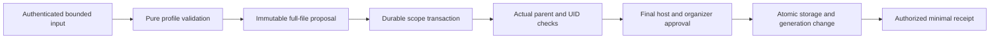

# Create-only availability import and storage contract

Status: **scoped create-only import implemented under ADR 0073; concrete mechanics under draft review**. Date: 2026-10-22. [ADR 0071](adr/0071-create-only-availability-import.md) records accepted product decisions, [ADR 0072](adr/0072-source-preserving-availability-storage.md) implements the storage prerequisite and [ADR 0073](adr/0073-authenticated-create-only-availability-import.md) implements the endpoint. Earlier design sections below record the proposal that led to this implementation; the [implemented operation](#implemented-create-only-operation) is the current API/transaction reference. Export and source reconciliation remain pending.

## Confirmed scope

The maintainer selected create-only authenticated availability import after [wire publication metadata](icalendar-availability-metadata.md). Extend storage first to preserve the entire supported wire value/property profile, including grouped metadata, CONTACT, arbitrary text UIDs and PERIOD additions. Do not solve storage gaps by silently flattening or discarding data, or by introducing a narrower first import shape. Resource/capacity limits still apply.

UID conflicts concern existing active definitions in the destination calendar, not every calendar in a host scope. Preserve source SEQUENCE, DTSTAMP and optional CREATED/LAST-MODIFIED as the initial protocol version, separately from database import time and API revision. Import requires separate host import permission in addition to creation permission for every definition; hosts may map both to the same rule. Source updates, replacement, merging, reconciliation and synchronization remain a later batch. Existing API UUIDs remain native identities, independently of protocol UIDs. The maintainer also confirmed distinct opening UUIDs for native edits and text protocol UIDs for source identity.

The initial input is one bounded standalone Gregorian VCALENDAR accepted by the existing VAVAILABILITY adapter. It may contain multiple definitions and validated known-zone VTIMEZONE data. METHOD, mixed components, unsupported properties/parameters, detached overrides, floating/DATE opening values and unsupported observance forms still reject. No mail, scheduling, alarm activation, feeds, URL retrieval or directory creation follows from import. Raw availability remains authenticated-only.

## Proposed storage model

Names below are candidates, not generated YAML. Keep storage server-only; use explicit writable commands, authorized views and frozen host snapshots. Generate sources and migrations with the pinned toolchain only after model review. The current [Serverpod model guide](https://docs.serverpod.dev/concepts/data-and-the-database/models) distinguishes serializable models from table declarations; neither generated models nor generation establish authorization or semantic validity.

| Logical value/record | Proposed fields and invariants | Change from current storage |
| --- | --- | --- |
| Definition identity | Existing server-generated availability UUID, actual calendar UUID, API revision and deletion marker | Keep native identity and minimal deletion content unchanged |
| Active protocol identity | Exact decoded UID string; destination-calendar lookup data; linked native definition UUID | Replace UUID-only/global protocol-UID assumption; ordinary native creation generates a UID string |
| Opening identity | Stable server-generated opening UUID plus separate exact protocol UID string | Current opening uid doubles as protocol/API identity; split those roles and retain UUID references in edits/protocol checkpoints |
| Category group | Ordered decoded TEXT values, optional LANGUAGE | Ordered groups preserve duplicates, group boundaries and language; replace one flattened native group |
| Repeated text | Decoded TEXT with optional LANGUAGE/ALTREP | Typed COMMENT and import-only CONTACT lists; bind annotations to values rather than parallel positions |
| Availability recurrence | Existing rule/start inclusions/exclusions plus typed PERIOD inclusions | Availability-specific storage maps full core timed recurrence; do not silently enable new event-service writes through a shared DTO |
| Period inclusion | Explicit UTC/named start and either explicit exclusive end or positive nominal duration | Preserve representation/units and original identity; reuse core conflict, zone and whole-second validation |
| Protocol component state | Required source DTSTAMP; optional source CREATED/LAST-MODIFIED; definition-only optional SEQUENCE | Preserve omission and independent source values; native audit times are not source dates |
| Override component state | Original recurrence identity, single/future timing action, source protocol metadata and supplied/omitted legal metadata | Retain accepted exception timestamps and inheritance without fabricating source properties |
| Audit state | Database createdAt/updatedAt and API revision | Import uses current database audit time and revision 1 regardless of source timestamps/version |

Keep singular SUMMARY/DESCRIPTION/LOCATION, legal annotation contexts, organizer/URL/class, registered private values, independent envelope bounds/duration and all existing timing semantics. Authoritative stored state must support semantic reconstruction of every accepted component, including end versus duration forms and omitted override properties. A canonical projection may normalize recurrence filters as the core already does; it must not lose property groups, protocol values, meaningful omission or duration units.

Do not make an original raw ICS blob the source of truth beside mutable canonical data. This proposal stores typed current state and necessary component provenance, not an original-file archive or byte-for-byte formatting promise. Source property case, original folding and physical parameter quoting are syntax-adapter concerns; future export needs a separately authorized deterministic serializer. Do not serialize an old source snapshot after native edits as if it represented current content. Do not duplicate an entire multi-definition input under every definition: deletion must remove that definition's content even if siblings survive.

CONTACT remains import-preserved and read-only through ordinary native editing. Native timing/content replacements must retain it server-side; omission from a writable request cannot clear it. Authorized raw views and host snapshots include it. Native category/comment editing must address typed groups without flattening other groups, dropping annotations or deduplicating imported values. The example must either support those groups or clearly preserve unsupported editing shapes; a single native text box cannot silently rewrite them. Organizer approval, private registration and metadata disclosure remain independently enforced.

## Identity, collisions and deletion

Match decoded protocol UIDs exactly and case-sensitively, without trimming, Unicode normalization or UUID parsing. Master and related override components share one protocol UID and are not duplicate definitions. The existing adapter rejects duplicate definition masters and repeated opening master UIDs across definitions in one input; this import does not relax that snapshot profile. Different imported files/calendars never get merged merely because their UIDs match.

Opening native UUIDs are confirmed. Propose protocol UID uniqueness within its actual definition, with native opening UUIDs serving every API reference. Definition conflict lookup is destination calendar plus exact protocol UID. Copies into other calendars receive new native definition/opening UUIDs while retaining source protocol UIDs. Ordinary native edits never rename protocol UIDs or retarget opening identities.

UID values may exceed a safe PostgreSQL B-tree text-index entry. Do not introduce an undocumented shorter UID limit or assume a unique text index accepts every adapter-supported value. Proposed implementation: a fixed-size UTF-8 UID digest narrows candidates, then exact string comparison under the existing durable scope write lock establishes equality and uniqueness. The digest index is non-unique: distinct UIDs with the same digest coexist and must not be merged or reported as equal. Every native create/import/delete path participates in that shared transaction protocol; do not rely on a process-local set. Physical lookup placement, collation/encoding and constraints require schema review and two-host tests, including an injected digest collision. The digest is an index aid, not an authorization token or the UID itself.

Only active definitions conflict. Deletion removes active identity lookup, protocol content, metadata and component state in the same transaction, leaving the existing content-free native marker. Reimporting that UID afterward creates a new native UUID, not a restore of the deleted object. This follows the selected active-only conflict rule and does not define upstream tombstone/reconciliation semantics.

## Protocol lifecycle after import

Import must not reset source SEQUENCE to zero, replace DTSTAMP with import time, invent CREATED/LAST-MODIFIED, or infer database audit history from source metadata. An omitted source SEQUENCE remains distinguishable from explicit zero, with effective value zero for a later native increment. Openings and their overrides have no SEQUENCE. Preserve each component's independent source timestamps rather than copying a definition timestamp onto every opening.

Source timestamps are untrusted metadata. Retain adapter-accepted values even when they do not resemble the local clock or form a chronological audit history; do not add a createdAt equality/order invariant that rejects the accepted wire profile. They neither authorize writes nor defeat API revision checks.

Proposed local mutation policy: identical normalized state preserves source version/omissions; an actual native change advances definition SEQUENCE once from its effective previous value. At the maximum, reject the change atomically. Set affected protocol modification stamps using whole-second max(database clock, retained relevant stamp, retained LAST-MODIFIED), preserving the existing nondecreasing guarantee even for a future-dated import. Keep source CREATED absent when unknown. Allocate known creation time only for newly created local components; native audit updatedAt still records the actual database clock separately. Unchanged sibling opening components retain their protocol state. The exact affected master/override checkpoint mapping must be reviewed against ADR 0061 before implementation; it must preserve original recurrence identities and timing-only inheritance.

Changing a native occurrence must update its current component state; immutable source provenance cannot substitute for the new component version. Whole-second dates and the [1970–2099 timing profile](adr/0041-whole-second-1970-2100-profile.md) remain unchanged. Protocol time is never the optimistic concurrency token.

## Proposed flow

This diagram is proposed. No successful parser result bypasses the transactional authorization steps. A denied or invalid member prevents the whole batch from committing.

## Authenticated operation (implemented under ADR 0073)

A candidate command contains destination calendar UUID, expected parent revision and bounded ICS bytes. It does not accept actor, scope, host registry, chosen native UUIDs or an authority flag. These are supplied or resolved server-side. No parse-preview token grants later commit permission. Choose final names, ByteData transport representation and size enforcement during API review.

1. Resolve the trusted actor/scope and actual active destination calendar; reject stale parent revision and unauthorized import/create access without disclosing existing rules. A cheap preliminary authority check can bound work before full parsing; it cannot replace the final transactional checks.
2. Parse and validate the entire file using the bounded existing adapter and a registry derived from trusted current module configuration. Do not let clients supply registrations or use a more permissive wire registry than native storage permits. Build immutable canonical proposals and source protocol states. Parse work must be bounded before database writes.
3. In one durable scope transaction, reload/fence the actual parent/revision and policy context. Check complete file duplicates, destination active UID conflicts, storage capacity and every definition/opening invariant. Reestablish checks after any transaction retry; no external side effects occur in callbacks.
4. Require distinct import authority plus ordinary createAvailability authority for every definition, and dedicated organizer approval where present. Host requests include actual parent, import action, full validated proposed content, source UID/protocol state, opening identity mapping and the batch context. Client source addresses never identify the actor or grant access.
5. Perform current extension validation and preliminary/final host decisions for the exact proposals using the declared coordinated or external fresh-check guarantee. No silent downgrade is allowed; an external final check still has the documented after-check revocation race. Expose all import-only and retained component data in the frozen host context.
6. Insert native identities, active content, protocol lookup/state and retained edits atomically. Revision starts at 1. Advance scope generation once for the accepted batch; preserve the parent calendar's own metadata revision/time because this creates children. Any invalid, conflicting, denied, unavailable or over-cap member rolls back the entire file.
7. Return a minimal authorized batch receipt, never an implicit full detail view. Receipt disclosure must use final authorization and cannot expose IDs/counts/UIDs for hidden definitions. Creation and read rights remain independent. A lost response does not justify replaying a cached allow decision; a retry reauthorizes and the same still-active UIDs conflict rather than duplicating definitions.

The implemented receipt and failure mapping is recorded below; its mechanics remain under draft review. A conflict must not expose the hidden conflicting object's UUID, content, revision, count or source value. Denied/out-of-scope destinations retain existing non-disclosure behavior. Do not report rollback after a commit merely because subsequent response delivery failed. Durable request-key/result recovery can follow separately if required; the first operation makes no general exactly-once or outcome-recovery promise.

## Capacity, migration and compatibility gates

The wire defaults are 1 MiB input, 64 definitions, 128 raw AVAILABLE components across a file, 64 overrides per opening series, shared candidate work and 65536 aggregate decoded metadata code points. Existing syntax/date/rule/zone budgets remain active, with raw duplicates charged before normalization. The former native service permitted 16 opening masters per definition. ADR 0072 raised that representational ceiling to 128 masters per definition so every permitted file shape can be represented; the shared 128-raw-component input cap still applies across the entire file. Review the larger persisted shape and query-work accounting before implementation; never silently discard masters. Existing destination capacity and bounded calculation/query limits still apply. Accepting storage does not establish that every expensive query succeeds: limit failures must remain failure/unknown, never free time.

Preserve populated native data in an upgrade: stringify existing protocol UUIDs exactly, retain native UUIDs/revisions, map existing opening UUIDs to stable API IDs and string protocol UIDs, turn the old category group and positional comments into equivalent typed groups, leave CONTACT/period/source-exception data absent, and preserve protocol baselines without read-time writes. Use generated migrations with an explicitly necessary data-preserving JSON/column transformation. Fresh schema and upgrade schema must agree. Do not hand-edit generated models, protocol clients or migration metadata.

The API is unpublished, so reviewed breaking DTO changes are allowed. Update host adapters, generated clients, example editors and fixtures together; stale old full-content payloads must not silently erase new read-only/source metadata. The prerequisite storage batch now follows ADR 0072; the create-only import operation is implemented under ADR 0073 below.

## Requirement coverage

This contract contributes design for FR-06/07/08/18 (interchange, atomic conflicts, host authorization and availability import/export). Storage changes must preserve FR-16/19/26 calculation/search semantics and NFR-09 complete/unknown coverage. Populated generation/migration and two-host/example checks provide the relevant NFR-03/14/15 evidence. None of these requirements becomes complete from documentation alone.

## Required implementation evidence

| Area | Checks required before claiming implementation |
| --- | --- |
| Mapping and retention | Arbitrary Unicode/text UIDs; separate UUIDs; groups/duplicates/annotations; CONTACT through native edits; end/duration/PERIOD forms; override omission/protocol state; immutable host snapshots |
| Protocol lifecycle | Imported explicit/omitted sequence and dates; future/non-ordered stamps; database import time separation; identical saves; actual native edits, affected components and maximum sequence |
| Authorization | Separate import/create rights, current organizer approval, wrong/foreign parents, hidden duplicates, preliminary/final denial and extension failure, declared guarantees and authorized receipts |
| Atomicity and capacity | Late member failure, combined budgets, stale parent, existing destination capacity, no partial rows/generation or parent metadata updates |
| Multiple hosts | Same-calendar duplicate race: at most one commit; different-calendar copies succeed; long UID and injected digest collision; concurrent parent deletion; permission changes and complete post-commit source projection |
| Upgrades and example | Fresh/populated upgrade without identity/data loss; actual generated-client API; synthetic file import UI and subsequent edits; raw source retention not leaked into busy summaries |

Use focused mapping/lifecycle/module tests while building, then broader VM/Chrome/database/two-host/Flutter checks once each agreed implementation batch is complete. Full repository checks are required before a PR becomes ready. This documentation batch requires link/decision/scope checks, not runtime claims.

## Sources and next steps

Primary standards: [RFC 7953 component profile](https://www.rfc-editor.org/rfc/rfc7953.html#section-3.1), [RFC 5545 UID](https://www.rfc-editor.org/rfc/rfc5545.html#section-3.8.4.7) and [change-management properties](https://www.rfc-editor.org/rfc/rfc5545.html#section-3.8.7). These sources define protocol properties; the transaction, lookup and API designs above are repository proposals. See [host authorization](host-authorization.md), [consistency guarantees](authorization-consistency.md), [native protocol lifecycle](availability-protocol-lifecycle.md), [model review gates](adr/0019-model-contracts.md) and the [RFC scope table](rfc/rfc-7953.md).

Review the model/identity/protocol/migration mechanics before changing schema. Source-preserving storage and create-only authenticated import now follow ADRs 0072/0073 with their scoped end-to-end evidence. Source updates/reconciliation, authorized export, other component import, HTTP feeds, scheduling and external-client compatibility remain separate work.

## Implemented storage follow-up

[ADR 0072](adr/0072-source-preserving-availability-storage.md) and [the implementation guide](availability-storage.md) supersede storage-pending wording for the scoped prerequisite/native behaviors. They document exact UID/group/CONTACT/PERIOD and component-version representations, retention, policy context, query caps and upgrade behavior. Authenticated import follows under ADR 0073 below; conversion alone is not authorization or publication.

## Implemented create-only operation

[ADR 0073](adr/0073-authenticated-create-only-availability-import.md) supersedes pending-import wording above for this scoped endpoint. Call `calendarAvailability.importCalendar(CalendarAvailabilityImportRequest(calendarId, expectedRevision, bytes))` through the authenticated generated client. `bytes` is `ByteData` with a 1 MiB decoded-input cap; other parser/zone/metadata/work limits remain active. The HTTP host must also configure an appropriate transport-body cap, including JSON/base64 overhead. This is one standalone supported VAVAILABILITY calendar, not an arbitrary ICS archive or source synchronization service.

The service copies the bounded byte view before awaiting policy code, performs an initial destination/import permission check, validates the full file, then reloads/rechecks the actual parent in the durable scope write transaction. Both preliminary and final checks require import plus per-member create rights. Every content check includes dedicated organizer approval and installed host extension validation. Parse-time extension admission uses only installed names/contexts; it never treats file data as registrations or bypasses current host validators.

Host `CalendarAuthorizationRequest.availabilityImport` carries the frozen full batch after parsing; it is absent during the cheap initial check. Each member has a server-allocated definition UUID, source protocol UID, validated full content/opening UUID mapping, retained edits and independent source protocol state. Member create requests identify their own proposed UUID as well as the actual parent. With configured policy batches smaller than the file, requests are chunked without committing any subset. The declared host coordination guarantee applies across all checks; external fresh-check policies retain the documented revocation race.

Under the shared scope lock, active destination capacity and exact UID conflicts are checked before any inserts. Case and Unicode spelling are preserved. Identical source UIDs in different calendars create distinct native definition/opening identities. A hidden active conflict yields only generic `dependencyConflict`; no existing object identity/content/count is returned. Deleted definitions no longer conflict. Parsing, denied/unavailable policy, failed extension/organizer validation, stale parent, duplicate or over-cap members leave no imported rows or generation changes. Successful import starts revisions at 1, records the actual database import time, retains source protocol versions, increments scope generation once, and leaves parent calendar metadata/revision unchanged.

The result contains `receipts`, an ordered list of minimal member receipts approved by both the final import decision and that member's final create decision. It contains no total, UID, hidden placeholder or implicit detail view. Empty receipts can accompany successful committed creation. Raw read permission is independent. Clients must not infer that an absent receipt means an object was skipped. Retrying reauthorizes and conflicts while those UIDs remain active; lost-response recovery and idempotency keys remain unimplemented.

The example Working hours screen offers an explicit import paste form and synthetic example. It converts text-area newlines to CRLF before UTF-8 encoding and retains a failed input for correction; this conversion is an example UI behavior, not byte-API leniency. No network metadata fetch, scheduling or alarm activation follows import.

No schema change/reset is required by this batch. For future pre-beta changes the maintainer permits breaking models requiring a fresh database; this supersedes any implication above that preserving every unpublished database upgrade is mandatory. Historical migration evidence is retained. Source updates/reconciliation, authorized export, event/task import and HTTP publication remain pending.
