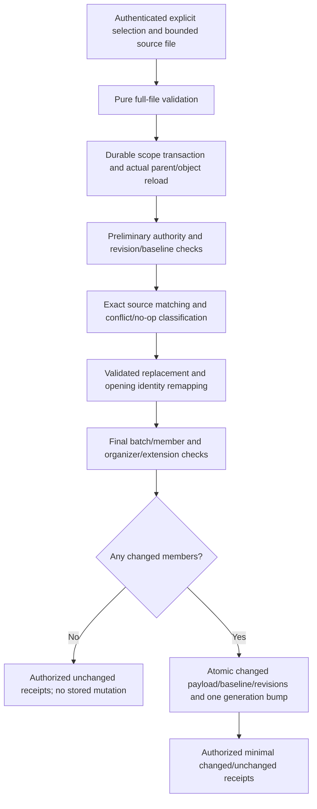

# Explicit availability replacement contract

Status: **scoped implementation under ADR 0076; concrete mechanics under draft PR review**. Date: 2026-10-22. [ADR 0075](adr/0075-availability-update-reconciliation-contract.md) records confirmed product choices; [ADR 0076](adr/0076-availability-replacement-implementation.md) records the approved private active-row snapshot/raw-read choices and concrete implementation. The [implemented operation](#implemented-operation) below supersedes pending wording in the historical design sections. Create-only import and authenticated export remain separate operations.

## Selected first scope

Explicitly replace selected existing definitions within one actual calendar. Supply expected parent/member API revisions and one bounded standalone availability file. The proposed contract requires a one-to-one match between the file's definition masters and the selected active definitions' exact protocol UIDs. Reject missing, extra, repeated, mismatched or foreign members rather than ignoring them or guessing a destination. Related override components are part of their matching definition, not additional replacement targets.

The entire file is atomic. No missing definition is created; no unselected definition is changed or deleted. Missing openings **inside an explicitly selected full definition replacement** are removed, as approved; that is distinct from deleting an unselected definition. No force overwrite, baseline adoption, mixed upsert, upstream fetch, automatic polling, snapshot deletion or scheduling reconciliation is included.

The current Gregorian/whole-second/date/known-zone/strict UTF-8/CRLF profile, supported wire properties and aggregate budgets remain authoritative. Parsing success establishes no authority. Do not flatten recurrence, discard unsupported state or turn a skipped native occurrence with retained restoration timing into a lossy wire exclusion.

## Accepted conflict and version policy

Use three separate kinds of evidence:

| Evidence | Purpose | Never substitutes for |
| --- | --- | --- |
| Expected API revision | Reject a target changed since the caller selected it | Current host authority or source freshness |
| Recorded import baseline | Detect changes to current native content/component state since accepted import | Source identity/ownership proof |
| Last accepted source SEQUENCE | Reject a source counter lower than the accepted one; omission compares as 0 | Native concurrency or permission to overwrite local work |

Source SEQUENCE comparison uses the recorded source version, **not** the locally advanced current protocol version. Preserve omission separately from explicit zero. A lower effective value rejects the whole batch. Equal values may accompany changed data in an explicit clean-target replacement. Higher values remain untrusted and cannot bypass local conflicts. This is a selected application policy, not a claim that standalone RFC files provide a universal merge order.

The maintainer explicitly selected exact incoming component timestamps and omissions on changed replacements, even when they regress. Do not clamp to previous source/local values, invent missing dates or retain an older field that is absent from the incoming replacement. Later native edits use their existing nondecreasing rule relative to this newly accepted state; there is no global nondecreasing timestamp promise across source replacements. API revisions still advance for changed replacements and remain concurrency tokens.

Do not infer relative freshness from DTSTAMP, LAST-MODIFIED, CREATED, source clocks or file order. Equal-sequence replacement can therefore accept an older external file with the same counter when an authorized caller explicitly selects a clean target. The first operation makes no promise to discover that external staleness. Counter-reset recovery remains a separate explicit design.

## Proposed baseline and comparison mechanics

Record an import baseline transactionally on future create-only imports and accepted changed replacements. It represents the last accepted normalized source component state, separate from current native content, API revision and database audit time. Existing native-created or earlier imported rows without evidence are ineligible; do not backfill an assumed baseline from their current state. The maintainer permits fresh pre-beta development/test storage and reimport instead of invented history. No reset is performed or authorized by this document.

Proposed server-only representation: a bounded canonical component snapshot, a canonicalization/profile version, retained source SEQUENCE with omission, and optional accepted-import revision/time for diagnostics. The snapshot contains supported decoded definition/opening/override values and independent protocol states. Use protocol UIDs and original recurrence identities within it; exclude native API UUIDs, database row IDs, audit timestamps and mutation-receipt disclosure. Physical fields/types and whether to use nested JSON or a separately owned active-data row remain review gates.

Canonical comparison must preserve the selected profile's distinctions: UTC versus exact named-zone civil meaning, explicit end versus nominal duration, period additions, recurrence/exclusion/override state, independent component timestamps/omissions, decoded text groups/duplicates/annotations, source-only CONTACT and extensions. Normalize already-defined unordered recurrence/filter values and compare opening/component identities consistently across input ordering. Preserve ordered metadata groups rather than treating them as sets. Native skips/retained restoration state count as local differences even though export cannot represent them.

Use exact normalized comparisons. A digest can narrow or accelerate equality checks; digest equality alone must not establish a no-op or erase a conflict. Baseline canonicalization must be versioned. Unknown/incompatible baseline profiles fail closed until a reviewed transformation/adoption exists, rather than being silently reinterpreted after code or timezone changes. The implementation must define bounded work for normalization/comparison and retain existing query complete/unknown limits.

The baseline can contain source content removed from current data by a local edit. It is private active comparison state, not an ordinary API view, export, historical listing or restore facility. Retain only one accepted baseline per active definition. A new accepted changed source replaces it; deletion scrubs it with all active definition content, leaving only the approved content-free marker. Do not duplicate an entire multi-definition file under every definition. Privacy/retention and policy-context details must be reviewed before schema changes.

### Proposed classification order

After full current authorization, matching and expected-revision checks, require a known baseline and reject a lower source SEQUENCE. Then classify the full normalized incoming state against current and baseline state:

| Current state | Incoming state | Proposed result |
| --- | --- | --- |
| Matches recorded baseline | Matches current | Authorized unchanged/no-op |
| Matches recorded baseline | Differs from current, source version allowed | Replace and record the new baseline |
| Differs from baseline | Differs from current | Reject local-edit conflict, even if incoming equals the old baseline or has a higher SEQUENCE |
| Differs from baseline | Exactly matches full current state | Authorized no-op; preserve the old baseline and its local-conflict protection, without implicit adoption |
| Baseline absent/incompatible | Any input | Reject; no automatic adoption |

This table is a proposal implementing the accepted choices; its exact comparison/API mechanics require review. Equality includes component protocol state, not just visible text or free/busy output. Returning text to its previous spelling does not clear a conflict while protocol/occurrence state still differs. An ordinary native accepted no-op save can advance its API revision without changing canonical content/protocol state; it must not by itself manufacture a local-content conflict.

Identical updates still require current permission, valid source data, matching targets, expected revisions, baseline eligibility and the source-version gate. They leave **all** API revisions, database audit times, protocol state, baseline and scope generation unchanged. A stale retry does not become authorized merely because its bytes match an old request. There is no cached allow decision or generic exactly-once/lost-response recovery promise.

## Native and source identities

Keep definition UUID, actual parent and protocol UID unchanged. Source UID equality is exact and case-sensitive; no trimming, Unicode normalization, case folding, UUID parsing or source-address ownership inference. A selected object's UID cannot be renamed or moved to another calendar by replacement. Same source UIDs in another calendar remain independent copies.

Within a selected definition, match current and incoming opening masters by exact protocol UID. Preserve each matching opening's native UUID, allocate a new server UUID for new source UIDs and remove openings absent from the explicitly authorized replacement. Remap proposed occurrence edits and component checkpoints to their actual retained/new native UUIDs before final host checks. Validate exact original recurrence identities/profile, no orphaned override or cross-definition retargeting, and retained source omission semantics. Source components supply no native UUID or authority.

An opening removed by one accepted replacement and reintroduced later is a new active opening identity; matching only the currently present openings must not restore an old UUID or its former native edits. No hidden opening history/restore feature is proposed. Whole-definition deletion/reimport retains ADR 0071's new-native-definition behavior.

## Authorization proposal

Require the confirmed independent replacement permission, tentatively `replaceAvailabilityFromImport`, in addition to `importAvailability` and applicable existing content/metadata/occurrence permissions. Exact names and change-to-permission mappings are reviewable. Proposed gates also require `readAvailability` for each selected current definition: equality classification, source baselines and conflicts must not become blind content-guessing oracles. Create-only import remains separately usable without replacement authority.

Resolve trusted actor/scope and actual parent/objects server-side. Requests never supply actor, scope, registry, authority flags, baseline, dirty status, native opening UUIDs or trusted source provenance. Expected revision/selection and source bytes are untrusted inputs, not permission grants. Hosts may map several independent module permissions to the same host rule.

Propose immutable full-batch policy context with actual current parent/definitions, current protocol/occurrence state, source-baseline version/eligibility, classification, exact incoming UIDs/source versions, validated final contents/edits, removed and retained/new opening mapping, and the exact replacement action. No arbitrary client-claimed parentage or hidden filtered candidate list participates. Exposure of baseline content versus bounded comparison evidence to trusted host code remains a review gate; do not expose baseline history through ordinary client responses.

Current private-extension registration and dedicated organizer approval apply independently at preliminary/final content checks, including organizer removal/replacement. Source-only CONTACT may change only through this explicitly authorized import path; ordinary native write restrictions remain. Replacement must not become a way to bypass timing, metadata or occurrence permissions by changing those values in a file. Exact permission gates for true no-op members need review; conservative proposal still requires replacement/import/raw-read access, with other edit gates tied to actual changes.

Retain coordinated/external fresh-check guarantees without silent downgrade. Reauthorize every member and the entire batch immediately before mutation under the durable scope transaction. A final external check retains its after-check revocation race. No source SEQUENCE, organizer address, UID, URL, baseline digest or preview token grants authority.

## Proposed transactional flow

The diagram is proposed. Every target is fenced by actual scope/parent/revision under the shared database lock across host processes. Retry callbacks must reestablish every current decision and have no external side effects. Any invalid, mismatched, denied, stale, no-baseline, conflicting, unavailable or over-cap member prevents the whole file from committing.

For changed members, propose advancing the existing native API revision once and recording actual database update time; preserve database creation time, parent calendar metadata/revision and identities. Record incoming source protocol state rather than treating the operation as an ordinary native edit that invents a new local SEQUENCE. The confirmed source-replacement timestamp policy permits regressions/omissions exactly as supplied; later ordinary native edits retain their existing nondecreasing behavior relative to the new state. Do not apply the native-edit clock clamp to a source replacement or invent a local SEQUENCE increment.

If any member changes, advance scope generation once for the committed batch. Unchanged members retain all state and revisions. A wholly unchanged batch has no generation bump. Authorized minimal receipts may identify changed/unchanged results only where final host decisions allow disclosure; no hidden totals, source values, conflicting revisions, baseline snapshots or partial-commit claims. Detailed DTOs/failure codes/receipt mapping remain review gates. Failed response delivery after commit is not rollback; stale retries still reauthorize and follow revision rules.

## Implementation gates and required evidence

Before writing models/endpoints, finalize canonical baseline fields/version/retention, define no-baseline treatment in generated schema, confirm permission/disclosure/receipt mappings and review native identity/override remapping. Fresh databases and breaking APIs are permitted before beta; preserve committed history and use pinned generation rather than hand-editing generated files.

Required tests for the later implementation batch:

- Exact file/selection matching and all-or-nothing late-member failure, including unchanged/changed mixtures and zero partial writes/generation changes.
- True no-op replay, stale retry, native accepted no-op saves, actual native metadata/timing/occurrence changes, skipped/restored state, and no implicit baseline adoption or overwriting from higher sequence values.
- Equal/lower/omitted source sequence compared to the last accepted source version, source timestamps/omissions, confirmed exact-source timestamp policy and maximum-version boundaries.
- No-baseline/incompatible-baseline rejection, bounded canonical exact equality and injected digest collisions if a digest accelerator is introduced.
- Stable current opening UUIDs, new/removal/readdition behavior, original recurrence identities, source metadata/contact/period/end/duration/override retention and no orphan retargeting.
- Independent permissions, actual parent/scope, hidden current/source data, frozen policy context, preliminary/final denial, organizer removal and registry/callback failures, no-op disclosure and external-policy changes.
- Two independent hosts competing to replace/edit/delete, explicit expected-revision winners, baseline/data coherence, generated-client and Flutter update/replay/conflict journeys, relevant fresh database/model checks and the full repository batch checks.

The scoped replacement implementation below supplies its own validation evidence; the preceding list records the original design gates. This contract adds no CalDAV sync, iTIP/iMIP availability-update protocol, HTTP feed, automatic source trust, delivery or real-client interoperability claim. Relevant requirements are FR-06/07/08/18 and NFR-03/14/15; none becomes complete from documentation alone.

Primary sources: [RFC 7953 component grammar](https://www.rfc-editor.org/rfc/rfc7953.html#section-3.1) and [RFC 5545 change-management properties](https://www.rfc-editor.org/rfc/rfc5545.html#section-3.8.7). Source properties do not specify the repository's baseline, host authority, no-op, identity or transaction protocol.

## Implemented operation

`CalendarAvailabilityEndpoint.replaceFromImport` accepts `CalendarAvailabilityReplaceRequest`: actual calendar UUID, expected calendar revision, explicit availability UUID/revision selection and copied `ByteData` source. The immutable selection reuses `CalendarAvailabilityExportSelection`; request bytes are copied using their actual offset/length before awaiting. Input is bounded to 1 MiB and 1–64 unique targets, subject to the existing aggregate wire/storage/query limits. Every source master must match exactly one selected current protocol UID. No source byte, UID, organizer or client identity grants authority.

The server resolves current actor/scope, authorizes the actual parent before parsing, then reloads all selected active definitions in the durable scope transaction. Current member raw-read and replacement authority precede revision/equality/conflict classification. Complete immutable current/proposed batch context is checked before classification and again with changed/local-change results; the historical baseline payload stays private. Final checks repeat import/replacement/raw-read authority, applicable edit rights and dedicated organizer/extension approval, including removals and no-op requests. External fresh checks retain their documented after-check revocation race.

| Change | Additional permission |
| --- | --- |
| Timing, recurrence, priority, closed-time type or opening structure | `updateAvailability` |
| Metadata or component protocol-state changes | `updateAvailabilityMetadata` |
| Opening occurrence timing/cancellation state | `changeAvailabilityOccurrence` |
| True canonical no-op | No edit gate; import, replacement, raw-read and organizer/extension checks still apply |

`CalendarAvailabilityReplacementIntent` carries all current snapshots and validated proposals, profile/source-sequence evidence and nullable pre-classification flags. Each proposal contains complete mapped opening identities, making retained/new/removed comparisons available to the host. It never includes a historical source snapshot. Comparing a source file is not a preview authorization grant.

### Stored comparison state and limits

A nullable `CalendarAvailabilityImportBaseline` is stored only on `CalendarAvailabilityDataRecord`, which is server-only active data. It contains `profile`, exact `canonicalValue` and optional `sourceSequence`. New create-only imports and changed replacements store it transactionally. Old imports and native-created rows remain null and reject replacement with `dependencyConflict`; no migration guesses history or adopts current data. The additive generated JSON-column migration requires no database reset. Reimporting into an empty/different calendar remains create-only import, not identity-preserving adoption.

The current profile is `availability-source-v1/<pinned IANA version>` (currently 2026e); incompatible/corrupt baselines fail closed with `unavailable`. Each canonical payload is limited to 2 MiB UTF-8; wire input and existing aggregate validation budgets independently constrain work. Compare exact strings, without a hash shortcut. Canonicalization excludes native UUIDs/audit fields, maps only opening-reference fields to exact protocol UIDs, sorts map keys/opening/component identities and unordered recurrence date/period lists, and normalizes supported native category representations. It preserves ordered metadata groups/duplicates/annotations, exact zone spelling, end/duration forms, independent source protocol versions/omissions and original occurrence identities. Arbitrary text resembling a UUID is never rewritten.

Only one last-accepted baseline is retained. Local edits leave it intact, even if it contains text removed from current values. Ordinary views/export omit it; active-data deletion scrubs it. Changed replacements replace it. A no-op matching current local data does not adopt or reset the older baseline. A native accepted no-op advances its ordinary API revision without manufacturing a canonical local-content change.

### Mutation and results

Require valid baseline and source-version gates even for no-ops. Lower effective source SEQUENCE rejects; equal values may change clean targets. Source timestamps/omissions are stored exactly, including regressions, while database audit update time remains separate and nondecreasing. Changed members retain creation time and identities, advance API revision once and install complete source content/edits/protocol/baseline. One changed batch advances scope generation once. Parent metadata and unchanged members remain untouched. Absent source openings are removed only within each explicitly selected full replacement; matching current protocol UIDs retain UUIDs, and reintroduced removed UIDs get new UUIDs.

`CalendarAvailabilityReplaceResult` contains only final host-approved `CalendarAvailabilityReplaceReceipt` values: the existing minimal mutation receipt plus `changed`. Final import/replacement/applicable-edit receipt disclosure controls visibility; raw-read receipt flags do not become mutation disclosure flags. There are no totals, baseline payloads or hidden-current-content diagnostics. Failure is atomic, using existing sanitized codes: `staleRevision`, `accessDenied`, `validation`, `dependencyConflict`, `unavailable` or `limitExceeded`. Failed response delivery after commit remains distinct from rollback.

The example offers an explicit per-definition replacement form. It shares the import textarea's visibly documented CRLF conversion, retains input on rejection, and requires reopening after stale revision. It supports authorized replay and reports conflict without overwriting native changes. The API accepts multiple selected definitions; the example form selects one.

Validation evidence is recorded in [the batch validation record](scaffold-validation.md#baseline-aware-availability-replacement-2026-10-22). Broader source adoption/overwrite, synchronization, other component import/export, HTTP feeds, scheduling and external-client interoperability remain outside this increment.
