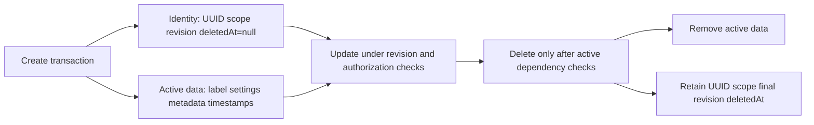

# First calendar schema and native name validation

Status: **maintainer-confirmed name rules and identity/active-data split; generated field/constraint details proposed, not implemented**. See [ADR 0048](adr/0048-calendar-name-validation-and-row-layout.md), [storage roles](calendar-storage.md) and [CRUD contract](calendar-crud-contract.md).

## Confirmed native display-name rules

Native creation/rename uses a trimmed, nonempty, single-line display name with a maximum of **256 Unicode code points**. Reject over-limit input; never truncate it. Preserve internal spacing and Unicode spelling: do not silently case-fold, normalize to NFC/NFD or strip combining marks/emoji joiners. This is a native label policy, not an iCalendar NAME/DESCRIPTION limit or a normalization rule for source UIDs, scope/subject references or exact named-zone keys.

Code points are not UTF-16 code units, bytes or displayed grapheme clusters. A supplementary character can occupy two Dart UTF-16 units but is one code point; a combined emoji or decomposed accented letter can use several code points. UI validation must use the same meaning; the server remains authoritative.

Proposed validation sequence:

1. Enforce bounded raw request/string input before allocating or scanning unbounded text. Exact request-byte caps remain configuration work; a trimmed-name cap is not a substitute.
2. Reject malformed Unicode and text unsupported by the storage/API profile, including NUL. Do not replace invalid sequences with replacement characters and call that preservation.
3. Reject line breaks in the submitted value, including CR/LF, NEL and Unicode line/paragraph separators, before trimming. An invalid multiline name must not become valid merely because its newline was at an edge.
4. Trim surrounding whitespace using a documented deterministic rule. The proposed implementation uses pinned Dart `String.trim()` with VM/Chrome boundary fixtures; do not collapse internal spaces.
5. Reject an empty result or more than 256 Unicode scalar/code-point values; store the trimmed result. Exact field-error codes/messages remain proposed.

The maximum, trim/single-line/nonempty behavior and preservation are selected; exact low-level rejection/whitespace implementation and raw-byte caps still need code review/tests. Name uniqueness, locale collation and localized native-label support are not selected. Initially permitting duplicate labels is proposed; UUID/scope, not display text, identifies a calendar.

## Confirmed two-row layout

Use a small identity row and a separate active-data row. The identity row survives calendar deletion under the selected marker policy; that does **not** select indefinite retention or a purge duration. Do not add label/content/created/updated timestamps to the minimal identity row just for a generic aggregate mixin.

| Identity-row field | Intended contract |
| --- | --- |
| UUID `id` | Native calendar identity; immutable, server generated, no required UUID version; proposed primary key matches the approved minimal marker |
| `scopeKey` | Trusted immutable host scope, checked on every resolution |
| `revision` | Authoritative aggregate revision; advances for active metadata/settings/association changes and deletion |
| `deletedAt` | Null while active; server-set UTC operational deletion time on deletion |

| Active-data contents | Intended contract |
| --- | --- |
| `calendarId` | Required UUID reference to identity, unique so one identity has at most one active-data row |
| `displayName` | Required native label with the selected 256-code-point/trim/single-line rules |
| Availability zone/fallback | Required exact named-zone key and selected free/unavailable fallback semantics |
| Active presentation/protocol fields | Explicit typed data preserving native/protocol/feed boundaries; metadata normalization/child-table detail remains proposed |
| `createdAt`, `updatedAt` | Server-owned active aggregate UTC operational timestamps; not retained on the minimal calendar marker |

The active row is not a second public calendar identity. A toolchain-required internal key, if needed, stays private; shared-key versus separate internal-key implementation must be verified before generation. Do not expose an internal surrogate or maintain competing revisions in the two rows. Scope is authoritative in identity; any duplicated scope/index field requires a consistent schema/service invariant rather than client input.

Proposed database access paths are UUID identity lookup; scope plus identity/deletion state for active resolution; a unique active `calendarId` relation; and unique scoped calendar/subject associations with contributor lookup. Index order, physical module-prefixed names and payload key details remain migration choices. Ordinary queries must require an undeleted identity **and** its active data. Missing payload for an active identity is an invariant failure, not a calendar to expose or a condition to treat as free.

## Transaction and lifecycle invariants

The diagram shows the selected lifecycle and proposed transactional implementation, not existing tables.

- Create both rows in one transaction after all required authorization/validation. Do not expose an identity with missing active data.
- Active updates, association changes and relevant invalidation advance the identity's aggregate revision atomically with their changes. Stale revisions reject; mutable payload is never a revision authority of its own.
- Every dependent create/link/write verifies the actual undeleted identity and participates in the same effective parent/delete coordination. A UUID foreign key to a marker does not establish an active parent.
- Delete checks all active dependencies and current authority/revision, removes active data and sets deletion time/final revision atomically. No archive/restore/cascade/detach workflow is implied. Ordinary APIs never expose marker contents or recreate active data for it.
- Keep delete/child-write ordering correct across hosts and all dependent modules; local locks are insufficient. Deferred/purged marker handling, independent receipt/history retention and authorization decision coordination remain separate explicit contracts.

Serverpod's current [one-to-one guide](https://docs.serverpod.dev/concepts/data-and-the-database/database/relations/one-to-one) documents a unique foreign-key relation with matching parent/child key types. That supports the shape, not a claim that our pinned generated calendar schema or concurrent lifecycle already works. Verify final YAML/relations/indexes/migrations with Serverpod 4.0.4 before implementation claims; do not hand-edit generated protocol/schema files.

## Required future fixtures/checks

| Case | Expected native behavior |
| --- | --- |
| 256 versus 257 ordinary code points | Accept versus reject, without truncation |
| 256 supplementary emoji | Count as 256 code points, not 512 UTF-16 units |
| Decomposed accents/combined emoji | Preserve spelling/joiners and count their constituent code points |
| Outer versus internal spaces | Trim outer; preserve internal spacing; whitespace-only rejects |
| Embedded/edge line breaks, malformed Unicode or NUL | Reject according to reviewed native validation; never repair by truncating/replacing |
| Same label on two calendars | Follow explicitly reviewed uniqueness policy; no accidental identity/name collision |
| Two concurrent creates/updates/deletes | Enforce one active row, authoritative identity revision and no orphan/marker child writes |
| Deleted calendar inspection | Retain exactly marker fields and no active content; ordinary API/cursor cannot discover or restore it |

These are planned checks, not test results. Final text-boundary fixtures, generated models, metadata representation, raw-byte limits, concrete query/authorization/coordination methods, indexes and marker retention/purge still need implementation review. The selected shape does not authorize raw rule/feed/scheduling/alarm schemas prematurely.
