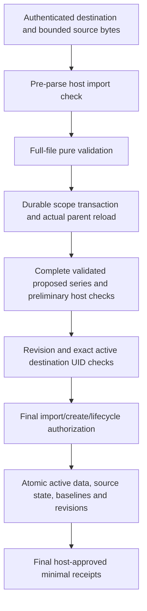

# Create-only VEVENT import and source-preserving storage contract

Status: **maintainer-confirmed product choices; proposed storage/API/lifecycle/transaction mechanics**. Date: 2026-10-22. [ADR 0078](adr/0078-create-only-event-import-and-storage.md) records ten confirmed choices. This is a documentation/design batch: there is no event import endpoint, new model, migration or changed runtime behavior yet. Existing native event services and the pure wire adapter remain implemented within their declared scopes.

## Selected scope and preservation boundary

Extend event storage first, then import a supported standalone event calendar into one explicitly selected calendar as new event series. Retain all supported decoded event-component distinctions: DATE/UTC/exact named zones, end/duration/default forms, RRULE and start/PERIOD additions/exclusions, single cancellation/timing and timing-only THISANDFUTURE components, text/annotations, state-property presence and independent component protocol versions. A master and its occurrence components form one native event series, not separate newly selectable event objects.

Use the current [event/zone profile](icalendar-event-adapter.md), [recurrence and PERIOD profile](icalendar-recurring-masters.md) and [occurrence-component profile](icalendar-occurrence-components.md). Every override requires a matching in-file master; detached components, per-occurrence content differences, future cancellation, floating/non-Gregorian/fractional/leap-second input, unsupported properties/parameters, alarms, scheduling METHOD and mixed unsupported component families reject atomically. No source UID/address/version makes a file trusted or activates invitations, mail, reminders, workers or subscription publication.

The maintainer selected **decoded event preservation, not exact file retention**. Full source VTIMEZONE validation still applies, including unused supplied definitions. Persist event zone identifiers and validated temporal meaning, not the original file's PRODID, unused zones, TZNAME/COMMENT/TZURL decorations or source folding/property order. Future export regenerates the calendar envelope and full-horizon zones from the pinned database. Text values, annotations, source omissions, original identities, explicit end versus duration and duration units remain distinctions to preserve. URI-valued annotations are never fetched. A source-document archive or exact byte round trip is outside this contract.

## Verified current gaps

The following mapping comes from current source inspection, rather than assuming the availability implementation already extends events:

| Area | Current event implementation | Required prerequisite |
| --- | --- | --- |
| Protocol UID | Server-only active record stores a globally unique random UUID; views expose a string | Accept exact supported source TEXT UIDs; active destination-calendar conflict scope; native UUID stays independent |
| PERIOD RDATE | Pure `IcalendarEventRecurrence.timedSet.periods` and core support exist; event content has no periods field | Persist complete exceptional spans and include them in recurrence, override membership, previews and occupied-time calculation |
| Text annotations | Native content stores plain SUMMARY/DESCRIPTION/LOCATION only; wire text also has LANGUAGE/ALTREP | Retain annotations with the corresponding property and disclosure group, including absent versus empty text |
| State presence | Native status/transparency are required with CONFIRMED/OPAQUE defaults; wire values may be absent | Separate effective native values from source property presence |
| Component versions | Active event record has database createdAt/updatedAt; native view lastModified projects administrative time | Preserve independent master/occurrence SEQUENCE/DTSTAMP/optional CREATED/LAST-MODIFIED, without relabeling audit time as source metadata |
| Occurrence state | Native timing overrides retain original identities/cancellation; pure series retains source components and versions | Map exact source anchors, cancellation geometry, range flags, presence/annotations and independent checkpoints without flattening |
| Import baseline | Event active data has no last-source comparison snapshot | One server-only normalized last-import baseline, versioned and scrubbed on active deletion |
| Authorization | Native create/update/status/delete and occurrence actions exist | Separate import gate, per-series create, cancelled-component lifecycle gate and full immutable validated import context |

Availability-specific models/helpers under ADRs 0072–0076 are precedents, not event support. Reuse independent temporal/codec primitives where appropriate; do not store an event as an availability opening or expose availability fields in event APIs.

## Proposed identity and storage mechanics

Retain native event UUID, trusted actual parent UUID, API revision and the existing content-free deletion marker. Change the active protocol UID representation to text. Native-created events continue receiving a stable server-generated UID; ordinary edits never rename it. Imported copies receive new native UUIDs and retain their exact decoded protocol UID. UID equality is case-sensitive, with no trimming, Unicode normalization or UUID parsing.

Match active conflicts by actual destination calendar plus exact protocol UID. A file cannot select another actor/scope, choose native UUIDs, retarget a parent, rename an existing UID or silently become an upsert. A master plus its valid RECURRENCE-ID components share one UID; duplicate masters or duplicate original component identities still reject under the pure profile. Deletion scrubs active protocol content and baseline; later reimport creates a new native UUID rather than restoring a deleted identity. No upstream tombstone, deduplication ledger or scheduling reconciliation is implied.

Long supported UIDs may not fit a PostgreSQL B-tree text entry. Proposed layout uses a fixed-size UTF-8 digest to narrow candidates, with a **non-unique** candidate index and exact string comparison under the durable scope lock. Digest equality alone is neither UID equality nor a uniqueness constraint. Different exact strings with an injected equal digest must coexist. Review whether to repeat actual calendarId in active data or join the identity row; any repeated parent must be server-resolved and kept consistent. Every native create, import and deletion path must participate across hosts. Do not add an undocumented shorter UID limit for index convenience.

Propose typed optional additions to event content for PERIOD spans and text annotations, plus independently validated server-owned component protocol/presence state and a private baseline on the active row. Exact field names, nesting, index columns and generated constraints remain schema-review gates. No raw syntax tree should become a client-writable authority bypass. Existing content/identity deletion discipline and Apache 2.0 license remain unchanged.

## Proposed model responsibilities

These are model responsibilities for schema review, not generated class names or approved field layouts:

| Model responsibility | Proposed values and visibility |
| --- | --- |
| Existing event content extension | Optional typed PERIOD list and summary/description/location annotation values; immutable transport values, context validation and frozen nested collections |
| Active event record extension | Text UID and candidate digest, validated server-owned current component/presence state, and optional private import baseline; active persistence stays server-only |
| Component checkpoint | Master or exact original DATE/UTC/zoned anchor plus single/range identity, independent optional sequence/created/modified and required stamp; source property presence retained separately from effective defaults |
| Authorized view projection | Existing predefined groups extended deliberately: annotations with their text, periods/occurrence identities with timing, effective status/presence with state, and permitted source-version scalars with protocol identity |
| Imported-source baseline | One server-only immutable profile/canonical snapshot/source-counter value per active series; no ordinary transport view or client-writable field |
| Later import command/result | Destination, expected parent revision and copied bytes; final-authorized minimal native mutation receipts; complete validated proposals exist only in trusted host context |

[Current Serverpod model documentation](https://docs.serverpod.dev/concepts/data-and-the-database/models), checked 2026-10-22, supports generated `.spy.yaml` class/value models, nullable fields and server-only visibility. Use `table` only for actual persistence; do not create a new table for every typed value. `immutable: true` makes generated fields final but does not replace defensive freezing/validation of caller-owned collections. Defaults must not erase the selected source-omission distinction, and server-only persistence is not itself field-level endpoint authorization. Keep the pinned 4.0.4 generator/migrations as verification evidence rather than assuming documentation alone validates the concrete schema.

## Effective state, versions and native edits

Omitted source STATUS has effective native CONFIRMED meaning by the maintainer's explicit application rule. Preserve omission so export does not invent `STATUS:CONFIRMED`. This is distinct from asserting an RFC default. Keep source TRANSP omission distinct from explicit OPAQUE while using its opaque behavior. Preserve an absent text property separately from an explicitly empty value and retain its legal annotations.

Import retains the master's and every accepted occurrence component's source SEQUENCE, UTC DTSTAMP and optional CREATED/LAST-MODIFIED exactly, including absent values. Do not derive them from API revision, database import time or a master component's timestamps. A larger counter or later source clock is not freshness or authority. Incoming values do not require monotonically increasing clocks across independent components. Database audit time records actual module persistence separately.

For later native edits, the maintainer confirmed the actual-change lifecycle policy: keep component versions stable for identical normalized content, advance API revisions according to existing accepted-write behavior, increment relevant protocol SEQUENCE only on actual component changes, and keep native-generated protocol timestamps nondecreasing relative to that component's accepted state. Missing source SEQUENCE can compare as zero when a native significant edit is designed, while omission remains retained until such an edit. The significance/no-op/nondecreasing choices are confirmed for events; exact component transition and increment-boundary mechanics remain review gates. Do not infer independent component edits from a master-only change or overflow a source counter.

The maintainer selected documented local initialization for native/legacy checkpoints: use known database audit times and SEQUENCE 0. Existing native records have known administrative creation/modification times, but no tracked protocol SEQUENCE or historical per-occurrence creation time. Do not infer edit counts from API revision, fabricate source history or create a last-import baseline from native data. This local protocol checkpoint must be labeled as initialization; unknown occurrence CREATED remains absent. It is not a last-accepted imported source snapshot and cannot make an object eligible for future source replacement. The current view's `lastModified` means native administrative modification projection. Do not silently reinterpret it as an imported optional LAST-MODIFIED; review an explicit source-version/audit API mapping, including authorized breaking renames if appropriate.

The maintainer confirmed that native text edits retain LANGUAGE/ALTREP until explicit authorized changes/clears. Native edits must preserve other retained source state they do not explicitly change. A plain-text editor cannot silently clear LANGUAGE/ALTREP, PERIODs or component presence/version state. Unsupported editing shapes must be retained server-side or blocked visibly. Define explicit clear/replace actions and permission mapping before exposing them. A master edit must reconcile explicitly repeated matching occurrence text with its inherited content and relevant component versions, rather than producing previously supported components with newly unsupported content differences.

Preserve PERIOD geometry and start identity, not just inclusion starts. They participate in exact original membership, orphan prevention and moved-in/long-interval overlap queries. Earlier additions do not rebase DTSTART/COUNT; exclusions retain precedence. Validate profile compatibility on pattern/timing edits and reject incompatible retained values instead of clearing them silently. Existing explicit-date replacement flags must not acquire an undocumented ability to delete PERIODs. Future occurrence changes remain ordered by original identity, while independent singles remain independent. Cancelled source components must retain their supplied timing/end/duration forms for state restoration and future export; never reduce them to an EXDATE that discards that state.

## Private source baseline

The maintainer confirmed one normalized last-accepted source snapshot inside each imported event's active-data row from the first import. It is separate from current native data/component versions and database audit time. It may retain accepted values later removed by local edits. Never return it in ordinary views, lists, previews, export, mutation receipts or host-field disclosure groups. Deletion scrubs it with the active payload; no archive/restore facility follows.

Propose the bounded exact-comparison approach used for availability: canonical profile/version, normalized component payload and last accepted source counter/omission, with explicit byte/work ceilings. Include source property distinctions, master/occurrence identities, timing forms, annotations and independent versions; exclude native UUIDs/audit data, envelope presentation and regenerated zone artifacts. Tie timezone-dependent comparison to the pinned data profile and reject incompatible profiles in any later update API. Digest equality alone must never erase a future conflict.

Native-created and older rows do not gain an invented imported baseline. Record snapshots transactionally only when an import is actually accepted. Define canonicalization, exact limits and compatibility before implementing this model. Future updates still need their own revision/conflict/source-version/adoption contract; the baseline alone authorizes no replacement. It is one snapshot per series, not a duplicated full multi-event source file.

## Proposed authenticated operation

Propose a bounded request containing actual destination calendar UUID, expected parent API revision and standalone ICS bytes copied before awaiting. Resolve trusted actor/scope server-side. Parse and validate the entire file using the existing strict UTF-8/CRLF, Gregorian, whole-second [1970,2100) and exact full-horizon known-zone profile. Retain existing raw component/explicit-date/candidate budgets before normalization, and review aggregate destination event/override capacity. Do not reinterpret the wire adapter's raw-component cap as a cap on only master rows.

Require the confirmed independent import permission, tentatively `importEvents`, and `createEvent` for each complete series. A CANCELLED master or single cancellation component also requires `changeEventStatus`. Creating a series with timing overrides is still creation of the proposed full series; action-specific gates for existing-object edits must not be accidentally bypassed by future import updates. Exact permission names and initial-override mapping remain API review items. Hosts may map separate permissions to the same rule. Authorize proposed import/create/lifecycle actions before exposing destination UID-conflict outcomes. A create-only import grants no detail/raw-read/export authority; host policy may restrict allowed source UIDs using the full proposal.

Propose immutable full-batch policy context with actual parent/current revision and every server-assigned proposed event identity, exact source UID, validated final content/PERIODs/annotations, original occurrence state, source property presence and component versions. No historical baseline payload or client-claimed actor/parentage is trusted. Cheap pre-parse authority checking does not authorize later writes. Apply preliminary and final per-member/batch decisions under the durable scope transaction; required coordinated/fresh-check guarantees cannot silently downgrade. External checks retain their after-check revocation race.

This diagram is proposed. No member commits if any source, target, policy, identity or budget check fails. One successful changed batch should advance scope generation once and create each event at API revision 1, without changing parent metadata/revision/time. Imported events immediately participate in native previews, occupied-time/free-busy calculation and active-parent deletion dependencies. Cancellation/transparency still control occupancy; source-only metadata never grants authority.

Propose final-authorized minimal receipts with native event/calendar UUIDs and revisions only where disclosed. No raw/hidden totals, source metadata or implicit read access. A lost response after commit is not rollback; a retried create may conflict rather than return the same native object. Exactly-once/idempotency-ledger behavior is not selected. Error DTOs, aggregate limits, receipt shape and disclosure need final review before endpoint generation.

## Implementation gates and acceptance

1. Review typed PERIOD/annotation/component-version/presence/baseline layout, exact candidate index, native/default lifecycle rules and disclosure. Source-version subrecords must not leak hidden summary/location/ALTREP through a protocol-identity-only group; annotations follow their underlying text group and timing follows timing authority.
2. Implement storage prerequisites with validation, snapshot immutability, native edit retention, original-identity/orphan checks, shared bounded preview/free-busy calculations and generated clients/Flutter adaptation. Review legacy initialization and migration/reset scope. Pre-beta breaking changes are allowed; identify development/test targets before any reset and do not rewrite committed ADR history.
3. Verify fresh schema and any selected populated upgrade with pinned generation/migrations. UUID-to-text transforms must preserve spellings and remove incompatible defaults/global uniqueness. Never hand-edit generated clients, protocol/test tools or migration metadata. A SQL-only data-preserving transform must match generated final schema.
4. Add create-only authenticated import only after the prerequisite batch passes. Test unsupported/late-member rejection and all-or-nothing UID/policy/source failures; exact separate-calendar copies; valid master/override grouping; long UIDs and forced digest collisions; source omissions/versions/text annotations/PERIODs/cancellation state; no scheduling/alarm side effects; parent revision/deletion races; current trusted actor/scope and final policy/guarantee failures; hidden receipts and no detail-read inference.
5. Require two independent host/generated-client tests for competing same-destination imports, independent-calendar copies and parent deletion, plus Flutter import/duplicate/rejection journeys. Run focused tests during development, broader VM/Chrome/integration checks once each agreed feature batch is complete, and full repository checks before readiness. Commit code only after the whole batch.

Authenticated current-state event export follows separately with explicit source/projection/disclosure decisions; no event export endpoint is implemented by this contract. Updates/adoption/overwrite, scheduling/iTIP/iMIP, feeds, richer event metadata, per-occurrence content, future cancellation, tasks and alarms retain their separate roadmap scope. No real-client interoperability follows from documentation or pure adapter acceptance.

Sources: [RFC 5545 event envelope](https://www.rfc-editor.org/rfc/rfc5545.html#section-3.6.1), [UID](https://www.rfc-editor.org/rfc/rfc5545.html#section-3.8.4.7), [PERIOD](https://www.rfc-editor.org/rfc/rfc5545.html#section-3.3.9), [RECURRENCE-ID](https://www.rfc-editor.org/rfc/rfc5545.html#section-3.8.4.4) and [source version properties](https://www.rfc-editor.org/rfc/rfc5545.html#section-3.8.7). The standards do not define this repository's host policy, database uniqueness, baseline or import transaction protocol.
