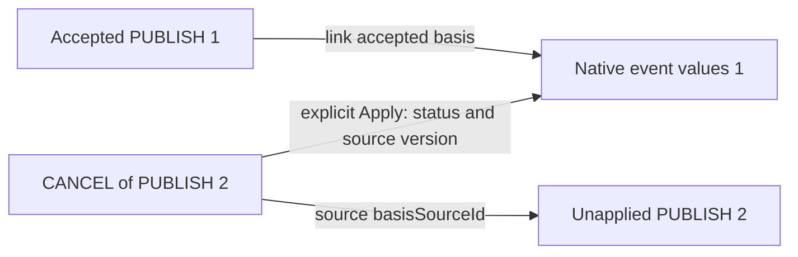

# Incoming event publications

Accepted [ADR 0183](adr/0183-incoming-event-publication-workflow.md) defines a private, optional incoming-publication runtime. The scoped runtime has completed [local batch validation](validation-incoming-event-publications.md). Full exact-head hosted readiness and real-mail interoperability remain separate.

## Review and explicit calendar actions

Trusted receipt creates private review state. It neither books time nor sends a participation reply. Dismissal changes only that review state. Publication inboxes and invitation inboxes have separate tables, host authority and APIs; absence of ATTENDEE never selects a trusted route automatically.

The generated `calendarIncomingPublication` API provides paginated `list`, `getEntry`, `getSource`, `dismiss`, `getLink`, `addToCalendar` and `applySource`. Add requires an explicit destination calendar and its expected revision. One permanent link identifies the resulting imported event. Apply requires the current entry/source identity and expected native event revision. It replaces supported source content only when the entire event series still matches its accepted baseline. Local series or occurrence edits cause a conflict; incoming receipt does not overwrite them.

Whole cancellation preserves the accepted event's timing/content and changes its source protocol status/version. A newer complete PUBLISH can explicitly reopen it. Neither action sends a reply. Native assignments, personal alarms and host identities are independent of source claims.

## Two different cancellation bases

Suppose PUBLISH version 1 was added to a calendar. PUBLISH version 2 then arrives but is not applied. A CANCEL for version 2 can be reviewed and applied without installing version 2's unpublished values into the event.

The cancellation source's nullable `basisSourceId` identifies the complete PUBLISH against which its supplied fields were checked. The link's separate accepted basis identifies the event values to preserve. Both sources are authorized and retained independently. The cancellation source reference targets a PUBLISH in the same private entry, never another cancellation; no reference chain is inferred. Maintenance retains referenced bases under the existing byte/slot caps.

## Host authority

Install `CalendarIncomingPublicationRuntime` with a trusted `CalendarIncomingPublicationHost`. The host resolves the actual delivery recipient/scope and verifies the publisher, delegate and publication purpose. A MIME From header, ORGANIZER address or client-supplied identifier proves none of these facts.

Independent operations cover intake/cancellation intake, list/header/summary/raw-source reads, dismissal, protected link reads, adoption, update, cancellation and reopening. Native calendar/event create/update/lifecycle and complete detail/source permissions also apply. Context includes actual source identity/digest, source and accepted bases, target identifiers and current/final proposed native state. Deleted historical retries expose target identifiers/deletion state without reconstructing pruned source content.

All writes use the shared database scope transaction and preliminary/final authorization. Host guarantees remain explicit: a fresh external check still has an after-check revocation race. Background intake fabricates no signed-in actor.

The host's `CalendarHostContext.policyRevision` must cover publication policy changes as well as ordinary calendar policy changes. Continuations bind that revision and recheck each page's disclosure; a host must not report an unchanged policy revision when the policy represented by it has changed.

## Source profile and retries

The first profile accepts one complete VEVENT PUBLISH master or a known whole-master CANCEL. DATE, UTC, named zones, supported recurrence and PERIOD additions retain their meaning. Times use whole seconds and the ordinary [1970, 2100) profile; supplied VTIMEZONE rules must match the pinned full horizon. Optional source versions remain independently optional. Ordering compares effective SEQUENCE followed by DTSTAMP; an equal tuple with different content is a conflict.

Attendees, VALARM, detached/range components, multiple event series, mode conversions and unprofiled data reject explicitly. Cancellation COMMENT remains source data and does not replace accepted event comments. This bounded profile is stricter than accepting every legal RFC message.

Creation receipts remain stable. Apply retains only the latest command/result; exact retained retries reauthorize without reactivation or another write. Distinct commands cannot reuse another link's command identity. Deleting an event scrubs its native payload and active link proof; a content-free link marker prevents later recreation. Independently received inbox mail follows its own retention policy.

The default limits are 512 KiB per source, 256 entries per recipient, 1,024 per scope, 32 sources and 64 receipts per entry, 16 MiB per recipient, 64 MiB per scope and 2 MiB of link proof. Pages default to 20, cap at 100 and share a bounded raw scan. Terminal retention defaults to 30 days; pinned creation/accepted/basis evidence remains subject to the same caps. Capacity exhaustion rejects atomically.

## Example boundary

The example's separate Published events screen reviews, adds and applies source state. Its development/test fixture composes synthetic MIME and uses an explicitly selected publication-purpose bridge. It accepts no client-provided mailbox authentication proof. Source text is inert; links are not fetched and alarms are not armed. No real sending, provider authentication or participation workflow is implemented by this feature.
