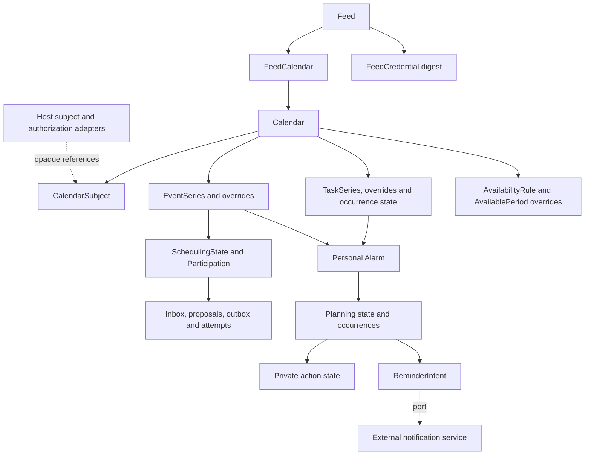

# Proposed model catalog

Status: **proposed domain catalog; bounded pure Dart temporal calculation is implemented**. No generated calendar domain models, tables or migrations exist; framework/authentication scaffolding is separate. See [temporal core](temporal-core.md). Date: 2026-10-19. This catalog translates the [requirements](requirements.md) and latest [RFC feature tables](rfc/README.md) into candidate model contracts. Names, physical storage, field cardinalities and unresolved lifecycle rules require review under [ADR 0019](adr/0019-model-contracts.md). Feature scope is selected; this document does not accept the implementation proposals in earlier ADRs.

## Reading the catalog

The catalog covers reusable values, durable calendar records, generated-client request/response models, internal protocol projections and the external notification boundary. It is a logical schema, not a promise of one table or YAML file per entry. `?` means optional; `List<T>` means a bounded collection, with legal minimum/maximum cardinality validated per component. Required server-managed fields are populated by services, not accepted as authority from clients. `Id` is a conceptual internal identifier: choose its Serverpod/Dart/database representation during scaffolding. `Ref<T>` denotes a constrained reference, not literal Serverpod YAML syntax.

All durable calendar records belong to a server-resolved host isolation scope. Call it `scopeKey: String` here; whether the host uses one scope or tenant isolation is an adapter contract. It must not be inferred from an untrusted payload or confused with a subject's namespace. Parent/child and referenced targets must have compatible scope. Except append-only ledger/attempt records, mutable aggregates have `revision: int`, `createdAt: DateTime` and `updatedAt: DateTime`, using UTC instants. Child writes compare and advance their aggregate revision transactionally; independently writable records also require their own revision. Revision increments, timestamps and publication identities are server-controlled.

Storage records are proposed as server-only. Explicit views expose authorized fields; explicit commands accept only writable fields. A generated model does not enforce authorization, recurrence validity, transaction isolation or uniqueness by itself. Pure Dart semantic types remain independent of Serverpod; mapping to generated transport/storage classes happens at the module boundary.

## Serverpod representation

The current [Serverpod models guide](https://docs.serverpod.dev/concepts/data-and-the-database/models), reviewed 2026-10-19, describes YAML model definitions, generated serializable classes, enums and exceptions. A `table` declaration opts a class into persistence; `serverOnly: true` restricts class generation to the server. Field-level `scope=serverOnly` requires a nullable field. Prefer separate storage and public classes to relying on field hiding for sensitive records. Explicit `serialized: byName` enums avoid index-dependent meaning; unknown security/status inputs must not default to a permissive value.

Illustrative documentation snippets only, **not generation-ready scaffolding**:

```yaml
### Gregorian civil date; validate the actual calendar date in the core.
class: CalendarDate
fields:
  year: int
  month: int
  day: int
```

```yaml
### Private credential material; never returned by management list APIs.
class: FeedCredentialRecord
serverOnly: true
fields:
  tokenDigest: String
  digestVersion: int
  revokedAt: DateTime?
```

The second snippet intentionally omits table, relation and index declarations; the complete logical record is below. Pin compatible Serverpod 4.x-or-later, Dart and Flutter versions before choosing actual model syntax, IDs, relations, indexes, nested-value storage or defaults. Validate generated serialization and migrations with that toolchain. Keep all YAML examples in Markdown until scaffolding; do not hand-edit generated Dart. Model documentation should describe invariants as well as fields using Serverpod's `###` comments. No SDK compatibility or executable validation is claimed here.

## Server-only authorization context proposals

The maintainer confirmed module-enforced, host-defined authorization with collection/object context under [ADR 0043](adr/0043-host-authorization-context.md). These are candidate internal contracts, not persistent tables, generated-client authority fields or finalized adapter signatures. See [the guide](host-authorization.md) for creates, queries, mutations and background/publication paths.

| Candidate context | Information/invariants |
| --- | --- |
| `AuthorizationActorContext` | Host-authenticated principal or trusted purpose-specific execution/publication context and resolved isolation scope; never client-asserted membership or a raw JWT/feed secret |
| `AuthorizationTargetContext` | Typed collection/object references and authoritative parent chain; calendar for contained items, host scope for calendar creation/listing; original recurrence identity for occurrence operations |
| `AuthorizationChangeContext` | Validated proposed fields/references and destinations, distinguishable from the current server-loaded revision/metadata |
| `AuthorizationRequestContext` | Actor, operation, target, relevant current/change/query/disclosure context and eventual transaction/snapshot integration; missing/denied/unresolved policy cannot allow access |

Operation context must preserve the confirmed calendar presentation/availability and task content/progress/assignment separations. A candidate `operation` value comes from the [proposed operation catalog](authorization-operations.md); family identifiers do not bypass specific object/field/action checks. Mixed intents require all applicable permissions against a consistent snapshot before commit. Final enum and adapter result types remain proposed.

A calendar is an item collection, not a general UI group or feed selection. Membership in a grouping or a subject link never grants access automatically. Context loading is internal and scope-limited; callers receive only authorized projections. Default ownership, role inheritance, adapter result/query types and external-policy consistency remain unselected.

## Authorized query/view proposals

The maintainer selected separate detail/free-busy responses, typed field-group disclosure and initial pages with opaque continuation but no totals under [ADR 0044](adr/0044-authorized-query-projections-and-pagination.md). Candidate internal batch decisions carry object visibility and granted groups; a candidate view envelope records disclosed groups so undisclosed content differs from genuine null/empty values. Exact group-to-field mappings, policy result types and minimum envelope fields remain unselected. See [the query design](authorization-queries.md).

No generic storage serializer becomes a response. Calendar/event/task pages contain authorized views only; a missing detail object does not remove it from a separately authorized busy calculation. `totalCount`, estimated/denied/candidate counts are excluded from the initial page contract. Cursor fields and snapshots are protected internal design, not client authority.

## Shared temporal and identity values

Current range/precision is selected in [ADR 0041](adr/0041-whole-second-1970-2100-profile.md): whole seconds, ordinary dates 1970 inclusive to 2100 exclusive, and a special exclusive endpoint. Earlier ADRs retain historical evidence; they do not restore superseded precision/ranges. Proposed generated calendar fields should omit fractional payloads. Native microsecond-named slots currently accept zero only; exact elapsed-microsecond getters are units, not fractional acceptance.


| Model | Candidate fields | Contract |
| --- | --- | --- |
| `SubjectRef` | `namespace: String`, `kind: String`, `externalId: String` | Opaque host reference; built-in kinds user/group/room/venue/equipment plus host-approved kinds. No user profile or membership snapshot. |
| `CalendarDate` | `year: int`, `month: int`, `day: int` | Valid Gregorian date; never represented as midnight UTC. Native value implemented with the maintainer-selected ordinary years 1970–2099, with an explicit exclusive 2100-01-01 endpoint under [ADR 0023](adr/0023-gregorian-date-only-values.md); calendar-day arithmetic and weekdays under [ADR 0026](adr/0026-gregorian-calendar-day-arithmetic.md); transport/storage remain proposed. |
| `CivilDateTime` | `date: CalendarDate`, `hour/minute/second: int`, `microsecond: int` (input must be zero) | Pure native value implemented; seconds 0–59 and whole-second validation under ADR 0041, superseding [ADR 0024](adr/0024-civil-date-time-values.md). Leap second 60 rejected. Not an independently accepted floating time; bounded named-zone resolution is separate under [ADR 0025](adr/0025-bounded-named-zone-resolution.md). |
| `IsoWeekDate` | `weekYear: int`, `week: int`, `weekday: int` | Native derived projection from `CalendarDate` under [ADR 0034](adr/0034-native-iso-week-fields.md): ISO Monday-first weeks, separate week-year and weekday 1–7. Independent of recurrence WKST. No parser, inverse conversion or wire/storage model. |
| `CalendarTime` | `kind: TimeKind`, `utc: DateTime?`, `date: CalendarDate?`, `local: CivilDateTime?`, `zoneRef: Id?` | Exactly one of UTC, date-only, or local plus validated named zone. Reject mixed and floating representations. |
| `CalendarDuration` | `sign: int`, `weeks/days/hours/minutes/seconds: int`, `microsecond: int` (must be zero) | Native unit-preserving value implemented under [ADR 0027](adr/0027-calendar-duration-values.md); portable whole-unit representation bound 2^53−1, nonzero weeks exclusive. Whole seconds/no rounding selected under ADR 0041. Explicit date/calendar-first zoned application under [ADR 0028](adr/0028-duration-application.md); exact explicit-UTC application under [ADR 0039](adr/0039-exact-utc-duration-and-event-spans.md). Context controls sign/zero/unit validity; wire and storage remain pending. |
| `DateEventSpan` | `start: CalendarDate`, `end: CalendarDate?`, `duration: CalendarDuration?`; derived `endExclusive` | Pure-core DATE-only event bounds under [ADR 0035](adr/0035-date-only-event-spans.md), preserving end/duration/default form. Exclusive increasing end; positive days/weeks or implicit one day. Effective end may reach only the explicit 2100-01-01 exclusive boundary. Explicit named-zone occupancy projection is available under ADR 0040; no task or wire/storage integration. Scoped recurrence-span queries are separate under [ADR 0036](adr/0036-date-event-series-overlap.md). |
| `DateEventSeries` | `recurrence: DateRecurrenceSet`, `span: DateEventSpan` | Pure-core uniform-length DATE-only occurrence overlap queries under [ADR 0036](adr/0036-date-event-series-overlap.md). Matching starts required; half-open queries include earlier overlapping starts, retain template form and return complete spans under explicit budgets. No global series identity, timed/override, authorization or wire/storage model. |
| `DateEventException` | `originalStart: CalendarDate`, `replacement: DateEventSpan?` | Explicit cancellation or complete replacement under [ADR 0037](adr/0037-date-only-single-occurrence-exceptions.md). Original DATE identity is retained; no sparse descriptive patch, task or range semantics. |
| `DateEventOccurrence` | `originalStart: CalendarDate`, `span: DateEventSpan` | Native effective occurrence within one series. Actual-start ties retain separate original identities. Not a global series key or authorization proof. |
| `DateEventExceptionSet` | `series: DateEventSeries`, immutable sorted `exceptions: List<DateEventException>` | Bounded validation against the effective recurrence set; reject duplicates/orphan/EXDATE targets. Query base and replacement spans separately, preserve original identity, and enforce shared validation plus raw/base/final query caps. No wire/storage or scheduling reconciliation. |
| `DateEventRangeChange` | `originalStart: CalendarDate`, `replacement: DateEventSpan`; derived signed `dayShift` | Native DATE timing anchor under [ADR 0038](adr/0038-date-only-this-and-future-timing.md); applies shift and replacement length/form to subsequent original dates. No pattern rewrite or range cancellation. |
| `DateEventRangeSet` | `base: DateEventExceptionSet`, immutable sorted `changes: List<DateEventRangeChange>` | Bounded anchor validation and inverse-segment envelope queries. Separate singles are preserved; reject duplicate/excluded/orphan anchors and single/range anchor collisions. Actual starts do not change original order or identity. No timed/task, wire/storage or service semantics. |
| `UtcEventSpan` | `start: DateTime`, `end: DateTime?`, `duration: CalendarDuration?`; derived `endExclusive`, `isPoint`, exact BigInt elapsed microseconds | Native UTC event bounds under [ADR 0039](adr/0039-exact-utc-duration-and-event-spans.md). Strictly later explicit end or positive duration; joint omission is a point with no occupied window. Half-open interval/point queries; preserve input form. Ordinary UTC event bounds follow ADR 0041; explicit projected geometry supports necessary boundary spillover. No recurrence, transport/storage or booking policy. |
| `TimedValue` | explicit UTC or civil plus exact `zoneId`; resolved instant/version | Native typed timed meaning under [ADR 0040](adr/0040-bounded-temporal-core-completion.md), separate from proposed generated `CalendarTime`. Ordinary civil years 1970–2099; explicit end factories permit the midnight 2100 boundary. Zone data includes generated future transitions and preserves unknown-offset failures. |
| `TimedRecurrenceRule` / `TimedRecurrenceSet` | selected timed frequency, canonical filters, UTC until; additions/exclusions/PERIOD spans | Native bounded UTC/zoned generation and union/subtraction under ADR 0040; preserves original COUNT and exclusions. No parser, multiple RRULEs or generated storage. |
| `TimedEventSpan` / `TimedEventSeries` | typed master bounds, recurrence, single exceptions and range changes | Native exact-end versus nominal-duration projections, points, bounded original membership and overlap. Range shifts use original civil identities; singles preserved. No range cancellation or durable revision workflow. |
| `TimedEventOccurrence` | `originalStart`, `actualStart`, resolved `UtcEventSpan` | Both typed starts retained, including requested gap fields; actual instant/original identity ordering. Scoped series context, not persistent identity or authorization. |
| `DateTaskTiming` / `TimedTaskTiming` | optional start, due or duration; recurring start projections | Undated/start-only/due-only allowed; duration requires start/positive units; no inferred due or busy interval. Recurrence timing is separate from completion and per-occurrence edit lifecycle. |
| `ZoneRulesSnapshot` / `ZoneOffsetChange` | finite horizon, initial offset, normalized transitions, exact zone key/version | Guarded native offset agreement only on equal horizons; adapter must validate/expand VTIMEZONE first. Changed version requires host-side recalculation; no durable migration or general coverage claim. |
| `TimeSpan` | `start: CalendarTime`, `end: CalendarTime?`, `duration: CalendarDuration?` | End and duration mutually exclusive. Component rules determine omitted-end semantics, compatible types and positive/zero lengths; date ends are exclusive. |
| `UtcWindow` | `start: DateTime`, `end: DateTime` | Required finite, increasing UTC bounds; half-open query interval. Exact BigInt `elapsedMicroseconds`; `duration` rejects lengths beyond 2^53−1 microseconds under [ADR 0039](adr/0039-exact-utc-duration-and-event-spans.md). Whole-second geometry includes only the declared UTC calculation padding under ADR 0041. |
| `OccurrenceKey` | `seriesId: Id`, `originalStart: CalendarTime` | Identity is the original recurrence start, even after a move. Canonical comparison/key encoding must retain value type and zone semantics. |
| `ByDayValue` | `weekday: Weekday`, `ordinal: int?` | Native weekday/ordinal value implemented under [ADR 0029](adr/0029-date-recurrence-rule-values.md); legal contexts validated by the DATE-only rule. Timed-rule integration is implemented under ADR 0040; wire/storage remain pending. |
| `DateRecurrenceRule` | DATE-only frequency, positive interval, count or date until, week start and date selectors | Pure immutable native parameter validator under [ADR 0029](adr/0029-date-recurrence-rule-values.md). Sorted, duplicate-free filter lists are confirmed; bounded generation is separate under [ADR 0030](adr/0030-bounded-date-recurrence-generation.md), with yearly week numbers under [ADR 0031](adr/0031-date-recurrence-week-numbers.md); wire/storage and timed-rule support remain pending. |
| `RecurrenceRule` | `frequency`, `interval`, `count?`, `until: CalendarTime?`, lists `byDay/byMonthDay/byYearDay/byWeekNo/byMonth/byHour/byMinute/bySetPosition`, `weekStart` | MINUTELY through YEARLY as selected; no SECONDLY/BYSECOND. COUNT/UNTIL exclusivity, RFC combinations, defaults and bounds validated centrally. |
| `RecurrenceDate` | `start: CalendarTime`, `end: CalendarTime?`, `duration: CalendarDuration?` | Retain date/date-time and legal RDATE period forms; exact component profile gates acceptance. |
| `DateRecurrenceSet` | `start: CalendarDate`, `rule: DateRecurrenceRule?`, `inclusions/exclusions: List<CalendarDate>` | Native DATE-only set under [ADR 0033](adr/0033-date-recurrence-sets.md). Earlier inclusions preserved; exclusions win without replenishing COUNT. Construction/expansion budgets are operation parameters, not semantic fields. No wire/storage or timed/PERIOD support. |
| `RecurrenceSet` | `rule: RecurrenceRule?`, `inclusions: List<RecurrenceDate>`, `exclusions: List<CalendarTime>` | No implied multiple RRULE support. Bounded expansion; overrides stored separately. |
| `ProtocolStamp` | `created: DateTime?`, `dtstamp: DateTime?`, `lastModified: DateTime?`, `sequence: int?` | Component-specific requiredness. Persistent ICS metadata, distinct from database timestamps and revision; reads never refresh it. |
| `ComponentIdentity` | `sourceUid: String`, `publicationUid: String?` | Source UID retained on ordinary interchange. Stable globally unique event publication UID shared across feeds/URLs; overrides inherit it. Scheduling UID remains separately correlated. |
| `ZoneDefinition` | `id`, `scopeKey`, `canonicalTzid`, `sourceTzid`, `tzdbVersion`, `validationProfileVersion`, `validatedRange?`, `observances: List<ZoneObservance>`, `sourceUrl?`, `lastModified?` | Durable accepted known-zone definition/metadata. Exact name/alias acceptance and a bounded core resolver are selected under [ADR 0025](adr/0025-bounded-named-zone-resolution.md); canonicalization, imported-rule matching and upgrades remain pending. Reject arbitrary/mismatched rules. No TZURL retrieval. |
| `ZoneResolution` | Requested civil fields, exact `zoneId`, UTC `instant`, unique/fold/gap kind, interpretation/effective offsets, data/profile version | Pure bounded computation result implemented; insufficient coverage fails explicitly. No generated transport/persistence model or VTIMEZONE validation is implied. |
| `ZoneObservance` | `kind: standard/daylight`, `localStart: CivilDateTime`, offsets from/to, names/comments, rule/inclusion dates | Adapter-owned accepted VTIMEZONE structure, with its own legal local-time rules. This does not admit floating event/task values. |

Zone versions participate in calculation/representation generations. Explicit gap/fold and recurrence-candidate policies are selected and implemented only in the bounded resolver under ADR 0025. Complete recurrence handling, component-specific duration/span integration, imported-zone matching and zone upgrade transactions remain prerequisites for schema approval. Scoped DATE-only event bounds under ADR 0035 do not complete those gates. A derived UTC index may accelerate queries but cannot replace canonical civil time or be trusted after its source generation changes. Unbounded series are not expanded into permanent copies.

## Descriptive and extension values

Values below are embedded in or attached to their owning aggregate; normalization into tables is not selected. A shared value type does not permit every property on every component. The RFC tables determine allowed contexts and multiplicity. Preserve parameters attached to the correct property instance, including repeated comments and multilingual calendar names where legal.

| Model | Candidate fields | Validation and disclosure |
| --- | --- | --- |
| `TextValue` | `text`, `language?`, `alternateRepresentationUri?` | Plain text retained; ALTREP is metadata, never fetched. |
| `UriMetadata` | `uri`, `mediaType?`, `label?`, `language?` | Typed URI metadata; context-specific scheme/size/disclosure policy. Never infer a bearer URL. |
| `AttachmentLink` | `uri`, `mediaType?` | Host-managed URI only; no binary content or automatic mail copying. |
| `GeoPoint` | `latitude: double`, `longitude: double` | Valid bounded coordinates; no geocoding. |
| `AddressMetadata` | `calendarAddress`, `commonName?`, `language?`, `directoryUri?`, `email?`, `sentBy?` | Organizer/attendee descriptive claims; trusted authority comes separately from the host. |
| `AttendeeValue` | address metadata, `calendarUserType`, `role`, `participationStatus`, `rsvp?`, `memberAddresses`, `delegatedFrom`, `delegatedTo` | Legal component/method constraints. Group/delegate claims do not grant identity or permissions. |
| `CalendarDescription` | `uid`, names/descriptions as legal text collections, `lastModified`, `url?`, `categories`, `color?`, `refreshInterval?`, `images` | Calendar and aggregate feed each own metadata. Positive polling hint, no client-refresh guarantee. |
| `CalendarImage` | URI/media metadata, `displayHints` | Calendar context only; BADGE/GRAPHIC/FULLSIZE/THUMBNAIL; no fetching or image storage. |
| `ConferenceLink` | `uri`, `features`, `label?`, `language?` | Event/task metadata; hide moderator-only links according to host policy. No meeting provider automation. |
| `StyledDescriptionLink` | URI/media metadata, `language?`, `derived?`, `order?` | URI-only rich content with ordinary plain description retained. |
| `StructuredDataLink` | URI/media metadata, `schemaUri?`, `derived?`, `order?` | No inline payload or schema fetching. ORDER positive where legal. Derived values are read-only to ordinary clients, including marker-clearing attempts. |
| `ExtensionProperty` | `name`, `valueType`, typed value, ordered parameter/value collections, `profileVersion` | Explicit registered-name or trusted host X-name allowlist, component validation and disclosure. Not an arbitrary JSON escape hatch. |
| `ImportPreservedMetadata` | legal CONTACT text collection, calendar SOURCE URI where applicable, validated extension values | SOURCE private, excluded from feeds and ordinary native writes; CONTACT import-only. Preserve through unrelated edits. |

### Structured publication components and relationships

| Model | Candidate fields and ownership | Contract |
| --- | --- | --- |
| `PublishedParticipant` | Stable UID, `participantType`, `calendarAddress?`, legal shared text/URI metadata, child locations/resources | Event/task child. All standard participant categories under the selected profile. Not an attendee, assignment or host identity record. |
| `PublishedLocation` | Stable UID, location type(s), legal name/description/coordinates/URI and structured-data fields | Leaf child of event/task/participant. Participant location disclosure requires participant permission. |
| `PublishedResource` | Stable UID, `resourceType`, legal shared text/URI and structured-data fields | Leaf child; selected ROOM/PROJECTOR/REMOTE-CONFERENCE-AUDIO/REMOTE-CONFERENCE-VIDEO vocabulary. No reservation/catalog creation. |
| `ItemRelationship` | Source item, property kind RELATED-TO/LINK, relation, target kind UID/URI/REFID/CONCEPT, target value, collection context, optional resolved target, `gap?`, label/language/media type | Legal relation/target matrix, signed nominal GAP, independent source/target access. LINK UID stays in one declared collection; cross-collection LINK uses URI. |
| `ItemClassification` | `categories: List<TextValue>`, `conceptUris: List<String>`, `referenceIds: List<String>` | Free-form labels, formal category URIs and grouping keys remain distinct; authorized search only. |

Basic PARENT/CHILD/SIBLING, temporal FINISHTOSTART/FINISHTOFINISH/STARTTOFINISH/STARTTOSTART, FIRST/NEXT, DEPENDS-ON, REFID and CONCEPT relations need explicit validation. They do not execute workflows, change dates or propagate status. XML-REFERENCE remains rejected. Alarm SNOOZE relationships use the private alarm model, not public item relationships.

Enforce bounded legal nesting rather than an arbitrary recursive component tree. Stable child identity, legal shared-property allowlists, missing targets, cycles, deterministic ordering, derived-source authority and privacy-safe publication UID mapping remain review gates. Never copy the full event schema onto every structured child. No lookup of external URI content is implied.

## Calendar, event and task records

All records use the common isolation/revision contract above. Values in this section describe canonical/native capability, independently of feed selection.

| Record | Candidate fields beyond common fields | Relationships and invariants |
| --- | --- | --- |
| `CalendarRecord` | `id`, `description: CalendarDescription`, `availabilityZoneRef`, `noRuleFallback: free/unavailable`, import-preserved metadata | Owns events/tasks/rules. Default fallback free only for completely known unbooked time with no applicable rule. Calendar deletion policy pending. |
| `CalendarSubjectRecord` | `id`, `calendarId`, `subject: SubjectRef`, `contributesAvailability: bool` | Many-to-many host links; unique calendar/subject tuple. Administration/access is host policy, not implied by this flag or link. |
| `EventSeriesRecord` | `id`, `calendarId`, component identity, protocol stamp, `span`, `recurrence?`, `status`, `transparency`, `summary?`, `description?`, `location?`, `geo?`, `resourceLabels`, classification, comments, attachments, URL, organizer/attendee metadata, conferences, structured children, relationships, preserved metadata/extensions | Represents recurring or non-recurring VEVENT. Unique source UID in calendar collection; no title requirement invented for valid imported components. Opaque confirmed events block; tentative mapping remains policy. |
| `EventOverrideRecord` | `id`, `eventSeriesId`, `originalStart`, `range: single/thisAndFuture`, explicit changes, cancellation state, protocol stamp | Unique original occurrence identity per series. Omitted versus cleared fields must differ. Retain cancellations; moved start never replaces original identity. |
| `TaskSeriesRecord` | `id`, `calendarId`, component identity, protocol stamp, optional typed `start/due`, optional `duration`, `recurrence?`, task status, `percentComplete?`, `completedAt?`, `priority?`, summary/description, legal location/classification/notes/URI/participant/structured/relationship metadata | Non-recurring and recurring VTODO; undated tasks allowed. DUE/DURATION constraints and status/progress consistency checked. No implicit availability booking or task mail. |
| `TaskOverrideRecord` | `id`, `taskSeriesId`, `originalStart`, explicit changes, cancellation state, protocol stamp | Sparse exception data, separate from completion state. Exact range/series-edit legality needs task profile review. |
| `TaskOccurrenceStateRecord` | `id`, `taskSeriesId`, `originalStart`, `status`, `percentComplete?`, `completedAt?`, `generation` | Sparse durable progress for touched recurring occurrences, unique series/original identity. Completion must not implicitly complete all future occurrences. Rollover/reopen/export mapping remains unresolved. |
| `TaskAssignmentRecord` | `id`, `taskSeriesId`, optional occurrence identity, `assignee: SubjectRef` | Unique assignment within chosen series/occurrence scope. Host validates allowed user/group targets; no inferred ATTENDEE or iTIP exchange. Per-occurrence assignment semantics pending. |

An event and a task keep independent identities/revisions even when linked. Explicit event time can reserve a block under host policy; task dates/relationships alone cannot. Separate override changes from private lifecycle state so an unrelated item edit cannot reset completion, personal alarms or import-preserved data. A typed change set needs per-field presence/clear semantics; a nullable field alone cannot distinguish omission from removal.

THISANDFUTURE stores an effective change anchored to original recurrence order, preserves distinct overrides, and invalidates affected availability/alarms. This is a logical requirement, not approval of a particular split-series algorithm. Master/exception imports with a shared UID are valid related components. Ordinary imports colliding with existing series conflict atomically rather than upserting.

Both item aggregates also carry optional `confidentiality` (CLASS), legal `priority`, `styledDescriptions: List<StyledDescriptionLink>` and `structuredData: List<StructuredDataLink>`. Confidentiality labels are distinct from `ItemClassification` search/grouping metadata and never grant access. Task metadata includes legal organizer/attendee values for standalone interchange without enabling scheduling mail. Only selected legal property contexts are accepted; event-only resource text and coordinates are not automatically added to tasks.

Feed records, selections, credentials and feed-management models in this catalog belong to the optional HTTP feed module under [ADR 0042](adr/0042-optional-http-feed-module.md). Calendar records/rules and authenticated import/export remain independent of installing feeds; physical schemas and projection/policy contracts remain pending.

## Availability rules and query models

| Model | Candidate fields | Contract |
| --- | --- | --- |
| `AvailabilityRuleRecord` | `id`, `calendarId`, source UID, protocol stamp including sequence, optional effective start/end/duration, `priority`, `busyType`, summary/description/location/categories/comments/contact, organizer/class/URL, legal extensions | VAVAILABILITY envelope can be unbounded. DATE/floating times and nested alarms rejected. Priority is RFC rule precedence, not task importance. |
| `AvailablePeriodRecord` | `id`, `ruleId`, source UID, protocol stamp, required UTC/zoned start, end or duration, recurrence, legal summary/description/location/categories/comments/contact/extensions | AVAILABLE opening definition; no envelope-only organizer/class/URL/sequence fields. |
| `AvailableOverrideRecord` | `id`, `periodId`, original recurrence identity, legal changed period fields | Sparse opening exceptions; same identity and atomicity principles, constrained to RFC 7953 contexts. |
| `AvailabilityTarget` | Exactly one `calendarId` or `subject: SubjectRef` | Deduplicate targets; host resolves the complete set of contributing calendars. No caller-supplied membership or policy override. |
| `AvailabilityQuery` | `targets`, `window: UtcWindow`, `mode: perTarget/commonFree`, optional positive minimum duration, optional subject summaries | Bounded targets/window/work/results. Authentication required; a feed URL grants no query rights. |
| `AvailabilityInterval` | UTC start/end, classification free/busy/tentative/unavailable | No event IDs, titles, attendees or locations. Precedence/merging policy must be deterministic. |
| `CoverageSegment` | UTC start/end, `state: complete/unknown`, privacy-safe reason code | Denied/unresolved/over-limit data never becomes free. Reason granularity must not disclose hidden calendars. |
| `CalendarAvailabilityResult` | Authorized calendar reference, interval list, coverage segments, snapshot reference | Separate calendar results remain distinct; inaccessible contributor identities need not be exposed. |
| `SubjectAvailabilityResult` | Requested subject reference, interval list, coverage, optional authorized calendar results | Summary intersects each contributor after its own rules/fallback/bookings. Missing contributors prevent complete free results. |
| `AvailabilityResult` | Per-target results, optional common-free intervals, common coverage, snapshot metadata, limit diagnostics | Common-free requires complete coverage for every requested target. Empty host resolution is not automatically proof of free time. |
| `CalculationSnapshot` | Opaque snapshot identifier, calculation time, profile/zone versions, consistency/coverage metadata | Opaque client projection; internal dependency revisions kept private. A query is never an exclusive reservation. |

Rules are not fake bookings. RFC priority/range composition runs within each calendar, then bookings are overlaid; opening rules cannot erase bookings. Raw rules are authenticated native/interchange data and excluded from bearer feeds. The per-calendar fallback is module configuration, not an invented RFC property. If expansion limits are hit, return explicit unknown coverage or fail according to the selected API contract, never an apparently complete partial result.

## Feed records and HTTP projection

| Model | Candidate fields | Contract |
| --- | --- | --- |
| `FeedRecord` | `id`, description metadata, `publicationAuthorityRef`, `projectionProfileVersion`, `contentLanguage?`, lifecycle state | Host authority reference, not membership snapshot. Aggregate metadata belongs to feed, not one selected calendar or credential. |
| `FeedCalendarRecord` | `feedId`, `calendarId` | Unique pair; at least one selection for active feed. Whole selection change authorized and revisioned atomically. |
| `FeedCredentialRecord` | `id`, `feedId`, `tokenDigest`, `digestVersion`, `label?`, creation/revocation timestamps, management revision | Digest uniquely identifies a credential; raw token never stored. Proposed minimum 256-bit random secret from ADR 0004. No subscriber identity inferred. |
| `FeedView` | Authorized feed metadata, revision, selected calendar references, credential summaries | No authority internals or digest. List all credentials using nonsecret IDs/labels/state. |
| `CreatedFeedCredential` | Management ID, full bearer URL, creation time | One-time creation result; redact from logs/traces and never return from subsequent lists. |
| `FeedRepresentation` | Internal exact bytes, media type, strong ETag, optional language, serializer/profile/zone version and snapshot dependencies | Derived value, not mandatory table. Private cache must recheck credential and current authority on every request, including 304. |

Proposed missing/unauthorized selection behavior denies the entire feed until repaired. Deleting a selected calendar must not silently cascade the join and publish a smaller feed. Stable source-to-publication UID mapping avoids collisions without changing scheduling identity. Metadata, exceptions, zone definitions, selection and serializer changes participate in deterministic bytes/ETags; fetch time, node ID and bearer URL do not.

GET/HEAD use fixed ICS output and the selected [HTTP profile](adr/0016-subscription-http-profile.md). If-Match precedes If-None-Match after access checks. HTTP request headers/statuses are transport concerns, not extra persistent calendar properties. No HTTP Last-Modified contract, redirect credential mapping or partial-range storage is introduced. Public feed projection excludes tasks, raw rules, SOURCE, personal alarm state and internal workflow data; any further field projection must be explicit and cannot silently alter event meaning.

## Scheduling and import/export models

| Model | Candidate fields | Contract |
| --- | --- | --- |
| `SchedulingStateRecord` | `id`, optional `eventSeriesId`, scheduling UID, organizer identity/address, optional occurrence identity/range, accepted sequence/stamp, cancellation/terminal state | Server-only correlation/order history; retained after event removal as needed to prevent stale resurrection. VFREEBUSY exchanges need no event. |
| `ParticipationRecord` | `id`, scheduling state reference, attendee address/metadata, participation state, accepted response version, delegation state | Per-attendee/occurrence state. Organizer/attendee/acting-sender authority validated by host for every transition. |
| `SchedulingProposalRecord` | `id`, scheduling reference, proposer address, original version/occurrence, proposed fields, disposition and response correlation | COUNTER/DECLINECOUNTER history; proposal does not silently mutate the accepted event. |
| `SchedulingInboxRecord` | `id`, trusted ingress reference, transport message ID?, deduplication key, payload digest, component/method, scheduling UID/occurrence/version, processing status/reason, processedAt? | Server-only durable ledger. Message-ID alone is not semantic deduplication or authority. Untrusted/unsupported input rejects/quarantines without mutation or automatic reply. |
| `SchedulingOutboxRecord` | `id`, logical intent key, scheduling reference/version/method, bounded validated payload or immutable payload reference, verified sender/recipient routing refs, status, attempt count, nextAttemptAt?, claim state | Intent commits with scheduling mutation. Retry preserves original meaning/version; no VTODO message queued. Revalidate current authority and supersession using method-specific policy. |
| `MailDeliveryAttemptRecord` | `id`, outbox ID, attempt number, submittedAt, outcome, adapter receipt?, privacy-safe failure code | Append-only, server-only. Accepted/failed/uncertain are distinct; provider acceptance does not prove receipt. No provider credentials or raw body in diagnostics. |
| `SchedulingMessage` | Component/method, UID, organizer/attendees, sequence/stamp, recurrence identity/range, typed event or free/busy payload, request statuses | Adapter value. VEVENT methods PUBLISH/REQUEST/REPLY/ADD/CANCEL/REFRESH/COUNTER/DECLINECOUNTER; VFREEBUSY PUBLISH/REQUEST/REPLY only. |
| `SchedulingRequestStatus` | Status code, description, optional exception data | RFC method-valid, privacy-filtered status; distinct from native exception codes. |
| `TrustedIngressContext` | Host-verified sender/address authority reference, receiving scope, provenance, policy version | Internal host-created value; not an ordinary generated-client request field. MIME From/SENT-BY text is insufficient. |
| `CalendarEnvelope` | Product/version/Gregorian scale, optional method, calendar metadata, component collection and validated zone definitions | Adapter aggregate for the selected standalone/scheduling/feed projection. Not a general unrestricted component tree or database table. |
| `FreeBusyDocument` | UID/stamp, bounded UTC window, UTC busy periods and types, legal organizer/attendee/status metadata | Calculated export or supported iTIP payload; no RRULE and no standalone file import. |
| `ImportRequest` | Target calendar, expected revision, bounded content, declared supported profile, request identity | Ordinary import is separate from trusted scheduling ingress. No client flag converts import into authorized reconciliation. |
| `ImportResult` | Committed item IDs/revisions, counts, bounded diagnostics | All-or-nothing. No successful partial import or silent dropped data. Imported alarms remain inactive. |
| `ExportRequest` / `ExportResult` | Authorized selection/profile and optional window; content/media type plus profile metadata | Standalone export retains source UIDs and approved private fields only for authorized operation. Feed export is a distinct projection. |

Inbox, scheduling transition and outbox intent commit atomically. Unique logical delivery identities and component/method ordering hold across instances. Retention of cancellation history, quarantine payload policy and counterproposal lifecycle require review; no indefinite raw-mail archive is assumed. MIME transfer encoding/charset/component/method checks belong to the evaluated adapter. Restricted iMIP excludes S/MIME and all task scheduling; mail and push credentials remain host-owned.

## Personal alarms, durable work and notification boundary

| Model | Candidate fields | Contract |
| --- | --- | --- |
| `AlarmRecord` | `id`, stable alarm UID, exactly one event/task parent, recipient SubjectRef?, `trigger: AlarmTrigger`, DISPLAY action/presentation, repeat count/interval?, activation state, generation, approved private metadata | Personal runtime requires host-authorized recipient and activation. Imported definitions may be inactive without a trusted recipient; never auto-arm. Count/interval paired and bounded. |
| `AlarmTrigger` | Kind absolute/relative, absolute UTC instant?, signed CalendarDuration?, anchor start/end/due? | Exactly one form; anchor legal for component. Date-only anchor zone/time and DST policy remain explicit open decisions. |
| `AlarmPlanningStateRecord` | Alarm/series reference, current generation, materialized-through boundary, next refill time, zone/profile versions, claim state | Bounded horizon/refill and crash recovery; not an infinite queue of recurring occurrences. |
| `AlarmOccurrenceRecord` | `id`, alarm ID, original item occurrence identity or explicit non-recurring marker, recipient, generation, repeat ordinal, dueAt, expiresAt?, state | Unique alarm/occurrence/recipient/generation/repeat identity. Current generation, access, cancellation and expiry rechecked before submission/retry. |
| `AlarmActionStateRecord` | `id`, alarm/occurrence/recipient, action revision, acknowledgedAt?, dismissedAt?, snoozedUntil?, snooze-parent UID?, action request identity | Private multi-device state. Acknowledgement is an authenticated action, not a delivery receipt. Exact repeat/snooze interaction and wire mapping pending. |
| `ReminderIntentRecord` | `id`, occurrence ID, stable logical request ID, generation, recipient, channel, safe payload reference, expiry, status, nextAttemptAt?, claim state, notification request/receipt reference? | Durable transactional handoff to notification port; provider/device fan-out is elsewhere. Suppressed/expired/failed/accepted/uncertain states remain distinguishable. |
| `WorkClaim` | `ownerInstanceId?`, `leaseUntil?`, `ownershipGeneration`, `attemptCount`, `availableAt` | Shared durable value on work records; atomic claim/reclaim and fenced stale-owner commits. Shared time or validated skew policy required. |
| `MutationReceiptRecord` | Scope/principal/operation/request key, request digest, result reference, completion/expiry timestamps | Proposed idempotency ledger for retried actions across nodes. Key reuse with different input conflicts; no credentials or unchecked cached authorization. |
| `NotificationIntent` | Stable request ID, recipient reference, generation, safe preview/route IDs, expiry, lifecycle revalidation reference | Port value, not provider-specific calendar storage. Cancellation/access revalidation must apply during downstream retries too. |
| `NotificationOutcome` | Request ID, accepted/suppressed/failed/expired/uncertain, timestamp, safe reason | Port response; acceptance does not establish OS display or human acknowledgement. |

Event/task/zone/alarm changes commit generation invalidation and durable planning/intent state together. Work callbacks are wake-ups; the database remains the record of due work. Lease generations and unique intent keys prevent a reclaimed stale worker from committing over a new owner. External acceptance followed by a crash can still cause redelivery: no end-to-end exactly-once guarantee.

Under [ADR 0020](adr/0020-notification-delivery-scope.md), the reusable notification module and example streaming adapter are in scope; platform delivery implementations are external. The following device/provider models describe optional external integration contracts, not required repository tables. The separate host/shared notification implementation can use logical `DeviceRegistration` (recipient/app/platform/token and active/revoked lifecycle), `NotificationDelivery` (request/device/channel/retry state) and `ProviderAttempt` (attempt/receipt/error/uncertain outcome) contracts, plus host-owned notification preferences. These are **external service responsibilities, not calendar tables**; use an existing service's equivalents where available. Tokens, provider SDK types, credentials and platform permissions do not enter calendar core. Flutter permission/presentation state belongs to the app; authenticated calendar action requests reference opaque current alarm/occurrence IDs.

## Generated-client API model families

These are candidate model families, not implemented endpoint signatures. Create/update inputs contain only the writable subset of the corresponding aggregate. Split create and update types during scaffolding; immutable/server-owned/import-only fields must not become writable through a generic serializer.

| Family | Required request data | Response/data model |
| --- | --- | --- |
| Calendar CRUD | `CalendarCreate`, `CalendarUpdate`, `CalendarDelete`: writable description/settings, ID and expected revision for changes | `CalendarView` with authorized metadata, settings and revision |
| Associations | `CalendarSubjectChange`: calendar ID/revision, validated subject and contribution flag | Authorized association views and new calendar revision |
| Event CRUD/series edits | `EventCreate`, `EventUpdate`, `EventDelete`: content, ID/revision, explicit whole/single/this-and-future scope and original identity where applicable | `EventView`, `EventOccurrenceView` with original and effective times, revision and permitted metadata |
| Event query | `EventQuery`: calendars, bounded window, page size/cursor, approved filters | `EventPage`: occurrences/items, opaque next cursor, snapshot and explicit limit result; stable sort includes identity tie-breaker |
| Task CRUD/query | `TaskCreate/Update/Delete`, `TaskQuery`: authorized calendars/assignees/status/dates/labels, page controls; changes include revision | `TaskView`, `TaskOccurrenceView`, `TaskPage`, retaining undated tasks and private lifecycle filtering |
| Task progress/assignment | `TaskProgressChange`, `TaskAssignmentChange`: item/occurrence, expected revision, permitted values/subjects | Updated task/occurrence view; no implicit booking or scheduling mail |
| Rule CRUD | `AvailabilityRuleCreate/Update/Delete`: envelope/openings, parent revision | Authorized `AvailabilityRuleView`; separate raw-rule export |
| Availability/search | `AvailabilityQuery` above | `AvailabilityResult` above, or authorized calculated `FreeBusyDocument` export |
| Feed management | `FeedCreate/Update`, `FeedSelectionChange`, `FeedCredentialCreate/Revoke`: IDs/revisions and authorized selection/label | `FeedView`, nonsecret `FeedCredentialView`, one-time `CreatedFeedCredential` |
| Scheduling actions | `SchedulingActionRequest`: event or free/busy target, permitted method/action, expected state version, occurrence, request ID | `SchedulingActionResult` and authorized participation/proposal views; trusted authority injected server-side |
| Alarm CRUD/activation | `AlarmCreate/Update/Delete/Activate`: parent/occurrence, recipient validated against caller/policy, trigger/repeat, revision | Private `AlarmView`, `AlarmOccurrenceView`; no device/provider secrets |
| Alarm actions | `AlarmActionRequest`: alarm/occurrence, acknowledge/dismiss/snooze, requested snooze time?, revision and idempotency ID | Current action view and revision, after access/generation validation |
| Import/export | Profile-specific `ImportRequest` / `ExportRequest` | `ImportResult` / `ExportResult`; scheduling has separate ingress |
| Failures | Typed `CalendarException`: code, safe message, permitted field diagnostics, retryability?, current revision only if authorized | Codes for validation, unsupported profile, conflict/stale revision, access/unavailable, limits and temporary failure; no stack traces or private existence leaks |

Initial list pages omit total counts under ADR 0044; detail view groups remain explicit and separate from free/busy. Cursor encoding, snapshot lifetime and limit behavior remain review gates. A page cursor must not bypass current authorization, nor silently skip items after concurrent edits. For mutation retries, a result lookup still checks current authority. Patch inputs require explicit field presence/clear semantics; clients cannot set DTSTAMP, revision, digest, trusted provenance, completion history or derived markers arbitrarily.

Enums should distinguish event/task statuses, participation state, coverage, busy classification, recurrence frequency/weekdays, edit scope, trigger/action, delivery state and protocol method. Avoid one universal status enum or treating unknown values as success/free/authorized. String-backed host kind/vocabulary extensions require server allowlists; they are not open-ended permission or protocol switches.

## Proposed relationships

The diagram omits embedded values and some ledger records for readability; it depicts proposed ownership, not implemented tables. Subject and notification service boxes remain outside calendar persistence.



## Constraints, indexes and transaction boundaries

These are logical obligations; exact database indexes, migrations and locking mechanisms await the pinned toolchain. Do not assume Serverpod model generation alone implements them.

| Area | Required constraint/access path | Atomic boundary |
| --- | --- | --- |
| Scope and containment | Every reference constrained to its authorized scope/parent; required child ownership; no mandatory FK to host identity tables | Parent/child validation plus mutation and revision check |
| Component identity | Calendar/source UID uniqueness; original occurrence identity uniqueness; stable publication UID uniqueness; define event/task cross-kind collision policy before schema | Master, exceptions and accepted metadata imported together |
| Series/task edits | Calendar/time and authorized task-filter access paths; bounded recurrence expansion; derived indexes generation-aware | Series/occurrence lifecycle, revision, affected alarms and output invalidation |
| Associations | Unique calendar/subject; lookup by scope/subject/contribution | Link change, calendar revision, calculation/publication invalidation |
| Availability rules | Rule UID in calendar, opening UID in rule, override identity; range access paths | Envelope/openings and calculation invalidation |
| Feeds | Unique feed/calendar, unique credential digest, lookup by management ID and feed | Selection/metadata/revocation commits; reads use consistent snapshot and current policy |
| Scheduling | Scoped semantic inbox dedup key, correlation/version lookup, unique logical outbox intent | Inbox acceptance, state/event changes and outbound intent |
| Alarms | Unique occurrence/repeat/generation/recipient and logical reminder request; due/state/availableAt lookup | Item/alarm actions, generation invalidation and durable work |
| Work and retries | Claimable state/time indexes; compare ownership generation at commit; unique request receipts | Claim/reclaim/update fenced across processes |

No automatic deletion cascades are approved for feeds, scheduling history, active alarm work or cross-item relationships. Define retention and cleanup after cancellation/revocation effects are durable. Preserve terminal ordering history required to reject replay. Personal state and payload retention policies must be explicit. Search indexes for labels, concepts, reference IDs and assignments require authorized result filtering, including counts.

## Coverage and review gates

| Requirement/source | Models carrying the capability |
| --- | --- |
| FR-01–FR-09; ADRs 0001–0003/0005/0010/0013/0017 | Generated API families, calendars/subjects, events/overrides, typed time, recurrence, zone definitions, import/export and metadata |
| FR-10–FR-14; ADRs 0004/0016 | Feed, selection, credential, one-time URL and deterministic representation |
| FR-15–FR-19/FR-26; ADRs 0006/0012 | Availability contributors, rules/openings, coverage and per-target/common-free results |
| FR-20–FR-23; ADRs 0007/0011/0015 | Scheduling state/participation/proposals, inbox/outbox/attempts, trusted ingress and free/busy messages |
| FR-24; RFCs 7986/9073/9253 and ADR 0014 | Calendar descriptions, structured metadata, URI-only content, classifications and relationships |
| FR-25/FR-27; ADRs 0008/0017 | Task series/overrides/occurrence state/assignments and generated-client views/commands |
| FR-28–FR-31; ADR 0009 and RFC 9074 | Alarm definitions/planning/occurrences/private actions/reminder intents and reusable notification and example streaming contracts |
| NFR-01–NFR-15; ADR 0018 | Authorization/isolation, bounded work, stable identities, revisions, claims, receipts and automated real-host/app evidence |

Before generating schemas, resolve physical normalization/ID types; property cardinalities and component/method allowlists; UID collection scope; typed patch encoding; recurrence range and task lifecycle; zone/DST/duration upgrades; deletion/retention; host publication and scheduling trust; alarm activation/date-only/expiry/snooze policy; snapshot pagination; and claim/retry protocols. The proposed catalog preserves room for these decisions without reopening selected feature scope. It does not introduce CalDAV, journals, arbitrary zones, floating times, task scheduling mail, provider credentials or a module identity directory.

Future validation must use synthetic fixtures and real migrations/generated APIs: semantic round trips without metadata loss; independent native/interchange/feed projections; authorization and forged-reference rejection; stale writes and atomic rollback; task occurrence completion; DST/range edits; privacy-safe incomplete availability; feed revocation before 304; scheduling replay/order; and competing/reclaimed alarm/mail workers. Exercise two independent hosts sharing storage and automated Flutter journeys under ADR 0018. External client and connected notification example evidence remain separate under ADR 0020. Documentation review only checks links, scope/ADR consistency and changed files; no runtime tests have run for these proposed models.
