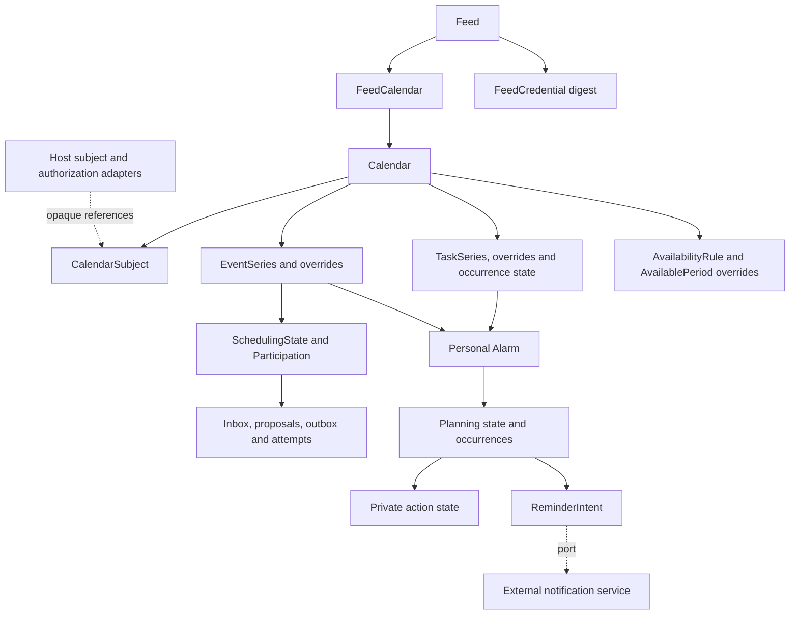

# Proposed model catalog

The [ADR 0117 message profile](itip-message-profile.md) adds immutable pure `IcalendarSchedulingMessage` values, not database tables or generated endpoint DTOs. Optional source timing/version fields remain distinct from durable scheduling state, which still requires its own reviewed storage contract.

ADR 0119 separates the pure envelope from an explicit list of `IcalendarSchedulingEvent` components, preserving each component's optional timing/version and original/range identity. Detached source components grant no parent association, stored membership or authority. This unpublished pure API change requires no database migration or generated client changes.

ADR 0121 adds separate immutable VFREEBUSY envelope/component/period-group values, reusing bounded source metadata and request statuses. They never represent a certified availability partition and introduce no persisted models.

ADR 0120 reuses these pure values for the remaining four selected event methods with independent method constraints; it adds no tables, generated models or native scheduling state.

ADR 0118 adds immutable request-status, exact geographic-position and descriptive resource-group values within that pure message. They remain source metadata with no native identity, reservation, retry or authority mapping.

[First native non-recurring event CRUD](native-single-events.md) now implements scoped event storage/commands/projections under [ADR 0053](adr/0053-first-native-single-events.md). Native recurrence, occurrence timing, free/busy and scoped working-hours composition are implemented in the increments linked below; wire/client interoperability remains pending.

[Native protocol UID and modification time](calendar-protocol-identity.md) add read-only identity/time disclosure under [ADR 0052](adr/0052-calendar-protocol-identity-and-revision-time.md), without parsing/export or feed validators.

Native metadata includes [links, categories, images and refresh hints](calendar-links-and-categories.md) under [ADR 0051](adr/0051-calendar-links-categories-images-refresh.md), including authorized exact category filtering; wire/feed interoperability remains pending.


The basic CRUD slice now also has [native presentation and scoped protocol text metadata](calendar-metadata.md) under [ADR 0050](adr/0050-calendar-presentation-and-protocol-text.md). This adds no wire/feed-client interoperability.


**Current implementation:** the first native calendar CRUD/association slice is described in [the implementation guide](calendar-crud-implementation.md) and [ADR 0049](adr/0049-first-calendar-crud-implementation.md). Broader model/interface proposals below remain future design unless explicitly covered there; this adds no iCalendar/feed-client compatibility.


Status: **proposed domain catalog; bounded pure Dart temporal calculation is implemented**. Generated native calendar CRUD/metadata models and migrations are implemented in the scoped increments linked above; the broader catalog remains proposed. See [temporal core](temporal-core.md). Date: 2026-10-19. This catalog translates the [requirements](requirements.md) and latest [RFC feature tables](rfc/README.md) into candidate model contracts. Names, physical storage, field cardinalities and unresolved lifecycle rules require review under [ADR 0019](adr/0019-model-contracts.md). Feature scope is selected; this document does not accept the implementation proposals in earlier ADRs.

## Reading the catalog

The catalog covers reusable values, durable calendar records, generated-client request/response models, internal protocol projections and the external notification boundary. It is a logical schema, not a promise of one table or YAML file per entry. `?` means optional; `List<T>` means a bounded collection, with legal minimum/maximum cardinality validated per component. Required server-managed fields are populated by services, not accepted as authority from clients. `Id` is a conceptual internal identifier: choose its Serverpod/Dart/database representation during scaffolding. `Ref<T>` denotes a constrained reference, not literal Serverpod YAML syntax.

All durable calendar records belong to a server-resolved host isolation scope. Call it `scopeKey: String` here; whether the host uses one scope or tenant isolation is an adapter contract. It must not be inferred from an untrusted payload or confused with a subject's namespace. Parent/child and referenced targets must have compatible scope. Except append-only ledger/attempt records and the selected minimal deleted-calendar markers under ADR 0047, mutable aggregates have `revision: int`, `createdAt: DateTime` and `updatedAt: DateTime`, using UTC instants. Child writes compare and advance their aggregate revision transactionally; independently writable records also require their own revision. Revision increments, timestamps and publication identities are server-controlled.

Storage records are proposed as server-only. Explicit views expose authorized fields; explicit commands accept only writable fields. A generated model does not enforce authorization, recurrence validity, transaction isolation or uniqueness by itself. Pure Dart semantic types remain independent of Serverpod; mapping to generated transport/storage classes happens at the module boundary.

## Serverpod representation

The current [Serverpod models guide](https://docs.serverpod.dev/concepts/data-and-the-database/models), reviewed 2026-10-19, describes YAML model definitions, generated serializable classes, enums and exceptions. A `table` declaration opts a class into persistence; `serverOnly: true` restricts class generation to the server. Field-level `scope=serverOnly` requires a nullable field. Prefer separate storage and public classes to relying on field hiding for sensitive records. Explicit `serialized: byName` enums avoid index-dependent meaning; unknown security/status inputs must not default to a permissive value.

Illustrative documentation snippets only, **not generation-ready scaffolding**:

```yaml
### Gregorian civil date; validate the actual calendar date in the core.
class: CalendarDate
fields:
  year: int
  month: int
  day: int
```

```yaml
### Private credential material; never returned by management list APIs.
class: FeedCredentialRecord
serverOnly: true
fields:
  tokenDigest: String
  digestVersion: int
  revokedAt: DateTime?
```

The second snippet intentionally omits table, relation and index declarations; the complete logical record is below. Pin compatible Serverpod 4.x-or-later, Dart and Flutter versions before choosing actual model syntax, IDs, relations, indexes, nested-value storage or defaults. Validate generated serialization and migrations with that toolchain. Keep all YAML examples in Markdown until scaffolding; do not hand-edit generated Dart. Model documentation should describe invariants as well as fields using Serverpod's `###` comments. No SDK compatibility or executable validation is claimed here.

## Server-only authorization context proposals

The maintainer confirmed module-enforced, host-defined authorization with collection/object context under [ADR 0043](adr/0043-host-authorization-context.md). These are candidate internal contracts, not persistent tables, generated-client authority fields or finalized adapter signatures. See [the guide](host-authorization.md) for creates, queries, mutations and background/publication paths.

| Candidate context | Information/invariants |
| --- | --- |
| `AuthorizationActorContext` | Host-authenticated principal or trusted purpose-specific execution/publication context and resolved isolation scope; never client-asserted membership or a raw JWT/feed secret |
| `AuthorizationTargetContext` | Typed collection/object references and authoritative parent chain; calendar for contained items, host scope for calendar creation/listing; original recurrence identity for occurrence operations |
| `AuthorizationChangeContext` | Validated proposed fields/references and destinations, distinguishable from the current server-loaded revision/metadata |
| `AuthorizationRequestContext` | Actor, operation, target, relevant current/change/query/disclosure context and eventual transaction/snapshot integration; missing/denied/unresolved policy cannot allow access |

Operation context must preserve the confirmed calendar presentation/availability and task content/progress/assignment separations. A candidate `operation` value comes from the [proposed operation catalog](authorization-operations.md); family identifiers do not bypass specific object/field/action checks. Mixed intents require all applicable permissions against a consistent snapshot before commit. Final enum and adapter result types remain proposed.

A calendar is an item collection, not a general UI group or feed selection. Membership in a grouping or a subject link never grants access automatically. Context loading is internal and scope-limited; callers receive only authorized projections. Default ownership, role inheritance and adapter result/query types remain unselected. [ADR 0045](adr/0045-authorization-consistency-guarantees.md) selects support for declared coordinated/external guarantees; concrete consistency mechanisms/defaults remain proposed.

## Authorized query/view proposals

The maintainer selected separate detail/free-busy responses, typed field-group disclosure and initial pages with opaque continuation but no totals under [ADR 0044](adr/0044-authorized-query-projections-and-pagination.md). Candidate internal batch decisions carry object visibility and granted groups; a candidate view envelope records disclosed groups so undisclosed content differs from genuine null/empty values. Exact group-to-field mappings, policy result types and minimum envelope fields remain unselected. See [the query design](authorization-queries.md).

No generic storage serializer becomes a response. Calendar/event/task pages contain authorized views only; a missing detail object does not remove it from a separately authorized busy calculation. `totalCount`, estimated/denied/candidate counts are excluded from the initial page contract. Cursor fields and snapshots are protected internal design, not client authority.

## Authorization decision/transaction proposals

[ADR 0045](adr/0045-authorization-consistency-guarantees.md) confirms support for both coordinated and external fresh-check host policies with declared guarantees and no silent downgrade. Candidate server-only decision evidence binds the actor/scope, operation, targets/revisions, validated change, attempt and guarantee/freshness context; exact types, persistence and validity rules remain proposed in [the consistency guide](authorization-consistency.md). A version label or same-database read alone is not a commit/revocation fence.

Mutations compare revisions, reestablish authorization on retries and commit domain changes/invalidation/outbound intent atomically; external dispatch and response disclosure have separate current checks. Required operation profiles, mode defaults, deadlines and coordination mechanisms must be specified before model/schema implementation. No client payload or cached receipt can assert authority.

## First calendar adapter/CRUD proposals

[Adapter methods](authorization-adapter-contract.md) specify proposed context resolution, keyed batch decisions, query planning and guarded commit responsibilities. [ADR 0046](adr/0046-first-native-calendar-crud-contract.md) confirms nonempty native creation name, explicit named creation availability zone and active-dependency deletion rejection. The [CRUD contract](calendar-crud-contract.md) preserves separate presentation/settings/association gates and revision checks. [ADR 0047](adr/0047-calendar-names-identifiers-and-deletion-storage.md) selects separate native/protocol names, native server UUIDs without a version requirement and minimal deletion markers. Command/view types, name validation, physical active/marker layout, retention duration and coordination remain review gates.

## Calendar identity/active-data schema refinement

[ADR 0048](adr/0048-calendar-name-validation-and-row-layout.md) selects outer-trimmed, nonempty/single-line native labels capped at 256 Unicode code points and separate identity/active-data rows. The logical `CalendarRecord` aggregate below is not a third physical table. Its revision belongs to identity; active timestamps and calendar content belong to payload. `CalendarDeletionMarker` is the deleted identity state, not a third marker table. See [the concrete schema proposal](calendar-schema.md). Low-level validation, generated keys/relations/indexes, metadata storage and lifecycle coordination remain pending.

## Shared temporal and identity values

Current range/precision is selected in [ADR 0041](adr/0041-whole-second-1970-2100-profile.md): whole seconds, ordinary dates 1970 inclusive to 2100 exclusive, and a special exclusive endpoint. Earlier ADRs retain historical evidence; they do not restore superseded precision/ranges. Proposed generated calendar fields should omit fractional payloads. Native microsecond-named slots currently accept zero only; exact elapsed-microsecond getters are units, not fractional acceptance.


| Model | Candidate fields | Contract |
| --- | --- | --- |
| `SubjectRef` | `namespace: String`, `kind: String`, `externalId: String` | Opaque host reference; built-in kinds user/group/room/venue/equipment plus host-approved kinds. No user profile or membership snapshot. |
| `CalendarDate` | `year: int`, `month: int`, `day: int` | Valid Gregorian date; never represented as midnight UTC. Native value implemented with the maintainer-selected ordinary years 1970–2099, with an explicit exclusive 2100-01-01 endpoint under [ADR 0023](adr/0023-gregorian-date-only-values.md); calendar-day arithmetic and weekdays under [ADR 0026](adr/0026-gregorian-calendar-day-arithmetic.md); transport/storage remain proposed. |
| `CivilDateTime` | `date: CalendarDate`, `hour/minute/second: int`, `microsecond: int` (input must be zero) | Pure native value implemented; seconds 0–59 and whole-second validation under ADR 0041, superseding [ADR 0024](adr/0024-civil-date-time-values.md). Leap second 60 rejected. Not an independently accepted floating time; bounded named-zone resolution is separate under [ADR 0025](adr/0025-bounded-named-zone-resolution.md). |
| `IsoWeekDate` | `weekYear: int`, `week: int`, `weekday: int` | Native derived projection from `CalendarDate` under [ADR 0034](adr/0034-native-iso-week-fields.md): ISO Monday-first weeks, separate week-year and weekday 1–7. Independent of recurrence WKST. No parser, inverse conversion or wire/storage model. |
| `CalendarTime` | `kind: TimeKind`, `utc: DateTime?`, `date: CalendarDate?`, `local: CivilDateTime?`, `zoneRef: Id?` | Exactly one of UTC, date-only, or local plus validated named zone. Reject mixed and floating representations. |
| `CalendarDuration` | `sign: int`, `weeks/days/hours/minutes/seconds: int`, `microsecond: int` (must be zero) | Native unit-preserving value implemented under [ADR 0027](adr/0027-calendar-duration-values.md); portable whole-unit representation bound 2^53−1, nonzero weeks exclusive. Whole seconds/no rounding selected under ADR 0041. Explicit date/calendar-first zoned application under [ADR 0028](adr/0028-duration-application.md); exact explicit-UTC application under [ADR 0039](adr/0039-exact-utc-duration-and-event-spans.md). Context controls sign/zero/unit validity; wire and storage remain pending. |
| `DateEventSpan` | `start: CalendarDate`, `end: CalendarDate?`, `duration: CalendarDuration?`; derived `endExclusive` | Pure-core DATE-only event bounds under [ADR 0035](adr/0035-date-only-event-spans.md), preserving end/duration/default form. Exclusive increasing end; positive days/weeks or implicit one day. Effective end may reach only the explicit 2100-01-01 exclusive boundary. Explicit named-zone occupancy projection is available under ADR 0040; no task or wire/storage integration. Scoped recurrence-span queries are separate under [ADR 0036](adr/0036-date-event-series-overlap.md). |
| `DateEventSeries` | `recurrence: DateRecurrenceSet`, `span: DateEventSpan` | Pure-core uniform-length DATE-only occurrence overlap queries under [ADR 0036](adr/0036-date-event-series-overlap.md). Matching starts required; half-open queries include earlier overlapping starts, retain template form and return complete spans under explicit budgets. No global series identity, timed/override, authorization or wire/storage model. |
| `DateEventException` | `originalStart: CalendarDate`, `replacement: DateEventSpan?` | Explicit cancellation or complete replacement under [ADR 0037](adr/0037-date-only-single-occurrence-exceptions.md). Original DATE identity is retained; no sparse descriptive patch, task or range semantics. |
| `DateEventOccurrence` | `originalStart: CalendarDate`, `span: DateEventSpan` | Native effective occurrence within one series. Actual-start ties retain separate original identities. Not a global series key or authorization proof. |
| `DateEventExceptionSet` | `series: DateEventSeries`, immutable sorted `exceptions: List<DateEventException>` | Bounded validation against the effective recurrence set; reject duplicates/orphan/EXDATE targets. Query base and replacement spans separately, preserve original identity, and enforce shared validation plus raw/base/final query caps. No wire/storage or scheduling reconciliation. |
| `DateEventRangeChange` | `originalStart: CalendarDate`, `replacement: DateEventSpan`; derived signed `dayShift` | Native DATE timing anchor under [ADR 0038](adr/0038-date-only-this-and-future-timing.md); applies shift and replacement length/form to subsequent original dates. No pattern rewrite or range cancellation. |
| `DateEventRangeSet` | `base: DateEventExceptionSet`, immutable sorted `changes: List<DateEventRangeChange>` | Bounded anchor validation and inverse-segment envelope queries. Separate singles are preserved; reject duplicate/excluded/orphan anchors and single/range anchor collisions. Actual starts do not change original order or identity. No timed/task, wire/storage or service semantics. |
| `UtcEventSpan` | `start: DateTime`, `end: DateTime?`, `duration: CalendarDuration?`; derived `endExclusive`, `isPoint`, exact BigInt elapsed microseconds | Native UTC event bounds under [ADR 0039](adr/0039-exact-utc-duration-and-event-spans.md). Strictly later explicit end or positive duration; joint omission is a point with no occupied window. Half-open interval/point queries; preserve input form. Ordinary UTC event bounds follow ADR 0041; explicit projected geometry supports necessary boundary spillover. No recurrence, transport/storage or booking policy. |
| `TimedValue` | explicit UTC or civil plus exact `zoneId`; resolved instant/version | Native typed timed meaning under [ADR 0040](adr/0040-bounded-temporal-core-completion.md), separate from proposed generated `CalendarTime`. Ordinary civil years 1970–2099; explicit end factories permit the midnight 2100 boundary. Zone data includes generated future transitions and preserves unknown-offset failures. |
| `TimedRecurrenceRule` / `TimedRecurrenceSet` | selected timed frequency, canonical filters, UTC until; additions/exclusions/PERIOD spans | Native bounded UTC/zoned generation and union/subtraction under ADR 0040; preserves original COUNT and exclusions. No parser, multiple RRULEs or generated storage. |
| `TimedEventSpan` / `TimedEventSeries` | typed master bounds, recurrence, single exceptions and range changes | Native exact-end versus nominal-duration projections, points, bounded original membership and overlap. Range shifts use original civil identities; singles preserved. No range cancellation or durable revision workflow. |
| `TimedEventOccurrence` | `originalStart`, `actualStart`, resolved `UtcEventSpan` | Both typed starts retained, including requested gap fields; actual instant/original identity ordering. Scoped series context, not persistent identity or authorization. |
| `DateTaskTiming` / `TimedTaskTiming` | optional start, due or duration; recurring start projections | Undated/start-only/due-only allowed; duration requires start/positive units; no inferred due or busy interval. Recurrence timing is separate from completion and per-occurrence edit lifecycle. |
| `ZoneRulesSnapshot` / `ZoneOffsetChange` | finite horizon, initial offset, normalized transitions, exact zone key/version | Guarded native offset agreement only on equal horizons; adapter must validate/expand VTIMEZONE first. Changed version requires host-side recalculation; no durable migration or general coverage claim. |
| `TimeSpan` | `start: CalendarTime`, `end: CalendarTime?`, `duration: CalendarDuration?` | End and duration mutually exclusive. Component rules determine omitted-end semantics, compatible types and positive/zero lengths; date ends are exclusive. |
| `UtcWindow` | `start: DateTime`, `end: DateTime` | Required finite, increasing UTC bounds; half-open query interval. Exact BigInt `elapsedMicroseconds`; `duration` rejects lengths beyond 2^53−1 microseconds under [ADR 0039](adr/0039-exact-utc-duration-and-event-spans.md). Whole-second geometry includes only the declared UTC calculation padding under ADR 0041. |
| `OccurrenceKey` | `seriesId: Id`, `originalStart: CalendarTime` | Identity is the original recurrence start, even after a move. Canonical comparison/key encoding must retain value type and zone semantics. |
| `ByDayValue` | `weekday: Weekday`, `ordinal: int?` | Native weekday/ordinal value implemented under [ADR 0029](adr/0029-date-recurrence-rule-values.md); legal contexts validated by the DATE-only rule. Timed-rule integration is implemented under ADR 0040; wire/storage remain pending. |
| `DateRecurrenceRule` | DATE-only frequency, positive interval, count or date until, week start and date selectors | Pure immutable native parameter validator under [ADR 0029](adr/0029-date-recurrence-rule-values.md). Sorted, duplicate-free filter lists are confirmed; bounded generation is separate under [ADR 0030](adr/0030-bounded-date-recurrence-generation.md), with yearly week numbers under [ADR 0031](adr/0031-date-recurrence-week-numbers.md); wire/storage and timed-rule support remain pending. |
| `RecurrenceRule` | `frequency`, `interval`, `count?`, `until: CalendarTime?`, lists `byDay/byMonthDay/byYearDay/byWeekNo/byMonth/byHour/byMinute/bySetPosition`, `weekStart` | MINUTELY through YEARLY as selected; no SECONDLY/BYSECOND. COUNT/UNTIL exclusivity, RFC combinations, defaults and bounds validated centrally. |
| `RecurrenceDate` | `start: CalendarTime`, `end: CalendarTime?`, `duration: CalendarDuration?` | Retain date/date-time and legal RDATE period forms; exact component profile gates acceptance. |
| `DateRecurrenceSet` | `start: CalendarDate`, `rule: DateRecurrenceRule?`, `inclusions/exclusions: List<CalendarDate>` | Native DATE-only set under [ADR 0033](adr/0033-date-recurrence-sets.md). Earlier inclusions preserved; exclusions win without replenishing COUNT. Construction/expansion budgets are operation parameters, not semantic fields. No wire/storage or timed/PERIOD support. |
| `RecurrenceSet` | `rule: RecurrenceRule?`, `inclusions: List<RecurrenceDate>`, `exclusions: List<CalendarTime>` | No implied multiple RRULE support. Bounded expansion; overrides stored separately. |
| `ProtocolStamp` | `created: DateTime?`, `dtstamp: DateTime?`, `lastModified: DateTime?`, `sequence: int?` | Component-specific requiredness. Persistent ICS metadata, distinct from database timestamps and revision; reads never refresh it. |
| `ComponentIdentity` | `sourceUid: String`, `publicationUid: String?` | Source UID retained on ordinary interchange. Stable globally unique event publication UID shared across feeds/URLs; overrides inherit it. Scheduling UID remains separately correlated. |
| `ZoneDefinition` | `id`, `scopeKey`, `canonicalTzid`, `sourceTzid`, `tzdbVersion`, `validationProfileVersion`, `validatedRange?`, `observances: List<ZoneObservance>`, `sourceUrl?`, `lastModified?` | Durable accepted known-zone definition/metadata. Exact name/alias acceptance and a bounded core resolver are selected under [ADR 0025](adr/0025-bounded-named-zone-resolution.md); canonicalization, imported-rule matching and upgrades remain pending. Reject arbitrary/mismatched rules. No TZURL retrieval. |
| `ZoneResolution` | Requested civil fields, exact `zoneId`, UTC `instant`, unique/fold/gap kind, interpretation/effective offsets, data/profile version | Pure bounded computation result implemented; insufficient coverage fails explicitly. No generated transport/persistence model or VTIMEZONE validation is implied. |
| `ZoneObservance` | `kind: standard/daylight`, `localStart: CivilDateTime`, offsets from/to, names/comments, rule/inclusion dates | Adapter-owned accepted VTIMEZONE structure, with its own legal local-time rules. This does not admit floating event/task values. |

Zone versions participate in calculation/representation generations. Explicit gap/fold and recurrence-candidate policies are selected and implemented only in the bounded resolver under ADR 0025. Complete recurrence handling, component-specific duration/span integration, imported-zone matching and zone upgrade transactions remain prerequisites for schema approval. Scoped DATE-only event bounds under ADR 0035 do not complete those gates. A derived UTC index may accelerate queries but cannot replace canonical civil time or be trusted after its source generation changes. Unbounded series are not expanded into permanent copies.

## Descriptive and extension values

Values below are embedded in or attached to their owning aggregate; normalization into tables is not selected. A shared value type does not permit every property on every component. The RFC tables determine allowed contexts and multiplicity. Preserve parameters attached to the correct property instance, including repeated comments and multilingual calendar names where legal.

| Model | Candidate fields | Validation and disclosure |
| --- | --- | --- |
| `TextValue` | `text`, `language?`, `alternateRepresentationUri?` | Plain text retained; ALTREP is metadata, never fetched. |
| `UriMetadata` | `uri`, `mediaType?`, `label?`, `language?` | Typed URI metadata; context-specific scheme/size/disclosure policy. Never infer a bearer URL. |
| `AttachmentLink` | `uri`, `mediaType?` | Host-managed URI only; no binary content or automatic mail copying. |
| `GeoPoint` | `latitude: double`, `longitude: double` | Valid bounded coordinates; no geocoding. |
| `AddressMetadata` | `calendarAddress`, `commonName?`, `language?`, `directoryUri?`, `email?`, `sentBy?` | Organizer/attendee descriptive claims; trusted authority comes separately from the host. |
| `AttendeeValue` | address metadata, `calendarUserType`, `role`, `participationStatus`, `rsvp?`, `memberAddresses`, `delegatedFrom`, `delegatedTo` | Legal component/method constraints. Group/delegate claims do not grant identity or permissions. |
| `CalendarDescription` | `uid`, names/descriptions as legal text collections, `lastModified`, `url?`, `categories`, `color?`, `refreshInterval?`, `images` | Calendar and aggregate feed each own metadata. Positive polling hint, no client-refresh guarantee. |
| `CalendarImage` | URI/media metadata, `displayHints` | Calendar context only; BADGE/GRAPHIC/FULLSIZE/THUMBNAIL; no fetching or image storage. |
| `ConferenceLink` | `uri`, `features`, `label?`, `language?` | Event/task metadata; hide moderator-only links according to host policy. No meeting provider automation. |
| `StyledDescriptionLink` | URI/media metadata, `language?`, `derived?`, `order?` | URI-only rich content with ordinary plain description retained. |
| `StructuredDataLink` | URI/media metadata, `schemaUri?`, `derived?`, `order?` | No inline payload or schema fetching. ORDER positive where legal. Derived values are read-only to ordinary clients, including marker-clearing attempts. |
| `ExtensionProperty` | `name`, `valueType`, typed value, ordered parameter/value collections, `profileVersion` | Explicit registered-name or trusted host X-name allowlist, component validation and disclosure. Not an arbitrary JSON escape hatch. |
| `ImportPreservedMetadata` | legal CONTACT text collection, calendar SOURCE URI where applicable, validated extension values | SOURCE private, excluded from feeds and ordinary native writes; CONTACT import-only. Preserve through unrelated edits. |

### Structured publication components and relationships

| Model | Candidate fields and ownership | Contract |
| --- | --- | --- |
| `PublishedParticipant` | Stable UID, `participantType`, `calendarAddress?`, legal shared text/URI metadata, child locations/resources | Event/task child. All standard participant categories under the selected profile. Not an attendee, assignment or host identity record. |
| `PublishedLocation` | Stable UID, location type(s), legal name/description/coordinates/URI and structured-data fields | Leaf child of event/task/participant. Participant location disclosure requires participant permission. |
| `PublishedResource` | Stable UID, `resourceType`, legal shared text/URI and structured-data fields | Leaf child; selected ROOM/PROJECTOR/REMOTE-CONFERENCE-AUDIO/REMOTE-CONFERENCE-VIDEO vocabulary. No reservation/catalog creation. |
| `ItemRelationship` | Source item, property kind RELATED-TO/LINK, relation, target kind UID/URI/REFID/CONCEPT, target value, collection context, optional resolved target, `gap?`, label/language/media type | Legal relation/target matrix, signed nominal GAP, independent source/target access. LINK UID stays in one declared collection; cross-collection LINK uses URI. |
| `ItemClassification` | `categories: List<TextValue>`, `conceptUris: List<String>`, `referenceIds: List<String>` | Free-form labels, formal category URIs and grouping keys remain distinct; authorized search only. |

Basic PARENT/CHILD/SIBLING, temporal FINISHTOSTART/FINISHTOFINISH/STARTTOFINISH/STARTTOSTART, FIRST/NEXT, DEPENDS-ON, REFID and CONCEPT relations need explicit validation. They do not execute workflows, change dates or propagate status. XML-REFERENCE remains rejected. Alarm SNOOZE relationships use the private alarm model, not public item relationships.

Enforce bounded legal nesting rather than an arbitrary recursive component tree. Stable child identity, legal shared-property allowlists, missing targets, cycles, deterministic ordering, derived-source authority and privacy-safe publication UID mapping remain review gates. Never copy the full event schema onto every structured child. No lookup of external URI content is implied.

## Calendar, event and task records

All records use the common isolation/revision contract above. Values in this section describe canonical/native capability, independently of feed selection.

| Record | Candidate fields beyond common fields | Relationships and invariants |
| --- | --- | --- |
| `CalendarRecord` | server-generated UUID `id`, native `displayName`, separate protocol `description: CalendarDescription`, `availabilityZoneRef`, `noRuleFallback: free/unavailable`, import-preserved metadata | Owns events/tasks/rules. Default fallback free only for completely known unbooked time with no applicable rule. Native creation requires a nonempty display name and explicit named availability zone; deletion rejects active dependencies under ADR 0046. ADR 0047 selects name-role separation and a minimal UUID/scope/revision/deletion-time marker with no content/archive/restore; exact physical layout, text validation and retention duration remain pending. |
| `CalendarIdentityRecord` | UUID, trusted scope, authoritative revision, nullable deletion time | Selected small identity row under ADR 0048; no label/content/created/updated timestamps. Same row supplies the minimal deletion marker; no ordinary API discovery. |
| `CalendarActiveDataRecord` | Unique UUID calendar reference, validated displayName, active settings/protocol metadata, createdAt/updatedAt; internal key if needed | Selected separate active payload under ADR 0048; no second public identity or competing aggregate revision. Final generated key/metadata fields pending. |
| `CalendarDeletionMarker` | UUID calendar identity, trusted scope, final revision, deletion time only | Internal non-discoverable marker under ADR 0047; no label/content or implicit read/restore/sync rights. Deleted state of the identity row under ADR 0048, atomic with payload removal; final keys/indexes and retention duration pending. |
| `CalendarSubjectRecord` | `id`, `calendarId`, `subject: SubjectRef`, `contributesAvailability: bool` | Many-to-many host links; unique calendar/subject tuple. Administration/access is host policy, not implied by this flag or link. |
| `EventSeriesRecord` | `id`, `calendarId`, component identity, protocol stamp, `span`, `recurrence?`, `status`, `transparency`, `summary?`, `description?`, `location?`, `geo?`, `resourceLabels`, classification, comments, attachments, URL, organizer/attendee metadata, conferences, structured children, relationships, preserved metadata/extensions | Represents recurring or non-recurring VEVENT. Unique source UID in calendar collection; no title requirement invented for valid imported components. Opaque confirmed events block; tentative mapping remains policy. |
| `EventOverrideRecord` | `id`, `eventSeriesId`, `originalStart`, `range: single/thisAndFuture`, explicit changes, cancellation state, protocol stamp | Unique original occurrence identity per series. Omitted versus cleared fields must differ. Retain cancellations; moved start never replaces original identity. |
| `TaskSeriesRecord` | `id`, `calendarId`, component identity, protocol stamp, optional typed `start/due`, optional `duration`, `recurrence?`, task status, `percentComplete?`, `completedAt?`, `priority?`, summary/description, legal location/classification/notes/URI/participant/structured/relationship metadata | Non-recurring and recurring VTODO; undated tasks allowed. DUE/DURATION constraints and status/progress consistency checked. No implicit availability booking or task mail. |
| `TaskOverrideRecord` | `id`, `taskSeriesId`, `originalStart`, explicit changes, cancellation state, protocol stamp | Sparse exception data, separate from completion state. Exact range/series-edit legality needs task profile review. |
| `TaskOccurrenceStateRecord` | `id`, `taskSeriesId`, `originalStart`, `status`, `percentComplete?`, `completedAt?`, `generation` | Sparse durable progress for touched recurring occurrences, unique series/original identity. Completion must not implicitly complete all future occurrences. Rollover/reopen/export mapping remains unresolved. |
| `TaskAssignmentRecord` | `id`, `taskSeriesId`, optional occurrence identity, `assignee: SubjectRef` | Unique assignment within chosen series/occurrence scope. Host validates allowed user/group targets; no inferred ATTENDEE or iTIP exchange. Per-occurrence assignment semantics pending. |

An event and a task keep independent identities/revisions even when linked. Explicit event time can reserve a block under host policy; task dates/relationships alone cannot. Separate override changes from private lifecycle state so an unrelated item edit cannot reset completion, personal alarms or import-preserved data. A typed change set needs per-field presence/clear semantics; a nullable field alone cannot distinguish omission from removal.

THISANDFUTURE stores an effective change anchored to original recurrence order, preserves distinct overrides, and invalidates affected availability/alarms. This is a logical requirement, not approval of a particular split-series algorithm. Master/exception imports with a shared UID are valid related components. Ordinary imports colliding with existing series conflict atomically rather than upserting.

Both item aggregates also carry optional `confidentiality` (CLASS), legal `priority`, `styledDescriptions: List<StyledDescriptionLink>` and `structuredData: List<StructuredDataLink>`. Confidentiality labels are distinct from `ItemClassification` search/grouping metadata and never grant access. Task metadata includes legal organizer/attendee values for standalone interchange without enabling scheduling mail. Only selected legal property contexts are accepted; event-only resource text and coordinates are not automatically added to tasks.

Feed records, selections, credentials and feed-management models in this catalog belong to the optional HTTP feed module under [ADR 0042](adr/0042-optional-http-feed-module.md). Calendar records/rules and authenticated import/export remain independent of installing feeds; physical schemas and projection/policy contracts remain pending.

## Availability rules and query models

| Model | Candidate fields | Contract |
| --- | --- | --- |
| `AvailabilityRuleRecord` | `id`, `calendarId`, source UID, protocol stamp including sequence, optional effective start/end/duration, `priority`, `busyType`, summary/description/location/categories/comments/contact, organizer/class/URL, legal extensions | VAVAILABILITY envelope can be unbounded. DATE/floating times and nested alarms rejected. Priority is RFC rule precedence, not task importance. |
| `AvailablePeriodRecord` | `id`, `ruleId`, source UID, protocol stamp, required UTC/zoned start, end or duration, recurrence, legal summary/description/location/categories/comments/contact/extensions | AVAILABLE opening definition; no envelope-only organizer/class/URL/sequence fields. |
| `AvailableOverrideRecord` | `id`, `periodId`, original recurrence identity, legal changed period fields | Sparse opening exceptions; same identity and atomicity principles, constrained to RFC 7953 contexts. |
| `AvailabilityTarget` | Exactly one `calendarId` or `subject: SubjectRef` | Deduplicate targets; host resolves the complete set of contributing calendars. No caller-supplied membership or policy override. |
| `AvailabilityQuery` | `targets`, `window: UtcWindow`, `mode: perTarget/commonFree`, optional positive minimum duration, optional subject summaries | Bounded targets/window/work/results. Authentication required; a feed URL grants no query rights. |
| `AvailabilityInterval` | UTC start/end, classification free/busy/tentative/unavailable | No event IDs, titles, attendees or locations. Precedence/merging policy must be deterministic. |
| `CoverageSegment` | UTC start/end, `state: complete/unknown`, privacy-safe reason code | Denied/unresolved/over-limit data never becomes free. Reason granularity must not disclose hidden calendars. |
| `CalendarAvailabilityResult` | Authorized calendar reference, interval list, coverage segments, snapshot reference | Separate calendar results remain distinct; inaccessible contributor identities need not be exposed. |
| `SubjectAvailabilityResult` | Requested subject reference, interval list, coverage, optional authorized calendar results | Summary intersects each contributor after its own rules/fallback/bookings. Missing contributors prevent complete free results. |
| `AvailabilityResult` | Per-target results, optional common-free intervals, common coverage, snapshot metadata, limit diagnostics | Common-free requires complete coverage for every requested target. Empty host resolution is not automatically proof of free time. |
| `CalculationSnapshot` | Opaque snapshot identifier, calculation time, profile/zone versions, consistency/coverage metadata | Opaque client projection; internal dependency revisions kept private. A query is never an exclusive reservation. |

Rules are not fake bookings. RFC priority/range composition runs within each calendar, then bookings are overlaid; opening rules cannot erase bookings. Raw rules are authenticated native/interchange data and excluded from bearer feeds. The per-calendar fallback is module configuration, not an invented RFC property. If expansion limits are hit, return explicit unknown coverage or fail according to the selected API contract, never an apparently complete partial result.

## Feed records and HTTP projection

The physical four-table boundary and generated transport types are now approved/implemented in the scoped [ADR 0116 profile](http-event-feeds.md#models-and-limits). The older candidates below remain design context for broader surfaces; they do not override that approved identity/active/selection/credential layout.

| Model | Candidate fields | Contract |
| --- | --- | --- |
| `FeedRecord` | `id`, description metadata, `publicationAuthorityRef`, `projectionProfileVersion`, `contentLanguage?`, lifecycle state | Host authority reference, not membership snapshot. Aggregate metadata belongs to feed, not one selected calendar or credential. |
| `FeedCalendarRecord` | `feedId`, `calendarId` | Unique pair; at least one selection for active feed. Whole selection change authorized and revisioned atomically. |
| `FeedCredentialRecord` | `id`, `feedId`, `tokenDigest`, `digestVersion`, `label?`, creation/revocation timestamps, management revision | Digest uniquely identifies a credential; raw token never stored. Proposed minimum 256-bit random secret from ADR 0004. No subscriber identity inferred. |
| `FeedView` | Authorized feed metadata, revision, selected calendar references, credential summaries | No authority internals or digest. List all credentials using nonsecret IDs/labels/state. |
| `CreatedFeedCredential` | Management ID, full bearer URL, creation time | One-time creation result; redact from logs/traces and never return from subsequent lists. |
| `FeedRepresentation` | Internal exact bytes, media type, strong ETag, optional language, serializer/profile/zone version and snapshot dependencies | Derived value, not mandatory table. Private cache must recheck credential and current authority on every request, including 304. |

Proposed missing/unauthorized selection behavior denies the entire feed until repaired. Deleting a selected calendar must not silently cascade the join and publish a smaller feed. Stable source-to-publication UID mapping avoids collisions without changing scheduling identity. Metadata, exceptions, zone definitions, selection and serializer changes participate in deterministic bytes/ETags; fetch time, node ID and bearer URL do not.

GET/HEAD use fixed ICS output and the selected [HTTP profile](adr/0016-subscription-http-profile.md). If-Match precedes If-None-Match after access checks. HTTP request headers/statuses are transport concerns, not extra persistent calendar properties. No HTTP Last-Modified contract, redirect credential mapping or partial-range storage is introduced. Public feed projection excludes tasks, raw rules, SOURCE, personal alarm state and internal workflow data; any further field projection must be explicit and cannot silently alter event meaning.

## Scheduling and import/export models

[ADR 0122](adr/0122-explicit-native-organizer-publication.md) explicitly approves the first physical outbound-only slice: organizer binding, immutable publication, per-recipient delivery and attempt tables, plus a server-controlled native/imported/unknown event-origin field. These now have generated model sources and migrations; see [scoped implementation](native-organizer-scheduling.md). Private latest-publication snapshots differ from live canonical data; their approved retention keeps the latest checkpoint while its binding is active and prunes superseded terminal history after a configurable 30-day default. The broader candidate catalog below still covers later inbound/participation/counter work and is not blanket schema approval.

| Model | Candidate fields | Contract |
| --- | --- | --- |
| `SchedulingStateRecord` | `id`, optional `eventSeriesId`, scheduling UID, organizer identity/address, optional occurrence identity/range, accepted sequence/stamp, cancellation/terminal state | Server-only correlation/order history; retained after event removal as needed to prevent stale resurrection. VFREEBUSY exchanges need no event. |
| `ParticipationRecord` | `id`, scheduling state reference, attendee address/metadata, participation state, accepted response version, delegation state | Per-attendee/occurrence state. Organizer/attendee/acting-sender authority validated by host for every transition. |
| `SchedulingProposalRecord` | `id`, scheduling reference, proposer address, original version/occurrence, proposed fields, disposition and response correlation | COUNTER/DECLINECOUNTER history; proposal does not silently mutate the accepted event. |
| `SchedulingInboxRecord` | `id`, trusted ingress reference, transport message ID?, deduplication key, payload digest, component/method, scheduling UID/occurrence/version, processing status/reason, processedAt? | Server-only durable ledger. Message-ID alone is not semantic deduplication or authority. Untrusted/unsupported input rejects/quarantines without mutation or automatic reply. |
| `SchedulingOutboxRecord` | `id`, logical intent key, scheduling reference/version/method, bounded validated payload or immutable payload reference, verified sender/recipient routing refs, status, attempt count, nextAttemptAt?, claim state | Intent commits with scheduling mutation. Retry preserves original meaning/version; no VTODO message queued. Revalidate current authority and supersession using method-specific policy. |
| `MailDeliveryAttemptRecord` | `id`, outbox ID, attempt number, submittedAt, outcome, adapter receipt?, privacy-safe failure code | Append-only, server-only. Accepted/failed/uncertain are distinct; provider acceptance does not prove receipt. No provider credentials or raw body in diagnostics. |
| `SchedulingMessage` | Component/method, UID, organizer/attendees, sequence/stamp, recurrence identity/range, typed event or free/busy payload, request statuses | Adapter value. VEVENT methods PUBLISH/REQUEST/REPLY/ADD/CANCEL/REFRESH/COUNTER/DECLINECOUNTER; VFREEBUSY PUBLISH/REQUEST/REPLY only. |
| `SchedulingRequestStatus` | Status code, description, optional exception data | RFC method-valid, privacy-filtered status; distinct from native exception codes. |
| `TrustedIngressContext` | Host-verified sender/address authority reference, receiving scope, provenance, policy version | Internal host-created value; not an ordinary generated-client request field. MIME From/SENT-BY text is insufficient. |
| `CalendarEnvelope` | Product/version/Gregorian scale, optional method, calendar metadata, component collection and validated zone definitions | Adapter aggregate for the selected standalone/scheduling/feed projection. Not a general unrestricted component tree or database table. |
| `FreeBusyDocument` | UID/stamp, bounded UTC window, UTC busy periods and types, legal organizer/attendee/status metadata | Calculated export or supported iTIP payload; no RRULE and no standalone file import. |
| `ImportRequest` | Target calendar, expected revision, bounded content, declared supported profile, request identity | Ordinary import is separate from trusted scheduling ingress. No client flag converts import into authorized reconciliation. |
| `ImportResult` | Committed item IDs/revisions, counts, bounded diagnostics | All-or-nothing. No successful partial import or silent dropped data. Imported alarms remain inactive. |
| `ExportRequest` / `ExportResult` | Authorized selection/profile and optional window; content/media type plus profile metadata | Standalone export retains source UIDs and approved private fields only for authorized operation. Feed export is a distinct projection. |

Inbox, scheduling transition and outbox intent commit atomically. Unique logical delivery identities and component/method ordering hold across instances. Retention of cancellation history, quarantine payload policy and counterproposal lifecycle require review; no indefinite raw-mail archive is assumed. MIME transfer encoding/charset/component/method checks belong to the evaluated adapter. Restricted iMIP excludes S/MIME and all task scheduling; mail and push credentials remain host-owned.

## Personal alarms, durable work and notification boundary

| Model | Candidate fields | Contract |
| --- | --- | --- |
| `AlarmRecord` | `id`, stable alarm UID, exactly one event/task parent, recipient SubjectRef?, `trigger: AlarmTrigger`, DISPLAY action/presentation, repeat count/interval?, activation state, generation, approved private metadata | Personal runtime requires host-authorized recipient and activation. Imported definitions may be inactive without a trusted recipient; never auto-arm. Count/interval paired and bounded. |
| `AlarmTrigger` | Kind absolute/relative, absolute UTC instant?, signed CalendarDuration?, anchor start/end/due? | Exactly one form; anchor legal for component. Date-only anchor zone/time and DST policy remain explicit open decisions. |
| `AlarmPlanningStateRecord` | Alarm/series reference, current generation, materialized-through boundary, next refill time, zone/profile versions, claim state | Bounded horizon/refill and crash recovery; not an infinite queue of recurring occurrences. |
| `AlarmOccurrenceRecord` | `id`, alarm ID, original item occurrence identity or explicit non-recurring marker, recipient, generation, repeat ordinal, dueAt, expiresAt?, state | Unique alarm/occurrence/recipient/generation/repeat identity. Current generation, access, cancellation and expiry rechecked before submission/retry. |
| `AlarmActionStateRecord` | `id`, alarm/occurrence/recipient, action revision, acknowledgedAt?, dismissedAt?, snoozedUntil?, snooze-parent UID?, action request identity | Private multi-device state. Acknowledgement is an authenticated action, not a delivery receipt. Exact repeat/snooze interaction and wire mapping pending. |
| `ReminderIntentRecord` | `id`, occurrence ID, stable logical request ID, generation, recipient, channel, safe payload reference, expiry, status, nextAttemptAt?, claim state, notification request/receipt reference? | Durable transactional handoff to notification port; provider/device fan-out is elsewhere. Suppressed/expired/failed/accepted/uncertain states remain distinguishable. |
| `WorkClaim` | `ownerInstanceId?`, `leaseUntil?`, `ownershipGeneration`, `attemptCount`, `availableAt` | Shared durable value on work records; atomic claim/reclaim and fenced stale-owner commits. Shared time or validated skew policy required. |
| `MutationReceiptRecord` | Scope/principal/operation/request key, request digest, result reference, completion/expiry timestamps | Proposed idempotency ledger for retried actions across nodes. Key reuse with different input conflicts; no credentials or unchecked cached authorization. |
| `NotificationIntent` | Stable request ID, recipient reference, generation, safe preview/route IDs, expiry, lifecycle revalidation reference | Port value, not provider-specific calendar storage. Cancellation/access revalidation must apply during downstream retries too. |
| `NotificationOutcome` | Request ID, accepted/suppressed/failed/expired/uncertain, timestamp, safe reason | Port response; acceptance does not establish OS display or human acknowledgement. |

Event/task/zone/alarm changes commit generation invalidation and durable planning/intent state together. Work callbacks are wake-ups; the database remains the record of due work. Lease generations and unique intent keys prevent a reclaimed stale worker from committing over a new owner. External acceptance followed by a crash can still cause redelivery: no end-to-end exactly-once guarantee.

Under [ADR 0020](adr/0020-notification-delivery-scope.md), the reusable notification module and example streaming adapter are in scope; platform delivery implementations are external. The following device/provider models describe optional external integration contracts, not required repository tables. The separate host/shared notification implementation can use logical `DeviceRegistration` (recipient/app/platform/token and active/revoked lifecycle), `NotificationDelivery` (request/device/channel/retry state) and `ProviderAttempt` (attempt/receipt/error/uncertain outcome) contracts, plus host-owned notification preferences. These are **external service responsibilities, not calendar tables**; use an existing service's equivalents where available. Tokens, provider SDK types, credentials and platform permissions do not enter calendar core. Flutter permission/presentation state belongs to the app; authenticated calendar action requests reference opaque current alarm/occurrence IDs.

## Generated-client API model families

These are candidate model families, not implemented endpoint signatures. Create/update inputs contain only the writable subset of the corresponding aggregate. Split create and update types during scaffolding; immutable/server-owned/import-only fields must not become writable through a generic serializer.

| Family | Required request data | Response/data model |
| --- | --- | --- |
| Calendar CRUD | Proposed `CalendarCreate/Get/List/UpdateMetadata/UpdateAvailabilitySettings/Delete`: explicit nonempty native name/named zone on creation, ID and expected revision for changes, separate metadata/settings gates | `CalendarView` with authorized groups and revision; dependency-blocked deletion. See [first CRUD contract](calendar-crud-contract.md); name-role separation follows ADR 0047; exact generated shapes/normalization remain proposed |
| Associations | `CalendarSubjectChange`: calendar ID/revision, validated subject and contribution flag | Authorized association views and new calendar revision |
| Event CRUD/series edits | `EventCreate`, `EventUpdate`, `EventDelete`: content, ID/revision, explicit whole/single/this-and-future scope and original identity where applicable | `EventView`, `EventOccurrenceView` with original and effective times, revision and permitted metadata |
| Event query | `EventQuery`: calendars, bounded window, page size/cursor, approved filters | `EventPage`: occurrences/items, opaque next cursor, snapshot and explicit limit result; stable sort includes identity tie-breaker |
| Task CRUD/query | `TaskCreate/Update/Delete`, `TaskQuery`: authorized calendars/assignees/status/dates/labels, page controls; changes include revision | `TaskView`, `TaskOccurrenceView`, `TaskPage`, retaining undated tasks and private lifecycle filtering |
| Task progress/assignment | `TaskProgressChange`, `TaskAssignmentChange`: item/occurrence, expected revision, permitted values/subjects | Updated task/occurrence view; no implicit booking or scheduling mail |
| Rule CRUD | `AvailabilityRuleCreate/Update/Delete`: envelope/openings, parent revision | Authorized `AvailabilityRuleView`; separate raw-rule export |
| Availability/search | `AvailabilityQuery` above | `AvailabilityResult` above, or authorized calculated `FreeBusyDocument` export |
| Feed management | `FeedCreate/Update`, `FeedSelectionChange`, `FeedCredentialCreate/Revoke`: IDs/revisions and authorized selection/label | `FeedView`, nonsecret `FeedCredentialView`, one-time `CreatedFeedCredential` |
| Scheduling actions | `SchedulingActionRequest`: event or free/busy target, permitted method/action, expected state version, occurrence, request ID | `SchedulingActionResult` and authorized participation/proposal views; trusted authority injected server-side |
| Alarm CRUD/activation | `AlarmCreate/Update/Delete/Activate`: parent/occurrence, recipient validated against caller/policy, trigger/repeat, revision | Private `AlarmView`, `AlarmOccurrenceView`; no device/provider secrets |
| Alarm actions | `AlarmActionRequest`: alarm/occurrence, acknowledge/dismiss/snooze, requested snooze time?, revision and idempotency ID | Current action view and revision, after access/generation validation |
| Import/export | Profile-specific `ImportRequest` / `ExportRequest` | `ImportResult` / `ExportResult`; scheduling has separate ingress |
| Failures | Typed `CalendarException`: code, safe message, permitted field diagnostics, retryability?, current revision only if authorized | Codes for validation, unsupported profile, conflict/stale revision, access/unavailable, limits and temporary failure; no stack traces or private existence leaks |

Initial list pages omit total counts under ADR 0044; detail view groups remain explicit and separate from free/busy. Cursor encoding, snapshot lifetime and limit behavior remain review gates. A page cursor must not bypass current authorization, nor silently skip items after concurrent edits. For mutation retries, a result lookup still checks current authority. Patch inputs require explicit field presence/clear semantics; clients cannot set DTSTAMP, revision, digest, trusted provenance, completion history or derived markers arbitrarily.

Enums should distinguish event/task statuses, participation state, coverage, busy classification, recurrence frequency/weekdays, edit scope, trigger/action, delivery state and protocol method. Avoid one universal status enum or treating unknown values as success/free/authorized. String-backed host kind/vocabulary extensions require server allowlists; they are not open-ended permission or protocol switches.

## Proposed relationships

The diagram omits embedded values and some ledger records for readability; it depicts proposed ownership, not implemented tables. Subject and notification service boxes remain outside calendar persistence.



## Constraints, indexes and transaction boundaries

These are logical obligations; exact database indexes, migrations and locking mechanisms await the pinned toolchain. Do not assume Serverpod model generation alone implements them.

| Area | Required constraint/access path | Atomic boundary |
| --- | --- | --- |
| Scope and containment | Every reference constrained to its authorized scope/parent; required child ownership; no mandatory FK to host identity tables | Parent/child validation plus mutation and revision check |
| Component identity | Calendar/source UID uniqueness; original occurrence identity uniqueness; stable publication UID uniqueness; define event/task cross-kind collision policy before schema | Master, exceptions and accepted metadata imported together |
| Series/task edits | Calendar/time and authorized task-filter access paths; bounded recurrence expansion; derived indexes generation-aware | Series/occurrence lifecycle, revision, affected alarms and output invalidation |
| Associations | Unique calendar/subject; lookup by scope/subject/contribution | Link change, calendar revision, calculation/publication invalidation |
| Availability rules | Rule UID in calendar, opening UID in rule, override identity; range access paths | Envelope/openings and calculation invalidation |
| Feeds | Unique feed/calendar, unique credential digest, lookup by management ID and feed | Selection/metadata/revocation commits; reads use consistent snapshot and current policy |
| Scheduling | Scoped semantic inbox dedup key, correlation/version lookup, unique logical outbox intent | Inbox acceptance, state/event changes and outbound intent |
| Alarms | Unique occurrence/repeat/generation/recipient and logical reminder request; due/state/availableAt lookup | Item/alarm actions, generation invalidation and durable work |
| Work and retries | Claimable state/time indexes; compare ownership generation at commit; unique request receipts | Claim/reclaim/update fenced across processes |

No automatic deletion cascades are approved for feeds, scheduling history, active alarm work or cross-item relationships. Define retention and cleanup after cancellation/revocation effects are durable. Preserve terminal ordering history required to reject replay. Personal state and payload retention policies must be explicit. Search indexes for labels, concepts, reference IDs and assignments require authorized result filtering, including counts.

## Coverage and review gates

| Requirement/source | Models carrying the capability |
| --- | --- |
| FR-01–FR-09; ADRs 0001–0003/0005/0010/0013/0017 | Generated API families, calendars/subjects, events/overrides, typed time, recurrence, zone definitions, import/export and metadata |
| FR-10–FR-14; ADRs 0004/0016 | Feed, selection, credential, one-time URL and deterministic representation |
| FR-15–FR-19/FR-26; ADRs 0006/0012 | Availability contributors, rules/openings, coverage and per-target/common-free results |
| FR-20–FR-23; ADRs 0007/0011/0015 | Scheduling state/participation/proposals, inbox/outbox/attempts, trusted ingress and free/busy messages |
| FR-24; RFCs 7986/9073/9253 and ADR 0014 | Calendar descriptions, structured metadata, URI-only content, classifications and relationships |
| FR-25/FR-27; ADRs 0008/0017 | Task series/overrides/occurrence state/assignments and generated-client views/commands |
| FR-28–FR-31; ADR 0009 and RFC 9074 | Alarm definitions/planning/occurrences/private actions/reminder intents and reusable notification and example streaming contracts |
| NFR-01–NFR-15; ADR 0018 | Authorization/isolation, bounded work, stable identities, revisions, claims, receipts and automated real-host/app evidence |

Before generating schemas, resolve physical normalization/ID types; property cardinalities and component/method allowlists; UID collection scope; typed patch encoding; recurrence range and task lifecycle; zone/DST/duration upgrades; deletion/retention; host publication and scheduling trust; alarm activation/date-only/expiry/snooze policy; snapshot pagination; and claim/retry protocols. The proposed catalog preserves room for these decisions without reopening selected feature scope. It does not introduce CalDAV, journals, arbitrary zones, floating times, task scheduling mail, provider credentials or a module identity directory.

Future validation must use synthetic fixtures and real migrations/generated APIs: semantic round trips without metadata loss; independent native/interchange/feed projections; authorization and forged-reference rejection; stale writes and atomic rollback; task occurrence completion; DST/range edits; privacy-safe incomplete availability; feed revocation before 304; scheduling replay/order; and competing/reclaimed alarm/mail workers. Exercise two independent hosts sharing storage and automated Flutter journeys under ADR 0018. External client and connected notification example evidence remain separate under ADR 0020. Documentation review only checks links, scope/ADR consistency and changed files; no runtime tests have run for these proposed models.

## Native recurrence model increment, 2026-10-21

[ADR 0054](adr/0054-native-event-recurrence-and-previews.md) adds `CalendarEventFrequency`, `CalendarEventByDay`, `CalendarEventRule`, `CalendarEventRecurrence`, `CalendarEventOccurrenceQuery`, `CalendarEventOccurrence` and `CalendarEventOccurrencePreview`. Existing event content/view gains an optional recurrence definition; update commands gain explicit date-replacement intent. [The guide](native-event-recurrence.md) distinguishes validated stored definitions from bounded calculated projections. Existing typed JSON holds recurrence; no new table/column or materialized occurrence store is added. Earlier non-recurring JSON remains readable. Individual/range overrides and interchange remain pending.

## Native occurrence timing models, 2026-10-21

[ADR 0055](adr/0055-native-occurrence-timing-edits.md) adds `CalendarEventSingleOverride`, `CalendarEventFutureOverride`, `CalendarEventTimingOverrides`, `CalendarEventOccurrenceAction` and `CalendarEventOccurrenceChange`. A nullable typed JSON column on active event data holds overrides separately from replaceable master content. The timing disclosure group controls its view, and host snapshots/proposals include it. [The guide](native-occurrence-timing.md) defines original identity, independent single timing/cancellation, future timing and explicit removal. Full per-occurrence content and future cancellation remain pending; earlier logical catalog proposals are not blanket physical schemas.

## First calendar free/busy models, 2026-10-21

[ADR 0056](adr/0056-first-calendar-free-busy.md) adds `CalendarFreeBusyQuery`, `CalendarFreeBusyCoverage`, `CalendarFreeBusyKind`, `CalendarFreeBusyPeriod` and `CalendarFreeBusyView`, with no new table. [The guide](calendar-free-busy.md) defines per-calendar booking/fallback coverage and merged UTC classifications without private source identities/counts. Unknown has no periods and establishes no free time. Broader rule/cross-scope/group-expansion models remain pending; the existing logical catalog still describes the larger release.

[Native working-hours CRUD/composition](native-working-hours.md) implements `CalendarAvailabilityContent`, `CalendarAvailabilityOpening`, create/update requests, views/receipts and separate identity/active-data records under [ADR 0057](adr/0057-native-working-hours.md). Raw management and private projection have separate host gates. Rich metadata, opening-occurrence overrides and wire import/export remain planned.

## Host-resolved subject availability increment, 2026-10-21

The maintainer confirmed an initial single trusted host scope and summary authority independent of direct calendar query access. [ADR 0058](adr/0058-subject-availability-search.md) and [the implementation guide](subject-availability-search.md) add native `CalendarAvailabilityTarget`, search query/mode/view, slots and subject results, reusing existing storage. Complete authoritative host resolution, per-source projection, final mapping/authority rechecks, shared work budgets and complete-only free intersections now support per-target/common-free modes. Empty/denied/unresolved/foreign/over-limit coverage never establishes free time. No source calendar IDs or private resolver/scope versions are disclosed. Cross-scope coordination, group-member expansion, large-calendar indexing, wire output and reservation remain separate work; broader logical models/interoperability scope remain proposed.

## Opening edits and scoped rule metadata, 2026-10-21

The maintainer selected the shared single/future timing and skip/restore policy, retained edits with orphan rejection, and legal text/categories/comments plus definition-only URL/CLASS first. [ADR 0059](adr/0059-availability-occurrence-edits-and-metadata.md) and [the native guide](availability-occurrences-and-metadata.md) add opening edit/query/preview DTOs, separate active-data override state, metadata/preview/action host gates and exact authorized category filtering. These changes immediately affect native calendar/subject/common-free calculation without disclosing metadata there. Organizer/language/ALTREP/extensions/CONTACT interchange, full protocol stamps, envelope duration shorthand, occurrence text/future cancellation and wire evidence remain pending. Existing temporal/profile guards and complete-or-unknown behavior remain unchanged.

## Native availability publication metadata increment, 2026-10-21

The maintainer selected dedicated host organizer approval, annotations on existing text and bounded host-validated private X-properties under [ADR 0060](adr/0060-availability-publication-metadata.md). [The native guide](availability-publication-metadata.md) records the scoped DTOs, per-comment parameter association, legal contexts, limits, no-fetch behavior and independent preliminary/final approval. Nullable nested JSON additions preserve old rows without a table migration. This supersedes earlier pending wording only for these native fields: CONTACT, arbitrary wire grouping, individually profiled IANA extensions, scheduling authority and import/export/feed interoperability remain pending.

## Native availability protocol lifecycle increment, 2026-10-21

The maintainer selected actual-change SEQUENCE, stable protocol state on identical saves and independent opening timestamps with an explicit legacy baseline under [ADR 0061](adr/0061-availability-protocol-lifecycle-and-envelope-duration.md). [The native guide](availability-protocol-lifecycle.md) records server-managed values, readonly host/API context, nullable storage, no-write legacy reads, overflow/revision guarantees and positive unit-preserving envelope duration. This supersedes earlier pending wording for those native increments only. Full wire exception-component/source metadata, parser/export, CONTACT, scheduling and feed/client interoperability remain pending.

## Bounded syntax foundation increment, 2026-10-21

The maintainer selected strict UTF-8/CRLF input under [ADR 0062](adr/0062-bounded-icalendar-syntax-foundations.md). [The syntax guide](icalendar-syntax.md) records immutable ordered syntax, retained unknown/repeated data, separate TEXT/RFC 6868 parameter codecs, bounded atomic failure and deterministic folded output. These pure Dart syntax models add no Serverpod tables/endpoints or domain mapping. Semantic profile validation, supported-source preservation, database import, authorized export, scheduling and HTTP feed/client interoperability remain pending; syntax acceptance alone grants none of them.

## Typed iCalendar temporal values, 2026-10-22

[ADR 0063](adr/0063-icalendar-temporal-value-codecs.md) adds scoped pure DATE, UTC/named-zone DATE-TIME and DURATION wire-to-core codecs; [the guide](icalendar-temporal-values.md) records strict forms, endpoint gating, exact integer/resource bounds and normalization. Existing temporal policy is unchanged. Complete component/property validation, VTIMEZONE matching, recurrence wire mapping, source-preserving database import, authorized export and HTTP feeds remain pending. Value acceptance alone establishes no domain authorization or client interoperability.

## First standalone event adapter, 2026-10-22

[ADR 0065](adr/0065-first-vevent-wire-adapter.md) and [the profile guide](icalendar-event-adapter.md) implement pure non-recurring VEVENT mapping for DATE/UTC/named-zone spans, basic text/state and source protocol metadata. Supplied VTIMEZONE definitions must match pinned IANA offsets over the full profile plus calculation-only UTC edges; the maintainer selected bounded explicit/yearly observances and validation-only earlier seeds. Accepted source syntax is retained; unsupported components/properties/parameters fail before any semantic result. This supersedes older blanket wire-pending wording only for the documented subset. No database import/identity reconciliation, authorized export, scheduling/alarm activation, HTTP feed or external-client compatibility is claimed.

## Recurring event master wire increment, 2026-10-22

The maintainer selected recurring VEVENT masters next, leaving PERIOD additions and separate occurrence-override components to later batches. [ADR 0066](adr/0066-recurring-vevent-master-adapter.md) and [the guide](icalendar-recurring-masters.md) implement typed RRULE/start-only RDATE/EXDATE mapping, strict grammar/profile/DTSTART checks, retained source and calendar-wide raw/work limits. Canonical core semantics preserve earlier inclusions, EXDATE precedence, COUNT, explicit WKST and DST behavior. Output puts FREQ first without altering retained source. This supersedes older recurrence-wire-pending wording only for the master subset; database import/export, identity reconciliation, scheduling/alarms and HTTP feeds remain pending.

## Scoped PERIOD wire increment, 2026-10-22

[ADR 0067](adr/0067-vevent-period-additions.md) adds pure [timed RDATE PERIOD adaptation](icalendar-recurring-masters.md#period-valued-rdate-additions), preserving exceptional end/duration forms, original identities and bounded rejection semantics. This supersedes older blanket PERIOD-wire-pending notes for that subset only. Native module PERIOD storage, occurrence components, authenticated database import/export, scheduling/alarms and HTTP feeds remain pending; no external-client compatibility follows.

## Scoped occurrence-component increment, 2026-10-22

[ADR 0068](adr/0068-vevent-occurrence-components.md) adds pure [single timing/cancellation and timing-only THISANDFUTURE component adaptation](icalendar-occurrence-components.md) to the existing core, preserving original identities, source metadata and bounded rejection. This is the maintainer-approved next feature batch. The maintainer also confirmed the matching in-file master requirement and omission-based content inheritance with supplied differences rejected; API/limit mechanics remain reviewable. It supersedes older blanket occurrence-wire-pending wording only for this subset; per-occurrence content/future cancellation, authenticated database import/export, scheduling/alarms and feeds remain pending. No external-client compatibility is claimed.

## Scoped availability wire increment, 2026-10-22

The maintainer selected the timing/composition-first slice and positive opening intervals under [ADR 0069](adr/0069-first-availability-wire-adapter.md). [The pure adapter](icalendar-availability-adapter.md) maps standalone VAVAILABILITY/AVAILABLE timing/recurrence/overrides, priority/BUSYTYPE, basic text and source protocol timestamps to bounded core composition inputs. This supersedes older blanket availability-wire-pending wording only for that subset. Rich metadata (including organizer/contact/extensions), authenticated database import/export, host authorization/reconciliation, scheduling/alarms and HTTP publication remain pending; no external-client compatibility follows.

## Availability wire metadata increment, 2026-10-22

[Availability wire publication metadata](icalendar-availability-metadata.md) under [ADR 0070](adr/0070-availability-wire-metadata.md) now validates and preserves organizer, legal URL/class, repeated category/comment/contact groups and bounded trusted private extensions. This supersedes earlier pending/rejection wording only for this pure adapter slice. CONTACT remains source-only; authenticated database import/export, current host approval and feeds remain pending. The next selected import increment is create-only, rejecting existing protocol UIDs; updates/reconciliation remain separate.

## Availability import storage decisions, 2026-10-22

[ADR 0071](adr/0071-create-only-availability-import.md) records confirmed create-only availability import choices: extend storage to preserve the supported wire profile first, detect active UID conflicts within the destination calendar, retain source protocol versions separately from database import time/API revisions, require separate import authority plus per-definition create authority, and keep native opening UUIDs distinct from text protocol UIDs. [The storage/import contract](availability-import.md) proposes models, migration, authorization, atomicity and validation gates. These extensions and the import endpoint remain unimplemented; physical/API mechanics still require review.

## Availability storage prerequisite increment, 2026-10-22

[ADR 0072](adr/0072-source-preserving-availability-storage.md) and [the storage guide](availability-storage.md) implement source-preserving availability prerequisites: text protocol UIDs with native UUID separation, grouped categories/read-only CONTACT, availability PERIODs, source component versions and data-preserving upgrades. Native edits/calculation enforce the expanded state; pure conversion supplies no host authority or database import. Authenticated create-only import remains the next batch under ADR 0071.


## Event source-preservation proposal under ADR 0078

[The event import mapping](event-import.md#prerequisite-mapping-recorded-before-adr-0079) distinguishes existing event records from proposed source-preserving fields. Proposed additions cover text protocol UID/exact destination-scoped candidate lookup, typed PERIODs/annotations, source presence/effective-state separation, independent component protocol checkpoints and one private imported source baseline in active data. Native UUID/revision/parent/deletion identities remain separate. Source annotations stay with their text disclosure groups; protocol-version access cannot expose hidden text or alternative-representation links. The original proposal is implemented as the scoped storage prerequisite under ADR 0079 below; concrete mechanics remain under draft review. The authenticated create-only event import endpoint now follows under ADR 0080; event export remains separate.


## Event storage prerequisite, 2026-10-23

[ADR 0079](./adr/0079-source-preserving-event-storage.md) and [the storage guide](event-storage.md) extend native events with stored PERIOD additions, retained text annotations, source property presence, independent component versions and a private baseline representation. Native edits, previews and occupied-time calculations use the retained values. Source conversion is pure and grants no authority; create-only VEVENT import now follows under ADR 0080; event export, source updates, feeds and scheduling remain pending. ADR 0080 now implements the selected create-only import; current-state event export is the next recommended area.


Generated additions are `CalendarEventTextParameters`, `CalendarEventProtocolVersion` and `CalendarEventOccurrenceProtocolVersion` for authorized values, plus server-only `CalendarEventProtocolState`, `CalendarEventOverrideProtocolState` and `CalendarEventImportBaseline`. Existing content/view/update models carry retained values and explicit replacement flags. These are implemented sources rather than renamed broader proposed catalog families.


## Create-only event import, 2026-10-23

[ADR 0080](adr/0080-authenticated-create-only-event-import.md) and [the implemented import guide](event-import.md#implemented-create-only-operation) add authenticated full-file create-only VEVENT import. Require separate import/create authority and lifecycle permission for cancelled masters/single occurrences, using immutable full-batch actual-parent context and final transaction checks. Preserve supported source semantics/versions and a private active-data baseline; exact active UID conflicts are destination-local. Return only final-approved minimal receipts, with no implied detail access. The schema is unchanged from ADR 0079. Event export, replacement/adoption, feeds, scheduling and alarms remain separate.


| Implemented import model | Fields and responsibility |
| --- | --- |
| `CalendarEventImportRequest` | Immutable destination `calendarId`, expected parent API `expectedRevision`, and `bytes: ByteData`; the server copies the bounded byte view before awaiting policy. No actor, native event identity, source checkpoint or baseline is accepted as client authority. |
| `CalendarEventImportResult` | Immutable `receipts: List<CalendarEventReceipt>`; only final-disclosed native IDs/revisions/deletion flag, with no totals or source metadata. |
| `CalendarEventImportIntent` / `CalendarEventImportMember` | Server-only host-adapter classes rather than generated wire models; a frozen full proposal with assigned native IDs, exact source UID, validated content, overrides and protocol state. The private source baseline is excluded. |


## Current-state event export, 2026-10-23

[ADR 0082](adr/0082-authenticated-current-event-export.md) and [the export guide](event-export.md) implement explicit revision-bound complete series from one calendar. Require separate export permission and all supported read-disclosure groups, with complete selection context and repeated post-serialization checks. Generate current supported semantics and pinned zones, excluding historical baseline/native storage metadata. Reject unrepresentable cancellation restoration state and any decoded current-state mismatch; never silently normalize or redact. Export is read-only; source replacement, feeds, scheduling and alarms remain separate.


## Native task increment, 2026-10-23

[ADR 0084](adr/0084-first-native-task-implementation.md) and [native task documentation](native-tasks.md) implement the confirmed ADR 0083 non-recurring CRUD/assignment/progress choices. Typed undated/DATE/UTC/named-zone tasks use independent host operations/disclosure, optimistic revisions, opaque pagination and content-free deletion markers. Completion is 100 percent with server whole-second UTC time; cancellation preserves percentage and clears current completion time; reopening resets to 0. Tasks never book time. Recurrence/history, task-specific filters, VTODO interchange, scheduling and alarms remain pending. This scoped increment supersedes earlier blanket statements that durable tasks are entirely unimplemented.

## Recurring task models proposed before implementation

[ADR 0086](adr/0086-durable-task-recurrence-implementation.md) proposes task occurrence queries/previews, per-original progress requests, projected current/history values and opaque history pages, separate server-only current/history tables, a nullable legacy progress-history checkpoint and cursor-kind bindings. Existing task content/view timing carries canonical recurrence. Confirmed scope comes from ADR 0085; exact mechanics remain draft review.


## Recurring task increment, 2026-10-23

[ADR 0086](adr/0086-durable-task-recurrence-implementation.md) and [recurring tasks](recurring-tasks.md) extend the initial native task slice with canonical recurrence, bounded start-based previews, independent original-occurrence progress and retained transition history. Reject orphaning pattern edits and ambiguous conversion from previously progressed or unknown legacy tasks. Retain history while active and scrub it at deletion. Preview/history have independent host operations/current timing/progress disclosure and isolated opaque history pages without totals. VTODO interchange, task timing/content exceptions, all-series lifecycle actions, scheduling and alarms remain separate. This scoped increment supersedes older non-recurring-only implementation statements.

## Pure VTODO master model proposal

[ADR 0088](adr/0088-vtodo-wire-master-implementation.md) proposes immutable `IcalendarTaskCalendar`, `IcalendarTask`, `IcalendarTaskRecurrence`, annotated task text and optional source status/progress/checkpoints, preserving source trees without native state/history inference. These pure adapter types are not Serverpod rows or import permissions; database mapping remains separate.


## Standalone VTODO master wire increment, 2026-10-23

[ADR 0088](adr/0088-vtodo-wire-master-implementation.md) and [the pure task adapter](icalendar-task-adapter.md) add bounded undated/DATE/UTC/named-zone VTODO masters with recurrence, basic annotated text/priority and independently optional source progress/checkpoints. Preserve source values rather than imposing native progress defaults; validate exact full-horizon zones and reject unsupported occurrence components, PERIODs, alarms, scheduling and unprofiled metadata. This is a pure parser/serializer, without native database import/export or assignment/history inference. Those services and richer task wire profiles remain pending.

## VTODO occurrence model proposal

[ADR 0090](adr/0090-vtodo-occurrence-component-implementation.md) proposes immutable `IcalendarTaskSeries` and linked `IcalendarTaskOccurrenceComponent` values with raw original source/progress/checkpoints, resolved task milestones and inherited text/priority. Calendar `.tasks` remains masters only; `.series` holds linked occurrences. Original DATE/timed identity remains separate from completion time. These pure models add no native import/history/assignment authority.

## VTODO progress occurrence wire increment, 2026-10-23

[ADR 0090](adr/0090-vtodo-occurrence-component-implementation.md) implements the confirmed [ADR 0089](adr/0089-vtodo-occurrence-component-contract.md) same-file-master and progress-only profile. The [pure task adapter](icalendar-task-adapter.md) links exact retained original identities to projected milestones and inherited text/priority while preserving raw source omissions, independent optional progress/checkpoints and component order. Reject detached, duplicate, excluded/absent/profile-mismatched originals, timing/content differences and RANGE. Aggregate membership work is bounded per master and shared across the file. This supersedes older blanket occurrence-wire-pending notes only for this slice; richer task metadata, native exceptions, authenticated database import/export, alarms and scheduling remain separate. No native history is invented and no external-client interoperability is claimed.

## VTODO text/link model proposal

[ADR 0091](adr/0091-vtodo-text-and-link-metadata.md) proposes immutable `IcalendarTaskMetadata` with optional URL/classification and grouped categories/comments/contacts, plus `IcalendarTaskCategoryGroup` preserving source property, decoded values and language. Raw component metadata retains source presence; linked occurrence metadata inherits omitted fields without changing source. These pure values are not database models, host permission decisions or native contact editors.

## VTODO text/link wire increment, 2026-10-23

[ADR 0091](adr/0091-vtodo-text-and-link-metadata.md) and [the task adapter](icalendar-task-adapter.md#text-and-link-metadata) now add source-preserving CLASS, HTTP/HTTPS URL and grouped CATEGORIES/COMMENT/CONTACT with legal annotations. Linked progress occurrences inherit omissions and reject explicit metadata differences; retain source grouping, duplicates and presence. Limits use the existing file-wide task budget and bounded per-component counts. No URI retrieval, host authority, native CONTACT editor or database import/export follows. Organizer/attendee, relationships, attachments and alarms remain separate profiles. This supersedes older metadata-pending notes only for this slice; native metadata editors/search and client interoperability remain unimplemented.

## VTODO source participant model proposal

[ADR 0092](adr/0092-vtodo-source-participants.md) proposes immutable `IcalendarTaskParticipants` with optional organizer and ordered attendees, and sealed `IcalendarTaskParticipant` with concrete `IcalendarTaskOrganizer`/`IcalendarTaskAttendee`, retaining source syntax, exact calendar address and frozen decoded parameter lists. Raw source-presence values remain separate from explicit effective RFC attendee defaults/fallbacks. Linked occurrences inherit omissions without changing raw state. These are untrusted publication claims, not host identities, native assignees, permissions or history.

## VTODO source participant wire increment, 2026-10-23

[ADR 0092](adr/0092-vtodo-source-participants.md) and [the task adapter](icalendar-task-adapter.md#inert-source-participants) now preserve organizer/attendee source addresses and bounded standard parameters, ordered address lists, exact spelling and source presence. Explicitly named effective attendee defaults/fallbacks remain distinct from raw values and task progress. Occurrence omissions inherit; explicit differing participant state rejects. Source claims never map themselves to native assignees/host identities, prove membership/authority, fetch directories or send messages. This supersedes earlier participant-wire-pending notes only for this inert profile. Native participant editing, authenticated task interchange, relationships/attachments/alarms and all VTODO scheduling remain separate.

## VTODO source reference model proposal

[ADR 0093](adr/0093-vtodo-source-references.md) proposes immutable `IcalendarTaskReferences` with ordered `IcalendarTaskRelationship` (source, decoded target UID, optional relation type and effective PARENT) and `IcalendarTaskAttachment` (source, inert URI and optional declared media type). Raw presence is separate from linked occurrence inheritance. These are unresolved source references, not native graph edges, host identity links or file access grants.

## VTODO source reference wire increment, 2026-10-23

[ADR 0093](adr/0093-vtodo-source-references.md) and [the task adapter](icalendar-task-adapter.md#unresolved-relationships-and-inert-attachments) now preserve basic unresolved RELATED-TO UID references and URI-only ATTACH/FMTTYPE metadata. Keep missing/self/cyclic references as data, source order/duplicates/presence and matching occurrence inheritance. No native graph edges, identity resolution, file access, fetching or workflow follows. Binary/data payloads and extended relationship semantics reject. This supersedes older basic relationship/attachment-wire-pending notes only for this pure task slice; native editors/graph rules, extended metadata, alarms and authenticated task import/export remain separate.

## VTODO DISPLAY alarm source model proposal

[ADR 0094](adr/0094-vtodo-display-alarm-source-profile.md) proposes immutable `IcalendarDisplayAlarm` source/description/trigger/optional UID/acknowledgement/repeat data and `IcalendarAlarmTrigger` source plus relative duration/explicit anchor or absolute UTC value. Raw task alarm lists retain absence and linked occurrences inherit only in projections. These are unarmed source definitions, not personal native alarms, recipient identities, action history or pending delivery rows.

## VTODO DISPLAY alarm wire increment, 2026-10-23

[ADR 0094](adr/0094-vtodo-display-alarm-source-profile.md) and [the task adapter](icalendar-task-adapter.md#unarmed-display-alarm-definitions) now preserve unarmed DISPLAY source alarms, relative task start/due or absolute UTC triggers, bounded paired repeats and optional source UID/ACKNOWLEDGED. Validate typed anchor presence and matching occurrence inheritance, with shared file/text budgets and exact portable duration bounds. No native recipient/consent/action/history or delivery is inferred; no firing instants are generated. Snooze relationships, event alarms, activation authorization, native storage/runtime and notification integration remain separate. This supersedes older blanket task-VALARM rejection only for this source slice; no runtime/client interoperability follows.

## VTODO snooze source model proposal

[ADR 0095](adr/0095-vtodo-snooze-source-profile.md) proposes optional decoded `snoozeTargetUid` and `isSnooze` on the immutable DISPLAY source alarm. Resolve exact sibling source UIDs within one raw VTODO for structural validation only; require acknowledged original, own UID and absolute UTC trigger without repeats. This is not a native personal snooze, verified acknowledgement or delivery record.

## VTODO sibling snooze source increment, 2026-10-23

[ADR 0095](adr/0095-vtodo-snooze-source-profile.md) and [the task adapter](icalendar-task-adapter.md#bounded-source-snooze-links) extend unarmed DISPLAY definitions with exact same-VTODO sibling SNOOZE links: own UID, absolute UTC trigger, acknowledged original and no repeats/chains/detached borrowing. Preserve source state/order and occurrence inheritance without native actions, consent, delivery or history. This supersedes older blanket snooze-wire rejection only for this structural source slice; event/native snooze, activation/privacy/runtime and notification integration remain pending.

## Source-preserving native task progress model proposal

[ADR 0096](adr/0096-source-preserving-native-task-progress.md) changes `CalendarTaskProgress.status`/`percentComplete` to nullable fields without implicit deserialization defaults, preserving independent optional UTC `completedAt`. Native commands still explicitly create consistent states. Recurring previews/actions inherit the master only when an original has no own progress row, without merging sparse component fields or inventing history. These nested JSON/API changes precede full source metadata storage/import.

## Source-preserving native task progress prerequisite, 2026-10-23

[ADR 0096](adr/0096-source-preserving-native-task-progress.md) and [the progress guide](task-source-progress.md) now preserve independently optional status/percentage/completion in native JSON/API values. Native commands explicitly produce agreed states; read/content edits retain source combinations. Recurring originals without a row use the complete master progress; sparse rows replace it without merging. No imported history is invented. Generated clients and Flutter handle absence explicitly. Full task source metadata/version/baseline storage and authenticated import/export remain separate; this supersedes older mandatory-progress/neutral-master read claims only for this prerequisite.

## Create-only task import model contract

[ADR 0097](adr/0097-create-only-task-import-contract.md) confirms create-only destination UID conflicts, separate import/create/progress gates, independent source component versions and a private active-row baseline. Request/receipt/source-storage DTOs remain proposed; the [contract](task-import.md) is not an implemented endpoint. Full decoded source storage must precede importing it.

## Task source storage model

[ADR 0098](adr/0098-task-source-storage-model.md) now implements structured immutable current metadata, signed alarm durations, per-original component source state/versions and a separate private versioned baseline. The [storage guide](task-source-storage.md) records the scoped prerequisite; authenticated task import/export and richer native editors remain separate. Imported non-recurring tasks retain unknown prior progress; neutral source fields do not authorize recurrence conversion. Source metadata never becomes host assignments, armed alarms or historical transitions. Complete DTO fields, retention/version rules, limits and validation gates are recorded in the ADR before changing table/model sources.

## Source-preserving task storage increment, 2026-10-23

[The storage guide](task-source-storage.md) records the ADR 0098 current source metadata/component-version and private-baseline prerequisite. Source values remain read-only, inert and unarmed; assignment-only edits keep protocol versions unchanged and occurrence progress versions its own component. Native projections must agree with source state, and incompatible edits reject. This supersedes the immediately preceding storage-pending/proposal notes only for the scoped storage increment; task import/export, native metadata editors, alarm runtime and external-client evidence remain separate.

## Create-only task import models

[ADR 0099](adr/0099-authenticated-create-only-task-import.md) profiles immutable `CalendarTaskImportRequest` (calendar UUID, expected parent revision, byte slice), minimal `CalendarTaskImportResult` receipts, and server host-context `CalendarTaskImportIntent`/`CalendarTaskImportMember` with complete current source proposals. The historical baseline is excluded from these contexts/responses. Existing ADR 0098 storage is reused without table changes. Import creates no history/assignments/alarm activation and keeps prior progress unknown.

## Current task export models

[ADR 0100](adr/0100-authenticated-current-task-export.md) profiles immutable `CalendarTaskExportRequest` (calendar UUID, expected revision, explicit selection), `CalendarTaskExportSelection` (task UUID, expected revision) and trusted immutable current `CalendarTaskExportIntent`/members. Complete source state is independently gated by `readTaskSource`; historical baselines are excluded. No table changes.

## Current task export increment, 2026-10-23

[ADR 0100](adr/0100-authenticated-current-task-export.md) and [the task export guide](task-export.md) add read-only current-state standalone VTODO output with explicit revision-bound complete-series selection. Export requires independent export, full ordinary task disclosure and rich-source-read authority, checked again after serialization. Preserve supported source metadata/progress/versions; exclude private baselines, native assignments/history and alarm activation. Native exceptions, source replacement/adoption, feeds/runtime and external-client evidence remain separate. This supersedes older task-export-pending wording only for this bounded profile.

## Single task occurrence timing models

[ADR 0101](adr/0101-single-task-occurrence-timing.md) records confirmed single timing/completed-history/progress-capture/wire-presence choices. Implemented scoped models: immutable `CalendarTaskOccurrenceTimingRequest` (task UUID, expected revision, original start, nullable complete replacement), nullable `CalendarTaskOccurrenceRecord.replacementTiming` and typed actual timing on `CalendarTaskOccurrence`. Trusted context includes actual original/current/final timing and independent component version; no historical baseline is disclosed. Generated API/nullable migration and native behavior are scoped under the timing guide; concrete mechanics remain under draft review.

ADR 0101 progress capture and complete explicit DTSTART timing are now maintainer-confirmed. Preview fields are `actualStart: CalendarEventTiming?` and `replacementTiming: CalendarTaskTiming?`; retain separate `startUtc`/`dueUtc` to preserve resolved fold instants. The occurrence record gains nullable replacementTiming. A nullable replacement in the timing request clears timing only. Progress capture adds no history and protocol versions remain per component.

## Single task occurrence timing, 2026-10-23

[ADR 0101](adr/0101-single-task-occurrence-timing.md) and [the timing guide](task-occurrence-timing.md) extend the scoped native/wire task profile with single complete timing replacements, effective-start previews and progress/history preservation. Explicit DTSTART replaces complete occurrence timing; absent DUE/DURATION clears the deadline. Capture current progress for a new own component without adding history, and reject incompatible retained alarm anchors. Task source baselines advance to v2; older imports require explicit reimport, without automatic repair or development reset. This supersedes earlier progress-only/timing-pending wording for this slice only. Future timing/content, source reconciliation, feeds/runtime and client evidence remain separate.

## Task future timing models

[ADR 0102](adr/0102-task-future-timing.md) implements nullable occurrence record/preview `futureTiming`, request `thisAndFuture: bool` default false and server-only source component `thisAndFuture: bool?` (true or absent). Preserve old non-range v2 canonical JSON; host current/final retained occurrence state includes both scopes. Preview `duration` preserves effective nominal units without reconstructing civil fold values. Nullable generated migrations do not infer ranges or progress/history; concrete mechanics remain under draft review.

## Task future timing, 2026-10-23

[ADR 0102](adr/0102-task-future-timing.md) and [the future timing guide](task-future-timing.md) extend single timing with absolute civil shifts, replacement deadline forms and independent single edits. VTODO RANGE=THISANDFUTURE propagates timing only; independently optional source progress belongs only to the anchor. Preserve every original/progress/history record, reject orphaning edits and conflicting timing scopes, and keep source alarms unarmed. Nullable storage and canonical true-or-absent source flags preserve valid non-range v2 baselines. This supersedes earlier future-timing-pending/RANGE-rejection notes for this bounded profile; content/future cancellation, reconciliation, feeds/runtime and client evidence remain separate.

## Selected task content override model

[ADR 0103](adr/0103-single-task-content-overrides.md) records the confirmed per-field set/clear/inherit and anchor-only RANGE content policy before model changes. Immutable sparse content DTO, selected-field/action change request, nullable occurrence-row contentOverrides and opt-in preview field groups keep content disclosure separate from timing/progress. Source v3 records the changed meaning of explicit repeated source content; older imports require explicit recreation/reimport without development reset. Concrete mechanics remain under draft review; the content guide records the scoped implementation.

## Selected task occurrence content, 2026-10-23

[ADR 0103](adr/0103-single-task-content-overrides.md) and [the content guide](task-occurrence-content.md) add selected-field set/clear/inherit for summary, description, location and priority. Omitted fields follow the series; explicit source values stay pinned. RANGE content/progress apply only to the anchor while timing propagates. Opt-in preview groups independently protect effective values and override presence. Preserve progress/history and own versions; source baselines advance to v3 for the changed repetition policy, with explicit recreation/reimport of older imports and no development reset. This supersedes earlier blanket task-content rejection/pending and v2 compatibility notes for this later scoped increment. Future content, source reconciliation, feeds/runtime and client evidence remain separate.

Models use CalendarTaskContentField/CalendarTaskContentAction enums, CalendarTaskOccurrenceContentChange (field/action/optional text or priority), CalendarTaskOccurrenceContentRequest (task/revision/original/changes), sparse CalendarTaskOccurrenceContent, nullable contentOverrides on records and optional content/contentOverrides on preview items. Query fieldGroups is optional; preview disclosedGroups is explicit. Requests snapshot lists before awaits; default previews never include content.

## Explicit task source replacement, 2026-10-24

[ADR 0104](adr/0104-task-source-replacements.md) and [the replacement guide](task-source-replacement.md) extend create-only task import with explicit revision-matched, all-or-nothing existing-series replacements. Current v3 baselines protect local content/progress, native assignments survive, lower master SEQUENCE rejects, equal is allowed and exact source timestamps/omissions remain intact. Identical replacements are true no-ops without adopting local edits. Require independent import/replacement, full ordinary-detail and rich-source-read authority plus applicable update/progress gates; historical snapshots stay private and source alarms stay unarmed. Adoption/overwrite, mixed upsert, scheduling, feeds and runtime remain separate. This supersedes earlier task-replacement-pending statements only for this bounded slice.

## Explicit event source replacement, 2026-10-24

[ADR 0105](adr/0105-event-source-replacements.md) and [the replacement guide](event-source-replacement.md) add explicit atomic existing-series replacement under independent import/replacement/full-detail and applicable edit/lifecycle authority. Current recorded baselines protect local edits; lower master SEQUENCE rejects, equal is allowed and source timestamps/omissions stay exact. Identical retries change nothing and never adopt a dirty baseline. Lifecycle checks include master status transitions and changes to the exact set of cancelled originals, including removal. Historical snapshots stay private. This supersedes earlier event-replacement-pending statements only for this bounded slice; adoption/overwrite, mixed synchronization, richer profiles, scheduling and feeds remain separate.

## Selected event occurrence content, 2026-10-24

[ADR 0106](adr/0106-single-event-content-overrides.md) and [the content guide](event-occurrence-content.md) extend events with selected summary/description/location exceptions, explicit clear/inherit, protected preview groups and anchor-local own wire text/annotations. Content-only exceptions preserve timing inheritance and reject lossy export; explicit timing components can round-trip local content. Master edits preserve pinned fields. Private event-source-v2 baselines supersede v1, which rejects fail-closed and requires explicit development recreation/reimport; no automatic reset/adoption is performed. This supersedes earlier timing-only/content-pending wording only for this scoped slice. Future content/cancellation, richer profiles, scheduling and feeds remain separate.

## Read-only event source metadata, 2026-10-24

[ADR 0107](adr/0107-read-only-event-source-metadata.md) and [the metadata guide](event-source-metadata.md) add source-preserved CLASS/URL and grouped CATEGORIES/COMMENT/CONTACT with legal annotations. Native editors retain these values; source-only values grant no authority and cause no retrieval. Independent `readEventSource` gates complete export and source replacement, including no-op/final paths. Omitted occurrence metadata inherits and explicit values must match the master; native metadata-only originals preserve timing inheritance and reject lossy export. Nullable server-only JSON fields preserve v2 baseline compatibility, with no new table columns or automatic reset. Broader/native metadata editors and other profiles remain separate. Broader batch verification is recorded in scaffold-validation.md.


### Event source participants — ADR 0108

[Inert event source participants](event-source-participants.md) now extend the bounded read-only source profile with ORGANIZER/ATTENDEE, preserved through storage, native edits and authorized import/export/replacement. They remain outside ordinary responses under independent source-read permission, with no host identity mapping, authority or invitations. Omitted own claims inherit; explicit claims must match the master. Native participant editors, richer profiles and scheduling remain separate.


### Inert event source references — ADR 0109

[The bounded source-reference profile](event-source-references.md) preserves unresolved RELATED-TO UIDs and URI-only ATTACH values through storage, native edits and authenticated import/export/replacement. Existing source-read authority protects disclosure; no native graph, target/file access, fetching, mail copying or scheduling follows. Extended relationships and native editors remain separate. Nullable source JSON adds no table columns/migration and preserves prior v2 snapshots; a narrow decoder correction handles omitted empty participant parameter maps without changing canonical bytes.

## Unarmed event source alarms, 2026-10-24

[ADR 0110](adr/0110-unarmed-event-source-alarms.md) now extends the supported source profile with [unarmed VEVENT DISPLAY alarms and bounded sibling snoozes](event-source-alarms.md). Nullable immutable server-only alarm/duration DTOs use existing metadata JSON, without table changes or a migration. Existing event-source-v2 baselines remain compatible. Separate `readEventSource` authority protects export/replacement and final/no-op checks; ordinary projections hide this data. Native edits preserve definitions and reject incompatible explicit-END anchor changes atomically. Source UID/ACKNOWLEDGED/SNOOZE are unverified data, never recipients, authority or native actions. This supersedes earlier event-alarm rejection/pending wording only for this source-preservation slice. Native personal definitions/editors, adoption, planning, delivery, feeds and client interoperability remain separate requirements.


## Native personal alarm definitions, 2026-10-24

[ADR 0111](adr/0111-native-personal-alarm-definitions.md) adds [private native event/task timing definitions and example editors](native-personal-alarms.md). The host resolves the current recipient; requests cannot select another. Independent alarm permissions, actual parent/current/proposed context, final recipient checks and revisions protect one bounded private table. Shared edits retain incompatible definitions as needing attention; parent deletion scrubs all recipients atomically. Private writes leave item/protocol versions, source baselines and public scope generation unchanged. All definitions remain unarmed; imported-alarm adoption, actions, planning and delivery remain required separate work. Concrete mechanics remain draft review material.


## Approved alarm work model

The maintainer approved the [ADR 0112](adr/0112-bounded-durable-alarm-planning.md) boundaries on 2026-10-25: additive armed/generation fields, separate server-only plan/firing/action rows, stable handoff identities and terminal history retained independently from action state. Generated module/example migrations preserve existing rows and default definitions to unarmed generation 1. See [the concrete fields, limits and transaction contract](durable-alarm-planning.md). Source alarm state remains separate; action commands and notification delivery still need implementation.


## Durable alarm planning increment, 2026-10-25

[ADR 0112](adr/0112-bounded-durable-alarm-planning.md) now adds [explicit arming, complete rolling plans and guarded durable handoff](durable-alarm-planning.md), with separate background policy, database leases/fences, source/lifecycle checks, stable retry IDs and terminal-history pruning that preserves action state. This supersedes earlier unarmed-only/planner-pending wording for native definitions only. Imported alarms remain unarmed. Native action APIs, reusable notification delivery and connected streaming remain separate requirements; the example delivery port explicitly remains unconnected. First-release alarm requirements are not complete.

## Approved native alarm-action additions, 2026-10-25

[ADR 0113](adr/0113-native-alarm-actions.md) proposes nullable action `resetAt` and nullable cursor alarm/list-kind discriminators on existing server-only tables. The maintainer approved these additive fields on 2026-10-25, alongside due/accepted-firing snooze eligibility and future-only reset without overdue replay. Generated module/example migrations add nullable fields without inventing reset or cursor state. No new table or provider data is introduced. Scoped commands and private activity pages are now implemented; broad batch evidence remains in the validation guide. See [the action contract](native-alarm-actions.md).

## Approved reusable notification storage, 2026-10-25

[ADR 0114](adr/0114-reusable-notification-delivery.md) proposes separate generic scope-lock, delivery/retry and cursor tables. The recommended live profile retains bounded source references and idempotency/lifecycle state, projecting current authorized text instead of storing a content inbox. The live profile was confirmed on 2026-10-25; the maintainer also approved all three physical models and defaults. Table sources, generated module/example migrations and the scoped delivery/recovery implementation now follow that approval, with batch evidence recorded separately. Calendar owns alarm timing/actions; the example owns the connected stream adapter.


## Timing-only source alarm adoption, 2026-10-25

[ADR 0115](adr/0115-timing-only-source-alarm-adoption.md) implements [explicit master-timing copying](imported-alarm-adoption.md) into new unarmed personal definitions, using current authorized item text. It reuses existing storage without a migration and enforces source-read/adopt/create rights, actual parent revisions and trusted recipients. This supersedes earlier adoption-pending wording only for this bounded flow. Source text/UID/acknowledgement/snooze state stays inert; broader profiles, private exports and release gates remain separate. Full local batch validation passed; see the validation record for exact evidence.

## Optional event-feed increment, 2026-10-25

[ADR 0116](adr/0116-optional-event-subscription-contract.md) records the approved separate module, stable publication UIDs, exclusion of all alarms and four-table/default choices. The [feed guide](http-event-feeds.md) describes scoped management/publication/HTTP implementation and the required whole-host logging guard. This supersedes blanket feed-not-implemented wording only for that bounded profile. Native and authenticated source behavior remain independent; full local batch validation passed and external subscription-client, scheduling and other release gates remain open.


Accepted [ADR 0123](adr/0123-explicit-native-organizer-cancellation.md) reuses ADR 0122's four physical tables for CANCEL and reopening. Existing publication.method stores REQUEST/CANCEL; no new table/column, migration or retention expansion is added. Public cancellation-request/status DTO generation is separate from database schema. A cancellation publication snapshot deliberately differs from preserved native draft content, and the host adapter receives both explicitly.


Accepted [ADR 0124](adr/0124-recurring-organizer-masters.md) reuses the same four scheduling tables, existing snapshot/projection JSON and public DTOs for recurring masters. No model source, migration or retention change is added. Recurring mode derives from actual rule/date/PERIOD properties. Full proposed native overrides are supplied to host policy, while the stored outgoing snapshot remains one master. PERIOD-only wire equivalence adjusts only the expected comparison shape; native content, protocol versions and stored import baselines are unchanged.

Accepted [ADR 0126](adr/0126-independent-occurrence-publication-versions.md) reuses those columns for complete supported REQUEST bundles. The private snapshot has version 2, complete canonical and distinct outgoing source snapshots, and an independent outgoing component-version ledger; projection separately records the complete actual outgoing components. Snapshot and projection each have a 512 KiB cap, independent of the existing payload cap. Legacy unversioned master-only rows remain readable, and the ledger stays self-contained across whole-series cancellation and retention cleanup. No table/column/model-source/migration or retention expansion is added. Native protocol versions and inheritance remain canonical and separate; full-message host authorization is an explicit unpublished interface break. See the organizer guide and validation for supported/rejected behavior and actual evidence.

Accepted [ADR 0127](adr/0127-retained-occurrence-reset-projections.md) advances the private snapshot/comparison format to version 3 in the same columns. A bounded typed `projectionOriginals` list identifies full-value reset projections; the complete retained identity set still derives from the validated independent component ledger. The internal `EventSchedulingOriginal` value contains only a point timing and single/future kind. It is not a new generated model/table or native override. Readers validate exact identity/profile/membership/body correspondence, preserve legacy/v2 records, and keep the self-contained markers/ledger through cancellation and cleanup. Existing 512 KiB caps and retention remain; no schema, generated-client or migration change is required.

Accepted [ADR 0128](adr/0128-explicit-single-occurrence-cancellation.md) adds immutable `CalendarSchedulingOccurrenceCancelRequest` (event/revision/command/original point), `CalendarSchedulingPublicationKind` and authorized status kind/target/individual-cancellation flag. Trusted intent/context includes kind/target, historical REQUEST basis and exact native-match result. Existing string columns store bounded v4 cancellation envelopes embedding a validated legacy/v2/v3 REQUEST basis, current canonical state and independent cancellation versions; nested v4 bases reject. Generated sources/clients changed normally. No table, column, migration, dependency or development reset is added.

Accepted [ADR 0129](adr/0129-explicit-occurrence-restoration.md) adds immutable `CalendarSchedulingOccurrenceRestoreRequest`, the `occurrenceRestore` kind and a generated restore endpoint/client. Existing private strings carry bounded v5 `individuals`: typed original, latest state/version and optional last-active REQUEST component. A restore sets latest and active versions together; later cancellation keeps its independent last-active component. Full REQUESTs refresh a non-recursive v3 basis while retaining restored identities and their latest versions. No new table/column/migration, retention change or dependency; legacy/v2/v3/v4 reads remain supported.

## Retained-cancellation reopening

Accepted ADR 0130 uses bounded v6 JSON in existing scheduling columns: one non-recursive v4/v5 individual-state proof with its ordinary active REQUEST basis, current active versions, publication masks, last complete REQUEST and reopening floors. No table, column, migration or reset is added. Canonical/current snapshots remain distinct from published source values. See [ADR 0130](adr/0130-preserved-cancellations-reopening.md).

## Proposed authenticated attendee replies

ADR 0131 proposes server-only normalized reply-source, host-ingress-receipt and attendee-response tables, bounded retained idempotency and protected stale review. Current source remains while referenced; other source/receipts default to 30 days. No table sources/migration are added before model/ADR approval. See [ADR 0131](adr/0131-first-authenticated-attendee-replies.md).
