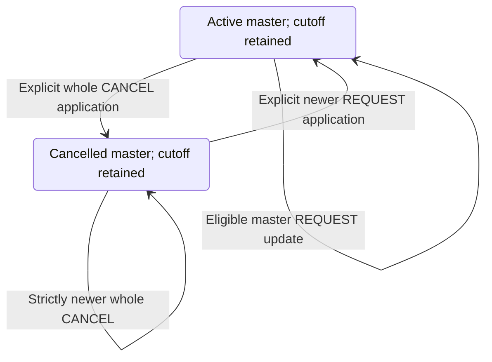

# Whole-master lifecycle preserving range cancellation

[Accepted ADR 0162](adr/0162-master-lifecycle-with-accepted-range-cancellation.md) permits explicit whole-series cancellation and a later explicit newer REQUEST reopening after accepted range cancellation. Existing `applyCancellation` and `applyUpdate` APIs keep the exact cutoff, retained single/future exceptions and independent original range source version. Receipt/review sends nothing and changes no calendar. Source-cutoff restoration and new occurrence applications remain separate.

Every transition requires current authority, a clean complete expected native state, validated source selection and expected revisions:

## Versions and retained values

A new whole CANCEL must have SEQUENCE strictly above the current accepted master, every retained canonical component and the historical range-cancellation source. Omitted existing SEQUENCE compares as zero without rewriting the omission. A later DTSTAMP cannot waive this floor. This conservative project rule may reject some senders; it is not a claim that every sender uses a global cross-component version. Maximum versions can prevent another new cancellation, while exact retained retries remain available.

Whole cancellation reuses the existing status/version-only projection: keep accepted master timing/recurrence/text/metadata, project the cancellation status and exact source version/timestamp omissions, and retain other payload properties for review. Do not copy its version onto the range cancellation or exceptions.

Explicit REQUEST reopening retains existing master ordering, including its established SEQUENCE/DTSTAMP tie-break. It composes accepted canonical targets and reapplies the cutoff. Cutoff and exception originals must still match the proposed profile and recurrence membership; orphaning/excluded/profile changes fail. Eligible pre-cutoff originals can become active again; the cancelled suffix and individual cancellations remain cancelled. Native local restoration remains a source conflict, not accepted source reopening.

## Private v6 integrity

V6 extends the existing frozen-original/current-composition separation to a verified current REQUEST or whole-meeting cancellation. Current kind/status must agree, and distinct v6 composition/receipt hash domains bind actual scope/recipient/link/parent/event/UID/organizer, current master/basis, original range evidence and expected current native state. Reconstruct historical range acceptance only from its original frozen basis. The ordinary event import baseline stays cutoff-free even when its master status is CANCELLED.

V4-to-v6 freezes the original cancellation basis/digest once. V5/v6 transitions retain that same original snapshot, source/version/floor/binding/time and range receipt; repeated updates keep v6 and add no per-transition snapshots. Legacy v1/v2/v3/v4/v5 reads remain strict. No lazy upgrades, marker-only acceptance, inferred history or corruption fallback is supported.

The frozen basis stays server-only until deletion and counts against existing 4 MiB/link, 16 MiB/recipient and 64 MiB/scope ceilings and configured lower limits. Slot/raw-source/work limits remain. Pruning inbox bodies preserves private retry evidence; event deletion scrubs it. No SQL, generated model, endpoint or view-field change is added.

## Authority, atomic effects and retries

Ordinary import/replacement/update/full-event/source rights, `composeAcceptedOccurrences`, `composeAcceptedRangeCancellation` and the applicable host operation remain required. Whole cancellation always requires lifecycle authority; reopening requires the existing status-change authority. Read eligibility checks these without mutation. Raw original range source reads use its actual source identity even while a different master notice is selected.

Preliminary/final contexts distinguish incoming message, current/proposed master status and retained cutoff, cutoff-free baseline and private checkpoint. Final denial or version/quota/membership failure rolls back all writes. Success atomically advances event/master/checkpoint revisions and audit time, dismisses only the selected notice and invalidates scope/feed/alarm generations and leases.

Whole cancellation withdraws all relevant reminder/live/retry/snooze eligibility. Reopening uses normal current/future planning and accepted-firing deduplication, retaining private alarm actions. It must not replay accepted reminders. No imported alarm activation or real mail follows.

The original latest range-cancellation retry and separate latest master retry reauthorize and return stable receipts without writes, even after newer notices or local edits. They never reapply a cutoff or dismiss a newer notice. Older commands retain their established latest-only supersession rules.

Existing protected flags distinguish a retained range cancellation from a blocked command. Flutter explicitly applies whole cancellation/reopening and explains that the cancelled suffix survives, preserving the same request across uncertain responses. Active-cutoff export/feed/new organizer REQUEST rejection and no-stale-304 behavior remain even while the master is cancelled; a temporarily redundant cutoff is never erased for publication. See [validation](scaffold-validation.md) and [development commands](development.md) for scoped synthetic evidence and readiness gates.

## Next proposal

[Proposed ADR 0163](adr/0163-pure-restore-only-range-source-projection.md) validates a restore-only source candidate at the exact cutoff, preserving retained values and individual cancellations. Its concrete pure mechanics await approval; durable acceptance and all current restoration guards remain separate.
