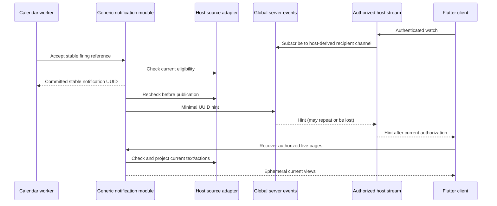

# Live notification delivery

Status: scoped implementation under ADR 0114 with completed local batch validation. See [recorded results](scaffold-validation.md). This is a reusable Serverpod delivery module plus a connected Flutter example. It is not a persistent content inbox or mobile background push service.

## Boundaries and trusted integration

`serverpod_notifications_server` has no calendar or Flutter dependency. Hosts install `NotificationModule` with a `NotificationHostPolicy`, a bounded registry of `NotificationSourceAdapter`s, and a `NotificationPublicationPort`. Only trusted server code calls `NotificationModule.accept`; no client endpoint accepts recipient identities, channels or source references. A synthetic non-calendar producer exercises the same module in database tests.

The host resolves current principal, scope, policy epoch and recipient. The source adapter verifies the actual source/recipient and supplies current presentation. Source addresses and opaque references grant no authority. Source callbacks distinguish `allow`, `deny` (withdrawn) and `unavailable` (retryable). Recovering a page with unavailable required source data fails the whole page; it never returns a deceptively complete partial result.

The public authenticated client API is `modules.serverpod_notifications.notification.recover(pageSize, cursor)`. It returns current authorized views plus an opaque continuation, without totals. The example additionally exposes `notificationStream.watch()`; that endpoint belongs to the host, not the generic module.

## Durable state and limits

The approved migration adds three server-only tables: a scope serialization marker, delivery/retry references, and private recovery cursors. Delivery rows hold bounded source pointers and immutable request fingerprints, never copied titles/bodies, device tokens or provider credentials. Protocol views contain ephemeral text and source action references; they are not durable inbox rows.

Defaults are 10,000 retained deliveries per recipient, 100 claims per sweep, 30-second leases/retries, 30-day terminal-reference retention and 15-minute cursors. A source reference is at most 4 KiB UTF-8; ordinary opaque identifiers are at most 256 bytes. Configuration validates bounds. Due/expiry values require whole-second UTC instants; generic operational/audit times retain database precision and do not import the calendar's year limits.

Acceptance handles already-due, unexpired work; future reminder scheduling remains the producer’s responsibility. It serializes by trusted scope and uses unique `(scope, source namespace, request ID)` identity. A matching retry returns the same UUID only after fresh source validation; changed recipient/reference/version/timing rejects. Capacity rejects atomically. Idempotency lasts while the reference is retained; an expired retry cannot recreate it through the trusted acceptance API.

Workers use database time, short `FOR UPDATE SKIP LOCKED` claims, expiring owners and increasing fences. Source withdrawal suppresses work; source/transport unavailability remains retryable. A crash after publication can repeat the same hint ID. Publication acceptance is not human display, reading or acknowledgement. Terminal pruning never removes still-unexpired published references; expired cursors are pruned in bounded maintenance sweeps. Scope markers retain only opaque synchronization identities, not a host identity directory, and currently remain until a future explicit host scope-retirement contract.

## Authorization, consistency and live recovery

Policies and source adapters explicitly declare `freshCheck` or `coordinated`. Requiring coordination rejects weaker registrations and live downgrades. A coordinated implementation must hold its relevant source/authority locks through the supplied notification transaction. Using the same database does not establish this guarantee. Callbacks have bounded timeouts; fresh source and host checks run before disclosure/publication, with database time checked again after slow work. External source changes can still race a final check; this is documented rather than presented as revocation atomicity.

The example calendar adapter uses a separate calendar transaction and therefore declares **freshCheck**. Lock order is notification scope then calendar source scope. Calendar workers release their source transaction before calling the delivery port. Host adapters must not introduce the reverse lock order. Presentation requires separate background `project` authority as well as dispatch authority and derives the current effective occurrence summary. The adapter preserves the difference between temporary dirty/missing planning state and a withdrawn source. Acknowledgement, completion, cancellation, expiry or deletion prevents obsolete views; temporary source unavailability clears the client projection until a successful fresh recovery.

Live pages use deterministic UUID keyset order, not chronological order or frozen snapshots. Cursors bind scope, principal, policy epoch, recipient, page size and expiry. They contain no raw client-selected recipient or total. Reconcile from the beginning on reconnect and periodically while connected. Later inserts may precede a cursor, which is why this periodic complete reconciliation is required. Already displayed information cannot be recalled.

## Connected example and actions

The example posts only UUID hints through `MessageScope.global`, explicitly requiring shared Redis. Missing Redis cannot silently switch to process-local routing. The host derives a hashed recipient channel and authorizes the subscription; knowledge of a channel or UUID grants no read access. The stream subscribes before its initial ready hint, rechecks current authentication/recipient on hints and five-second heartbeats, and closes after one minute so clients reconnect. Authentication uses the configured supported handler, not an indefinitely cached handshake identity.

Flutter recovers after hints, every 15 seconds and after reconnect. Pause clears projections and cancels the stream without disarming alarms; resume recovers live references. Logout/disposal cancels subscriptions and clears text. An issued access JWT can remain valid until its Serverpod expiry after logout; this implementation does not invent immediate access-token blacklisting.

Calendar acknowledgement/dismissal/snooze use the existing separately authorized revision-checked calendar commands. Generic notifications do not own those actions or copy their history. Snooze is offered only for eligible automatic origins; the seven-day server/database-time rule remains authoritative. Imported alarms remain unarmed; this batch introduces no adoption, private-alarm export, FCM/APNs, OS notifications, real email or provider credentials.

## Validation and remaining scope

Focused tests cover generic non-calendar acceptance, conflicts/capacity, source/host denial, unavailable pages, current text, cursor bindings, retries, expiry, pruning and fences. Calendar regressions exercise independent projection authority and dirty-plan/withdrawal distinctions. The process probe uses two independent Serverpod processes, competing acceptance/leases, actual owner termination, takeover and stale-owner rejection. The real host harness and Flutter journey separately exercise generated clients, Redis hints, reconnect/current text and native actions; consult the validation record for outcomes actually completed.

HTTP feeds, iTIP/iMIP, imported-alarm adoption, advanced actions, provider integrations and CI release evidence remain separate requirements. This scoped implementation does not complete the first-release roadmap.

## Timing-only source alarm adoption, 2026-10-25

[ADR 0115](adr/0115-timing-only-source-alarm-adoption.md) implements [explicit master-timing copying](imported-alarm-adoption.md) into new unarmed personal definitions, using current authorized item text. It reuses existing storage without a migration and enforces source-read/adopt/create rights, actual parent revisions and trusted recipients. This supersedes earlier adoption-pending wording only for this bounded flow. Source text/UID/acknowledgement/snooze state stays inert; broader profiles, private exports and release gates remain separate. Full local batch validation passed; see the validation record for exact evidence.
